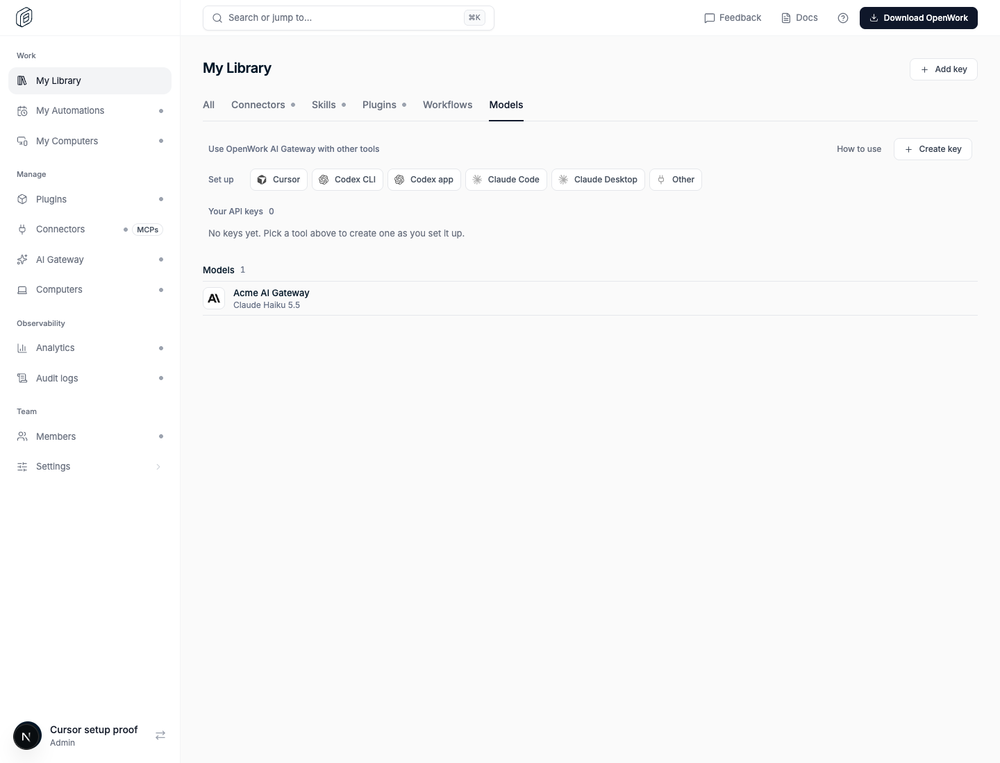
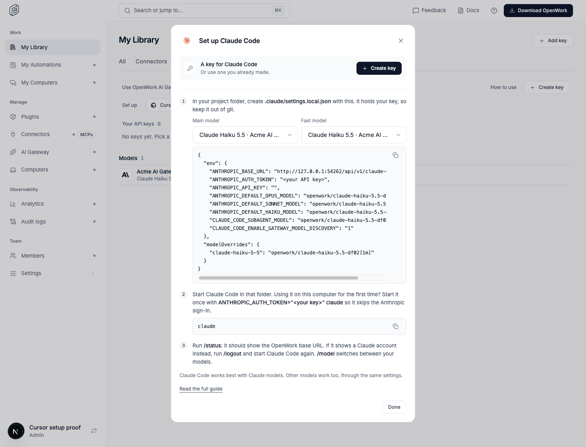
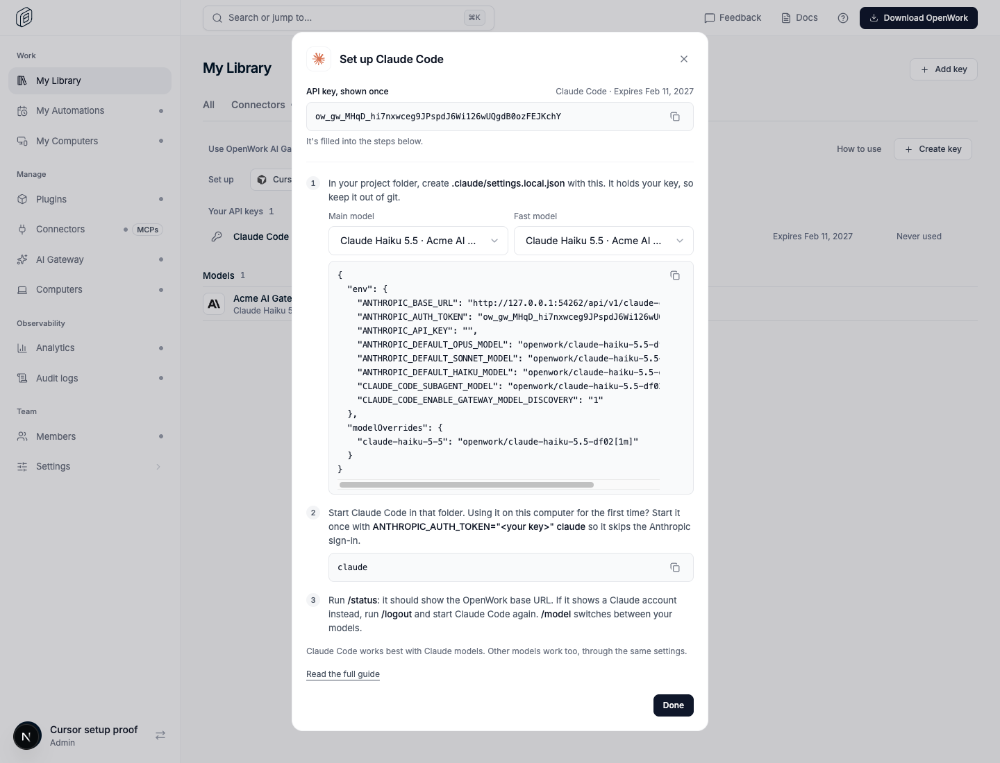

# AI Gateway: set up other tools from My Library

Feature key: `gatewayToolSetupButtons` · Deployments: cloud and self-hosted · Default: off · Author: @OmarMcAdam

## What changes

In **My Library › Models**, the section that was called "API keys for 3rd party tools" becomes
**Use OpenWork AI Gateway with other tools**, with a new **Set up** row: one small logo button per
supported tool (Cursor, Codex CLI, Codex app, Claude Code, Claude Desktop, Other). The separate
"Set up Cursor" link is replaced by the Cursor button.

Each button opens a dialog with that tool's steps (the same steps used after creating a key). At the
top, **Create key** makes a key named after the tool, shows it once, and fills it into every snippet
in the steps, so a person can copy each one as is.

When the organization has turned 3rd party tools off, the dialog still opens and shows a lock with
who can turn it back on, instead of the Create key button (DESIGN.md P4).

## Try it

Turn the feature on for an organization in `/admin`, allow 3rd party tools in AI Gateway › API Keys,
then open My Library › Models. Proof: `evals/proofs/gateway-tool-setup-buttons.proof.test.ts`.

## Turning it off

Restores the previous section title, key count and Set up Cursor link. Keys created from the dialog
are ordinary member keys and keep working; nothing is migrated.
