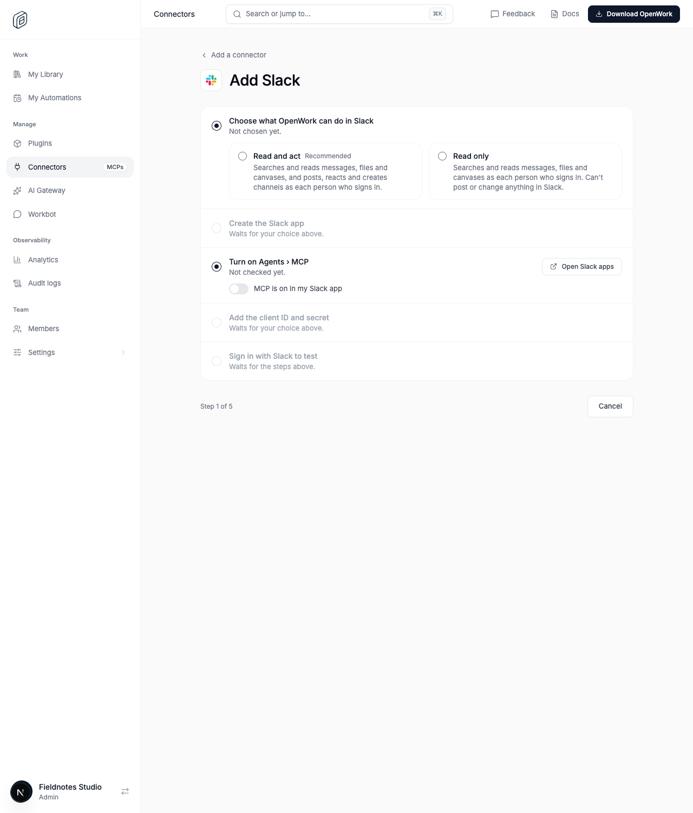
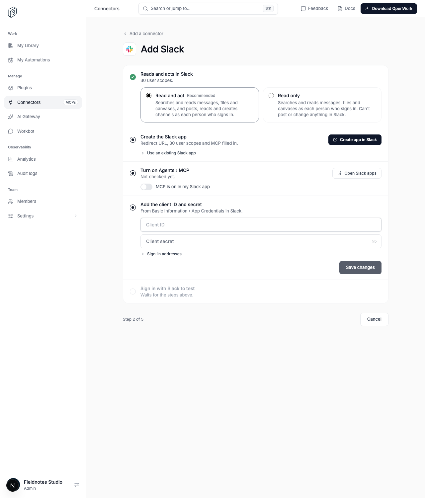
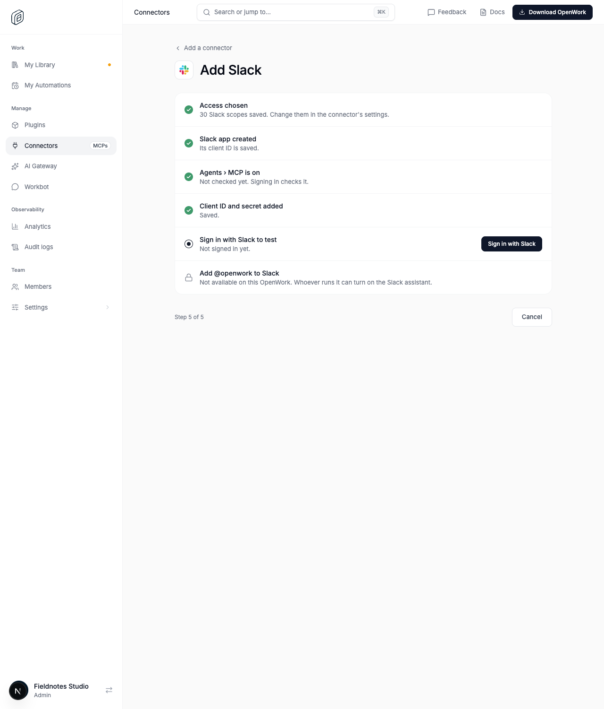
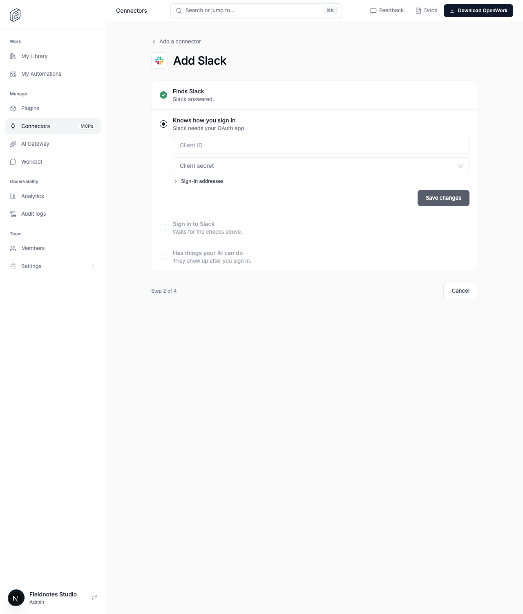

# Guided Slack setup

Feature key: `guidedSlackSetup` · Deployments: cloud and self-hosted · Default: off · Author: @benjaminshafii

## What people get

Admins adding the Slack preset (Manage › Connectors › Add a connector › Slack)
get one checklist instead of the shared connector checks:

1. **Choose what OpenWork can do in Slack.** A required choice, nothing
   preselected: **Read and act** (Recommended: the preset's default scopes
   plus its `optionalOAuthScopes`, all 30 user scopes Slack's MCP server
   offers) or **Read only** (the same list without any `:write` scope, 21).
   Each option states in one line what OpenWork does, with what, as whom. The
   app link, credential fields and sign-in stay locked until a choice is made,
   and the choice is saved as the new connection's requested scopes.
2. **Create the Slack app.** "Create app in Slack" opens Slack's
   create-from-manifest page (`https://api.slack.com/apps?new_app=1&manifest_json=…`)
   prefilled with this Den's OAuth redirect URL, exactly the chosen scopes and
   `settings.is_mcp_enabled: true`.
   "Use an existing Slack app" (collapsed) has the redirect URL, scopes and
   manifest to copy. Locked, with who can fix it, when the deployment has no
   public API address.
3. **Turn on Agents › MCP.** Says "Not checked yet" until the admin's test
   sign-in records a readiness check, then shows the result. Slack refusing
   MCP (`tools_unreadable`, see #6661) fails this step with Open Slack apps and
   Check again. The admin confirms the switch before sign-in unlocks.
4. **Add the client ID and secret.** The existing fields.
5. **Sign in with Slack to test.** Shows checking, ready, or the failure with
   its next action.
6. **Add @openwork to Slack (optional).** Only for an eligible connection;
   locked when this OpenWork has no Slack assistant runner. On the final screen,
   "Set up @openwork in Slack next" opens the connector page at its OpenWork in
   Slack section.

With the flag on, the new Slack connection requests exactly the chosen scopes,
so the request always matches the manifest. A connection created before any
choice (for example **Add anyway** after a failed check) requests only the
preset's default 11, never the optional ones. Off, setup requests what the
server advertises, exactly as before.

Flag on, fresh setup (nothing chosen, the app link locked):

After choosing Read and act:

After the client ID is saved and MCP is confirmed:

Flag off (as shipped), the shared checks:

## How to try it

Turn it on for an organization in `/admin`, then open
`/dashboard/mcp-connections/new/slack` as an organization admin. The proof
`evals/proofs/den-slack-guided-setup.proof.test.ts` walks through it without
contacting Slack.

## Turning it off

The Slack preset goes back to the shared setup checks on the next page load.
Nothing is stored by the checklist itself (the MCP confirmation is page
state); connections it created stay as they are, with their requested scopes.

## What to watch

- `external_mcp_readiness_check_failed` logs with `category` and
  `http_status` for Slack connections created after turning it on.
- `/admin` › organization › Features usage: counted when an admin clicks
  Create app in Slack or Sign in with Slack from the checklist.

## Not behind the flag

- `GET /v1/mcp-connections/presets` returns `oauthCallbackUrl` for presets that
  need a pre-registered OAuth app (additive API field).
- The Slack preset gains `optionalOAuthScopes` (the 19 other scopes Slack's MCP
  server offers), returned by the presets endpoint. Its `defaultOAuthScopes`
  are unchanged, so API- and agent-created connections request the same 11 as
  before, and optional scopes are never a server default. Stored connections
  are not changed.
