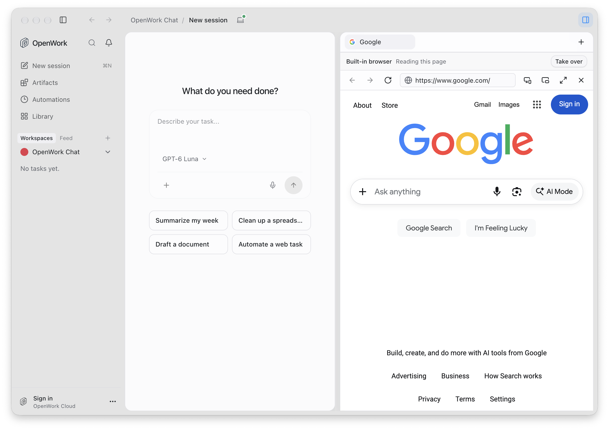
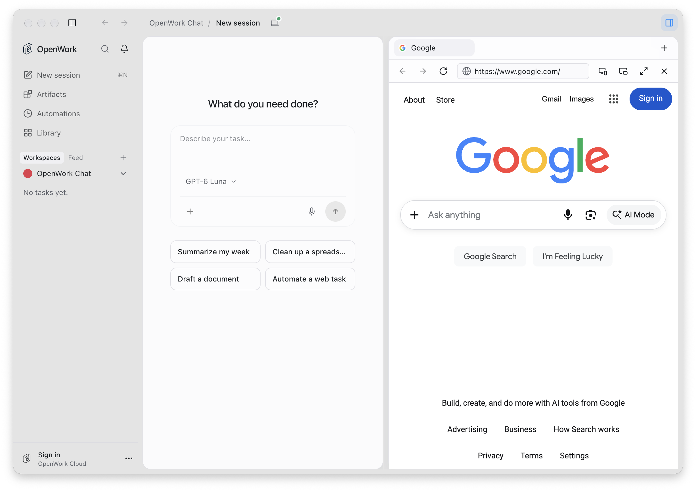

# No status bar above the built-in browser (`hideBrowserTaskBar`)

- **Feature key:** `hideBrowserTaskBar`
- **Deployments:** cloud and self-hosted (`everywhere`), off by default
- **Author:** @benjaminshafii
- **Surfaces:** Desktop app, built-in browser in the side panel

## What people get

With the feature off, a bar appears above the address bar whenever the agent
is using the tab. It reads "Built-in browser", shows what the agent is doing,
and has a **Take over** button that pauses the agent (then **Resume browser**).

With the feature on, that bar never appears. The tab strip leads straight into
the address bar and the page gets the height back.

| Off | On |
| --- | --- |
|  |  |

## What is lost

- The **Take over** and **Resume browser** buttons. A person can still use the
  page directly, and when the agent pauses the browser for a sign-in, the
  person's next message hands it back, as before.
- The line saying what the agent is doing on the page.

## How it works

`side-panel.tsx` reads the feature in `BrowserPanelContent` and skips the bar.
Nothing else changes: pausing, resuming and the browser's status elsewhere in
the app work as before.

## Turning it off

Turn the feature off for the organization, or use its kill switch. The bar
returns with no deploy.
