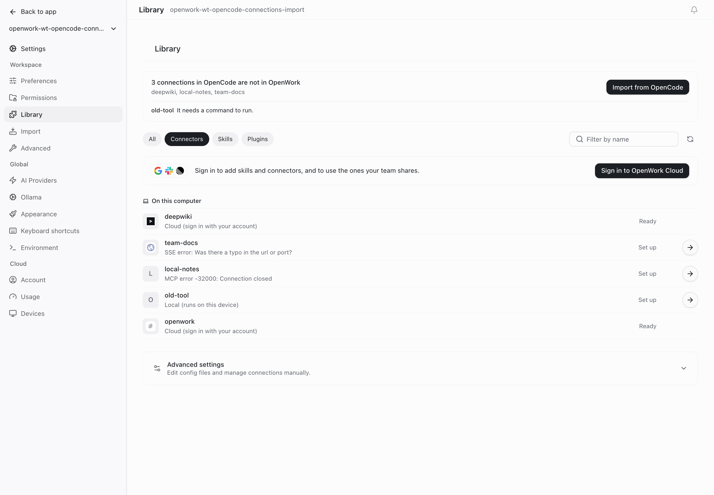

# Import connections from OpenCode (`importOpencodeConnections`)

- **Feature key:** `importOpencodeConnections`
- **Deployments:** cloud and self-hosted (`everywhere`), off by default
- **Author:** @benjaminshafii

## What people get

People who used OpenCode before OpenWork often already have connections (MCP
servers) set up in their own OpenCode config. Settings → Library now says how
many of those are not in OpenWork yet and offers **Import from OpenCode**.

After importing, the same place shows what was imported with each
connection's real state from the engine that serves chats (Ready, Issue, …),
and stays until **Done** is pressed. Entries that cannot be imported are
listed with the reason: written incorrectly in the file, or blocked by the
organization (lock icon, plain text). Nothing shows when there is nothing to
import or to report.

## How it works

- OpenWork reads the global OpenCode config folder (`config.json`,
  `opencode.json`, `opencode.jsonc`, comments allowed) only when Settings asks.
  A missing or broken file is reported as nothing to import; it never stops
  chats. The current engine (OpenCode v2) does not load connections from
  that file on its own, which is why they need importing.
- A map nested under `mcp.servers` is read the same way as `mcp`.
- Importing copies the chosen entries into OpenWork's own store through the
  same steps as adding a connection by hand: name and config validation,
  organization policy, one approval for the batch, engine reconciliation and
  an audit entry.
- A name that already exists in OpenWork is left alone and never overwritten.
  Importing can be run again at any time.
- The person's OpenCode files are never written. Commands, arguments,
  headers and environment values are never returned to the app or logged; the
  app only sees a name, whether it is local or remote, and the command name or
  host.

Routes: `GET` and `POST /workspace/:id/opencode-import/connections`.

## Off

The state line and action are hidden. Connections imported earlier stay, and
can be removed like any other connection. The routes stay available; they
need the same workspace access as adding a connection.

## Try it

Add a server under `mcp` in `~/.config/opencode/opencode.jsonc`, turn the
feature on, and open Settings → Library → Connectors.

`apps/server/test/opencode-connections-import.test.ts` and
`apps/app/tests/opencode-connections-import.test.tsx` cover reading, importing,
policy, already-present entries and the states shown.
