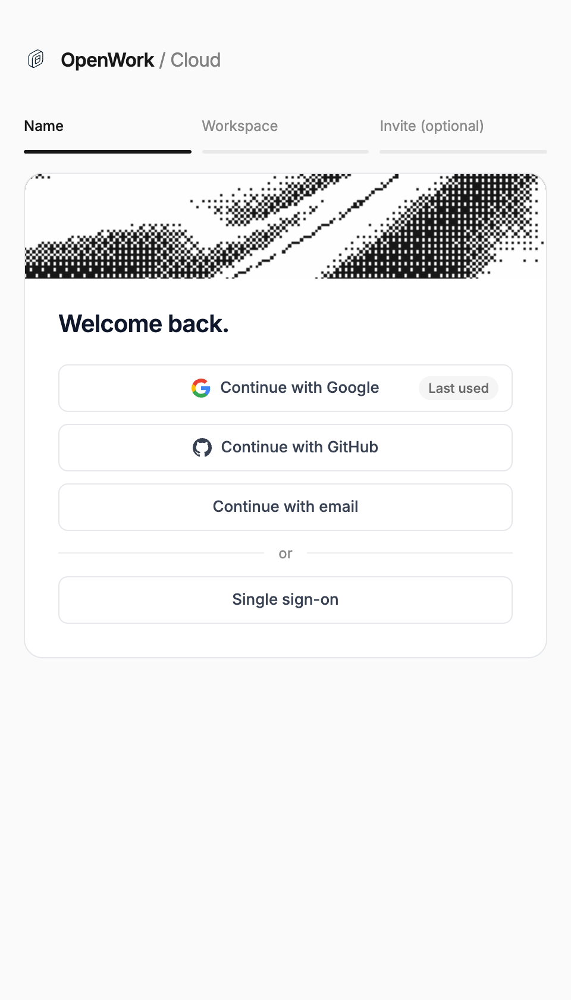
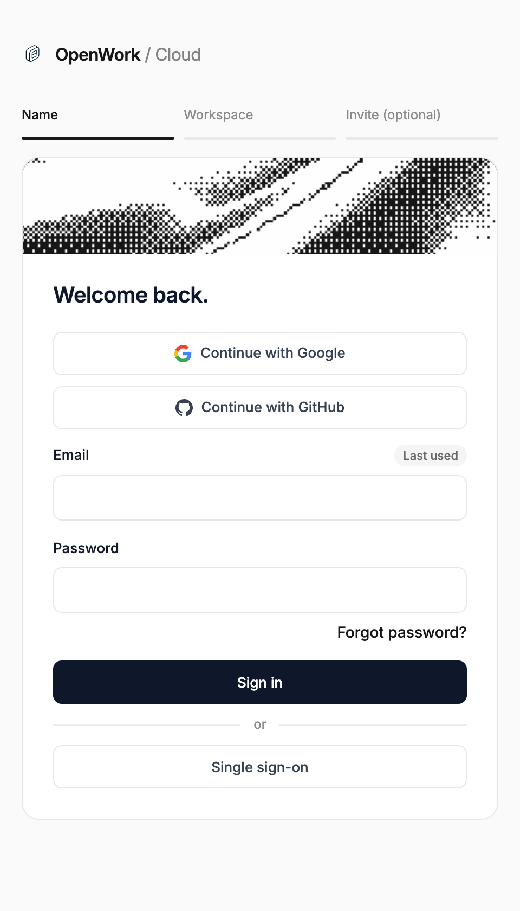

# Remember last sign-in method

Feature key: `lastUsedSignIn` · Deployments: cloud and self-hosted · Default: off · Author: @benjaminshafii

## What people get

Den web's sign-in normally starts with an email step, then shows the one method
that email uses (SSO, Google, GitHub, password, or a new account).

With this feature on, someone who last signed in on this browser with a
**password, Google or GitHub** skips the email step. They see every method at
once, with a **Last used** badge on the one they used:

- Continue with Google
- Continue with GitHub
- Continue with email (opens email and password in place; open by default when
  password was last used)
- **Single sign-on**, the last option, which goes back to the email step so the
  organization's SSO can be found from the email address

People who have never signed in on the browser, or whose last sign-in was SSO,
see the email step as before.

## How it works

- After a sign-in that creates a session, Den API's Better Auth after-hook
  (`ee/apps/den-api/src/auth.ts`, `updateLastSignInCookie`) writes the
  `openwork-last-sign-in` cookie with `password`, `google` or `github`. It
  lasts 400 days (the browser maximum), is `SameSite=Lax`, `Secure` on HTTPS,
  and on the shared cookie domain when one is configured.
  - Password: `/sign-in/email`, `/sign-up/email`
  - Social: `/callback/:id` (only after the enterprise SSO check passed) and
    `/sign-in/social` with an ID token
- A real SSO sign-in (`/sso/callback/:providerId`,
  `/sso/saml2/sp/acs/:providerId`) **clears** the cookie. Admin SSO connection
  tests do not touch it.
- The cookie only names a method: no email, no token. It is not HttpOnly so
  the browser can read it; it never authorizes anything.
- Den web (`auth-panel.tsx`) reads the cookie and `GET /v1/features` (signed
  out, deployment-wide state). It only skips the email step when both say so.
  Invitations, prefilled or locked emails and single-org SSO deployments keep
  their own flow.
- Choosing a method still goes through the normal checks: a password sign-in
  for an SSO-managed email is redirected to SSO, and so is a Google or GitHub
  sign-in.

Logic and tests: `ee/apps/den-api/src/last-sign-in-method.ts`
(`test/last-sign-in-method.test.ts`) and
`ee/apps/den-web/app/(den)/_lib/last-sign-in.ts` (`last-sign-in.test.ts`).

## Turning it on or off

Turn it on in `/admin` › Features (everyone) or with an operator lock. Signed-out
people have no organization, so it follows the deployment-wide state only.

Turning it off (or the kill switch) stops new cookies being written and Den web
ignores existing ones within a minute (`/v1/features` is cached for 60s), so
everyone sees the email step again. Cookies already in browsers are harmless and
are cleared at the next SSO sign-in or when they expire.

## What to watch

- Den API warning `could not read lastUsedSignIn; not remembering the sign-in
  method` (component `last_sign_in_method`): the feature lookup failed, the
  sign-in still succeeded.
- PostHog `den_auth_submitted` by `method`: returning people should reach a
  method without a `/v1/auth/login-options` lookup.
