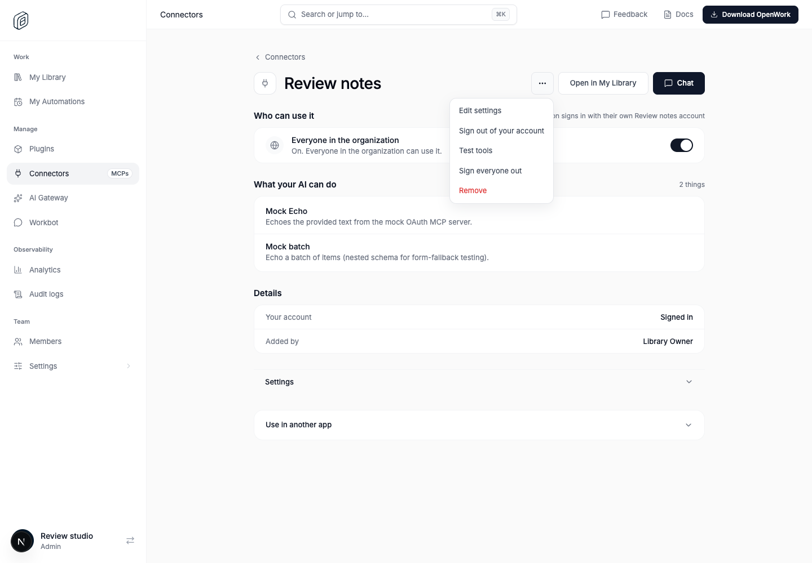
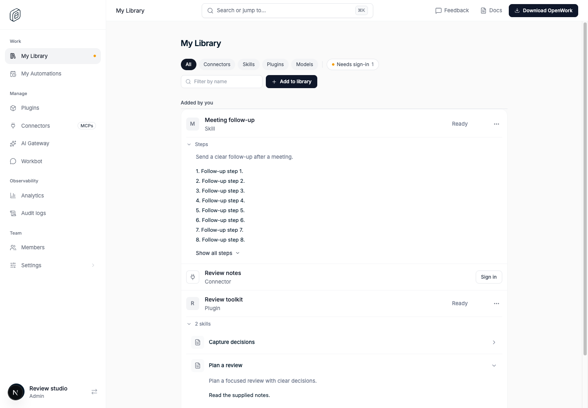

# Library connector navigation and skill previews

> **GA:** Available without a feature flag. The former rollout key is retired.
> Off/on screenshots below are historical comparisons, not current deployment options.

- Retired rollout key: `libraryConnectorNavigation`
- Deployments: Cloud and self-hosted
- Author: `benjaminshafii`
- Status: generally available (no flag)

## What changes

Manage Connectors and My Library link to each other for the same connector:

- **Manage → My Library** appears only when the viewer can use the connector
  (it is in their usable list). Managing a connector is not a grant to use it.
- **My Library → Manage** appears only for people who can open Manage ›
  Connectors (`connections.view`). Members manage what they added from My
  Library itself (Share, Remove) and never see a link to a page they cannot open.

On the management page, **Sign out of your account** (or **Remove your key**)
uses the existing caller-scoped disconnect, separate from **Sign everyone out**.
Once signed out, the page no longer lists the tools the person could use before;
it says they show up after signing in.

The My Library list stays compact: no inline skill previews, nested skill lists,
or disclosure controls beneath a row. Open a plugin or skill to read its detail
page. Skill instructions expand inline on that detail page, and instructions
longer than eight lines offer **Show all steps**. Content uses the existing
authorized plugin query; skill source is shown as text.

## Try it

As an admin: open an assigned connector in Manage, choose **Open in My
Library**, then **Manage** from its menu to go back. Sign in to a per-person
connector, then use **Sign out of your account**; teammates stay signed in.
An unassigned connector offers no Library link.

As a member: open a connector you added in My Library. Share and Remove are
there; **Manage** is not.

In My Library, verify that plugin and skill rows have no inline previews. Open a
row, then expand a skill's instructions on its detail page and use **Show all
steps** for a long body. Check keyboard disclosure, narrow windows, and detail
loading failures and recovery.

## Availability

Generally available. The rollout flag is retired; organization/member overrides,
operator locks and old kill-switch rows no longer disable this behavior.
Authorization, provider setup, consent and runtime compatibility still apply.

## Evidence

Assigned connector, with personal sign-out separate from organization sign-out:

Published skill steps expanded in the Library plugin detail:

Historical list-style skill disclosures, no longer part of the compact Library
list (open the detail page instead):

`evals/proofs/library-connector-navigation.proof.test.ts` exercises the real Den
pages with assigned and unassigned connectors and published skill steps.
