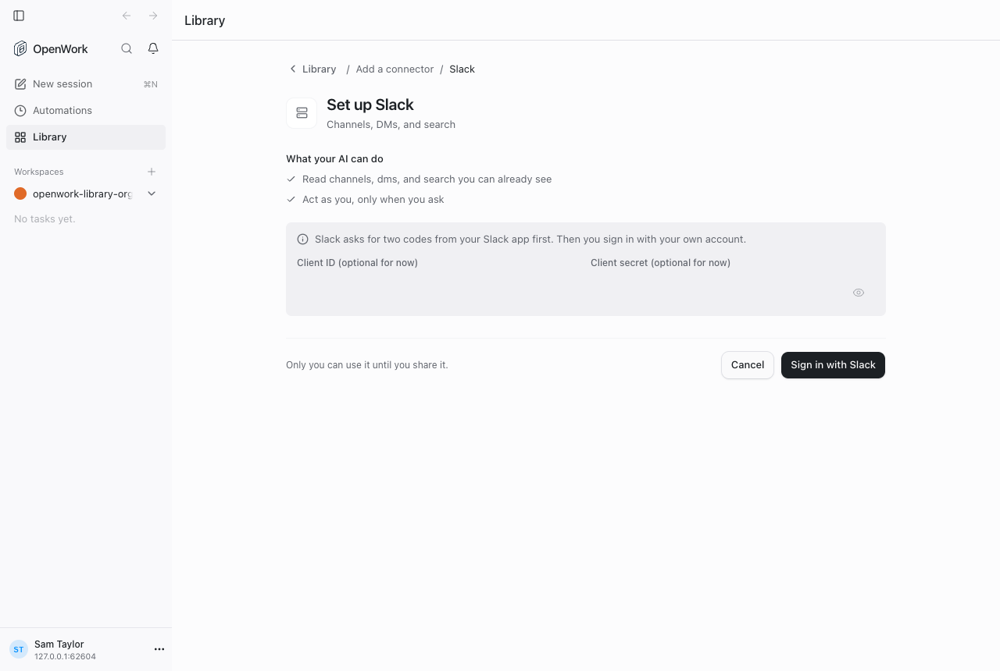
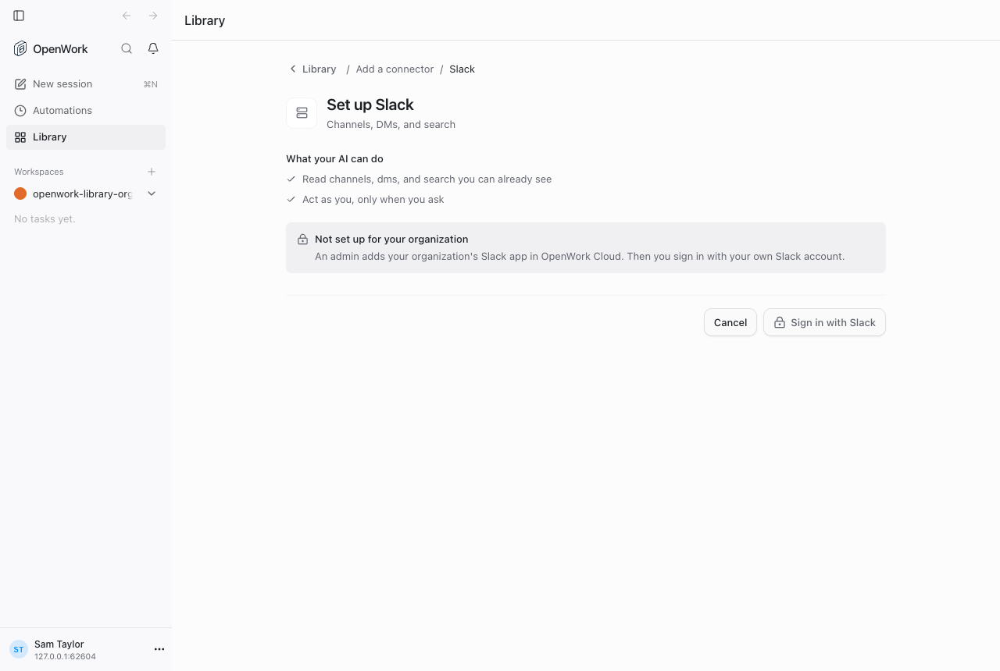
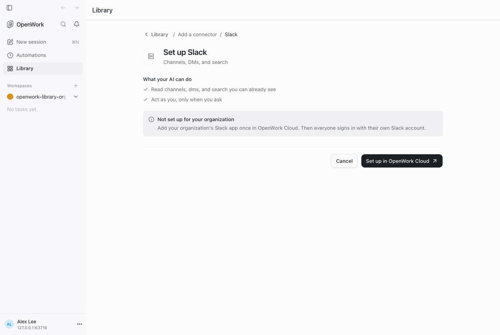
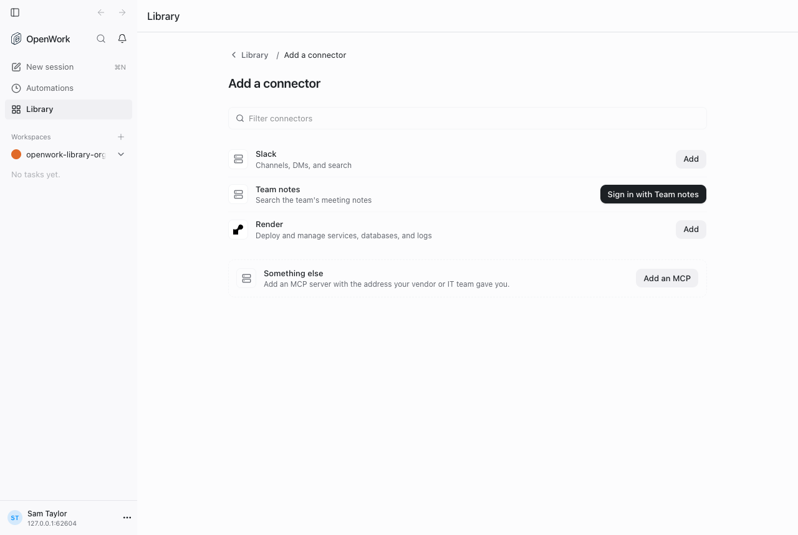

# Desktop: connectors that need an organization app

> **GA:** Available without a feature flag. The former rollout key is retired.
> Off/on screenshots below are historical comparisons, not current deployment options.

- **Retired rollout key:** `libraryConnectorOrgSetup`
- **Deployments:** cloud and self-hosted, generally available (no flag)
- **Author:** @benjaminshafii
- **Surface:** desktop app, Library › Add a connector, and Library connection rows

## What changes

Some connectors (Slack, GitHub) only accept an OAuth app that the organization
registers with the provider (`requiresOAuthClient` on the Den preset, with no
`defaultOAuthClientId`). Organization setup is the default:

- **Members** see the connector locked: "Not set up for your organization",
  who can set it up (an admin, in OpenWork Cloud) and a disabled sign-in.
  No fields to fill in.
- **Owners and admins** get **Set up in OpenWork Cloud**, which opens Den's
  admin connector setup for that preset (`/dashboard/mcp-connections/new/<presetId>`).
- Presets with OpenWork's own app (`defaultOAuthClientId`, e.g. Render) are a
  plain **Sign in with X** for everyone.
- A connector the organization **already has**, which the member has not signed
  in to yet, shows **Sign in with X** in Add a connector instead of an inert
  "Added". It uses the same per-person connect as the Library row.
- When a member's sign-in comes back but does not connect, the desktop stops
  waiting as soon as Den records the result for that member (instead of after
  90 seconds) and shows Den's reason. When the cause is a setting in the
  service's own app (`provider_setup_required`, e.g. a Slack app with MCP
  turned off), the row and the catalog say so, ahead of any "Sign in", with an
  **Open Slack app settings** link when Den sent one. Only https links on
  `api.slack.com` are opened.

| Off: member is asked for codes | On: member sees it locked |
| --- | --- |
|  |  |

| On: admin goes to OpenWork Cloud | On: one-click sign-in to an added connector |
| --- | --- |
|  |  |

## How to try it

1. Sign in to the organization.
2. In the desktop app, open Library › Add to library › Connector.
3. Pick Slack as a member, then as an admin; pick a connector the organization
   already added as a member who has not signed in.

Proof: `evals/proofs/library-org-app-connectors.proof.test.ts`.

## Availability

Generally available. The rollout flag is retired; organization/member overrides,
operator locks and old kill-switch rows no longer disable this behavior.
Authorization, provider setup, consent and runtime compatibility still apply.

## What to watch

- Den logs for failed sign-ins (`provider_setup_required` readiness rows) if
  members report a stuck connector.
