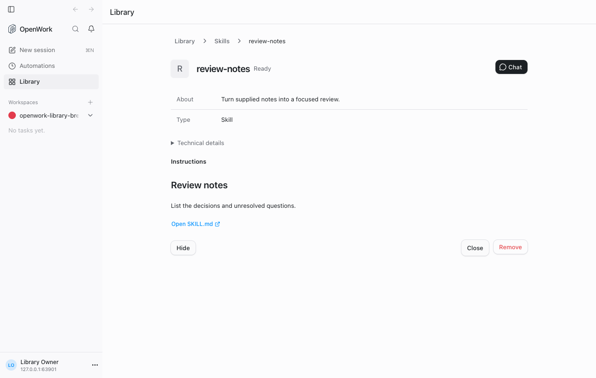
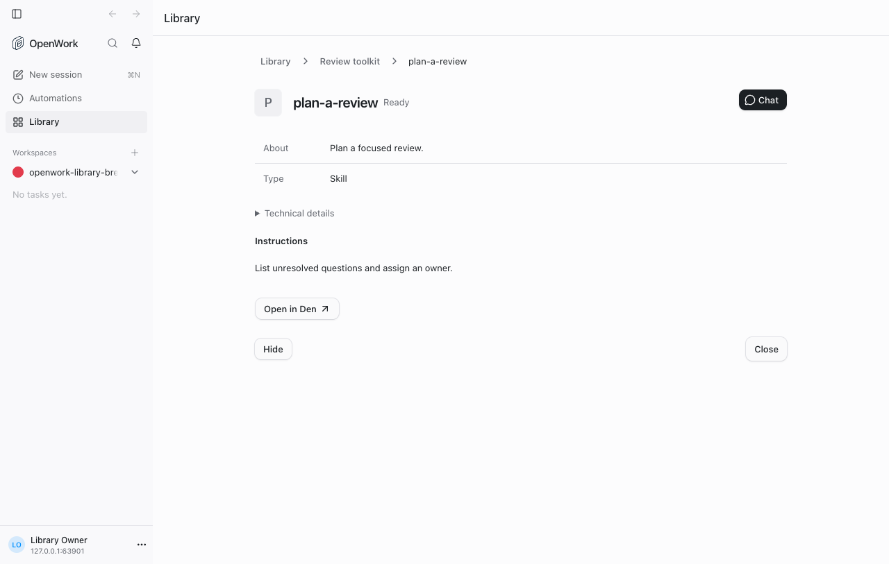

# Library detail breadcrumbs

> **GA:** Available without a feature flag. The former rollout key is retired.
> Off/on screenshots below are historical comparisons, not current deployment options.

- Retired rollout key: `libraryDetailBreadcrumbs`
- Deployments: Cloud and self-hosted
- Author: `benjaminshafii`
- Status: generally available (no flag)

## What changes

Desktop Library detail pages show a breadcrumb trail instead of the single
Library back button. The current item is text, not an action; each ancestor
is a separate keyboard-accessible button.

- A standalone skill shows **Library / Skills / Skill name**.
- A skill opened inside a plugin shows **Library / Plugin name / Skill name**.
  Opening a plugin capability through its preferred standalone skill route no
  longer discards the plugin parent. Direct links and reloads also show a
  plugin ancestor when there is exactly one matching containing plugin.
- A category breadcrumb returns to that category. Library returns to All.
  The existing Close action returns to the selected Library category.
- The same detail frame is used for connectors, plugins, commands, and agents.
  Dialog presentations keep their existing controls.

This changes navigation only. It does not change skill instructions, grants,
sharing, sign-ins, or installation.

## Try it

Open Library, select
Skills, and open a skill. Choose Skills in the trail: Skills should still be
selected, and the search should remain intact. Choose Library to return to All.

Open a plugin containing skills, then open a skill inside it. Choose the plugin
in the trail: that plugin's contents should appear, not the Library list.
Check keyboard focus and a narrow window with a long skill name.

## Availability

Generally available. The rollout flag is retired; organization/member overrides,
operator locks and old kill-switch rows no longer disable this behavior.
Authorization, provider setup, consent and runtime compatibility still apply.

## Evidence

The real app in headless Chrome, with a local skill open:

A skill opened from a plugin keeps its parent:

## Verification

- `apps/app/tests/library-breadcrumbs.test.tsx` checks ancestor actions, the
  non-clickable current page, and truncation hooks.
- `evals/proofs/library-detail-breadcrumbs.proof.test.ts` drives the real app in
  headless Chrome with default behavior, then follows category and
  plugin ancestors. No desktop window is needed for this React surface.
- DESIGN rules: P5 (shared Button primitive), P10 (real screenshots), P11
  (navigation keeps context), V1/V2 (existing typography and semantic colors).
