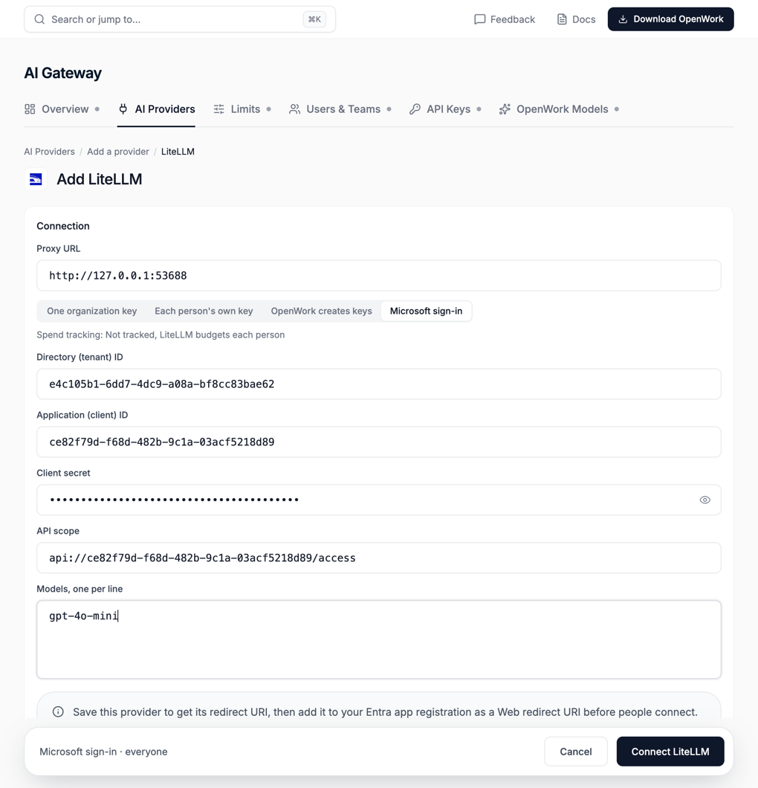
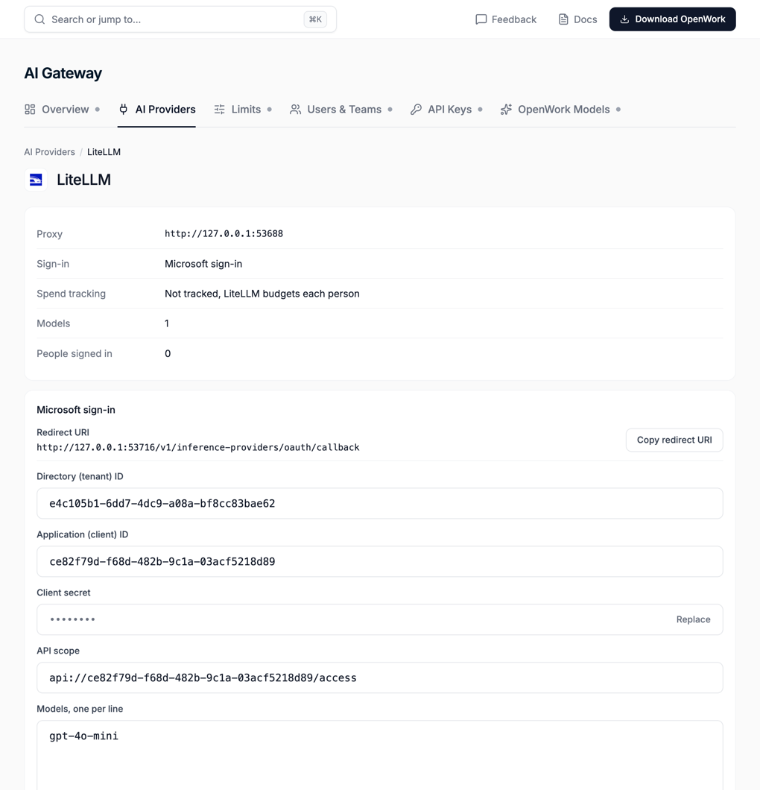
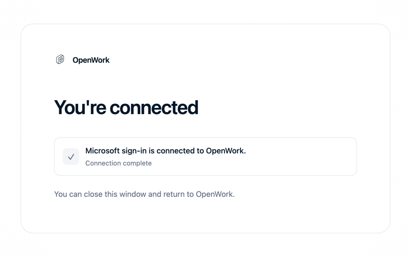
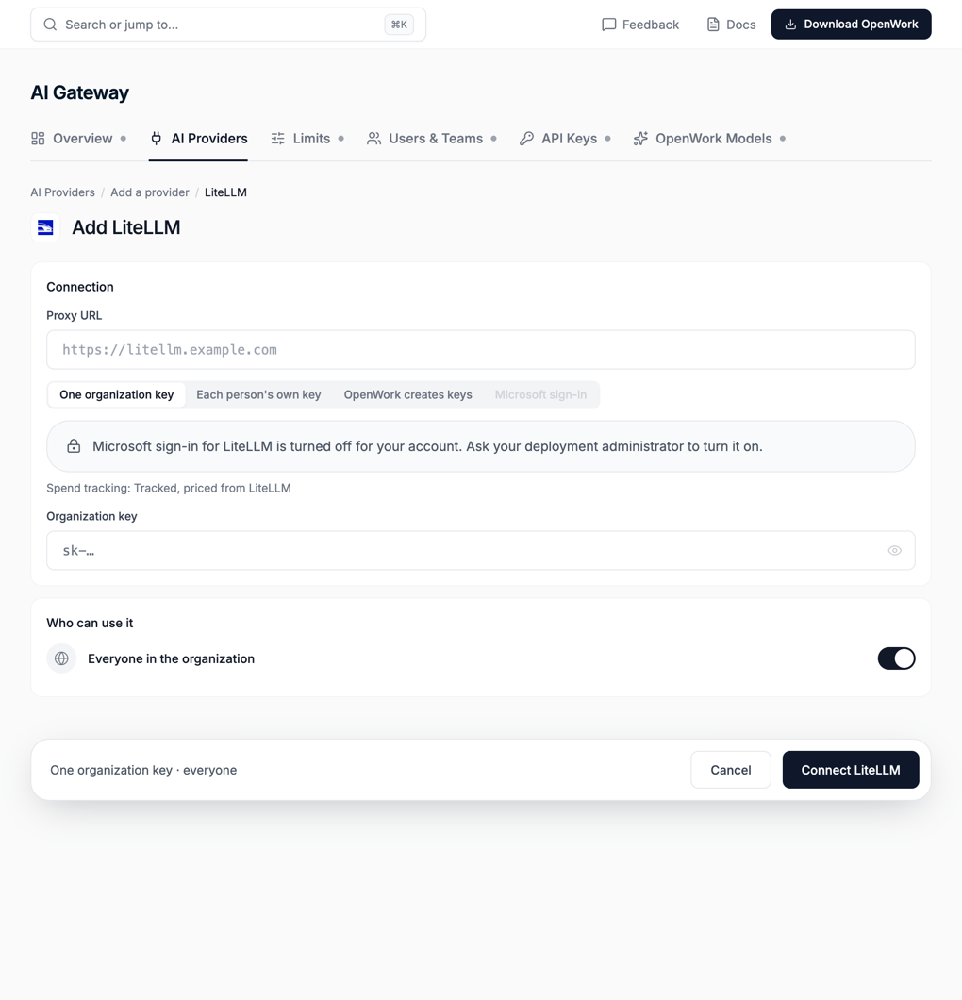

# LiteLLM: member Microsoft Entra sign-in

Feature key: `litellmEntraMemberSignIn` (cloud and self-hosted, off by default).
Author: `benjaminshafii`.

## What changes

Some organizations run LiteLLM with JWT auth only (`enable_jwt_auth`,
`litellm_jwtauth`) and turn LiteLLM virtual keys (`sk-…`) off. The three
existing LiteLLM modes all need a LiteLLM key, so those proxies could not be
added to AI Gateway.

With the feature on, **AI Gateway › AI Providers › Add a provider › LiteLLM**
offers a fourth choice, **Microsoft sign-in**:

- The admin enters the proxy URL, a dedicated Entra app registration
  (directory (tenant) ID, application (client) ID, client secret), one API
  scope such as `api://<app-id>/access`, and the list of model names people
  may use. OpenWork never holds a LiteLLM key for this provider and never
  reads the proxy's models, teams or keys.
- Each allowed person selects **Connect** in the OpenWork app and signs in
  with Microsoft once (authorization code + PKCE, the same flow as Microsoft
  Foundry member sign-in). Den stores their tokens encrypted.
- AI Gateway renews the access token with the stored refresh token and sends
  the person's own Entra **access token** as `Authorization: Bearer …` to
  LiteLLM, which validates it (JWKS, issuer, audience).

Nothing changes for Microsoft Foundry sign-in or for the three key-based
LiteLLM modes, with the feature on or off.

## What it looks like

Screenshots from a local Den with the feature on, taken while running the
proof described under [Verified](#verified). The tenant, application and
addresses are throwaway values.

**Add a provider › LiteLLM › Microsoft sign-in.** The admin enters the app
registration, one API scope and the model names. No LiteLLM key is asked for.

**The provider page.** It shows the redirect URI to add to the app
registration, how many people signed in, and the settings an admin can change.

**Connect, in the member's browser.** The person continues to Microsoft and
comes back to a confirmation.

**With the feature off.** Microsoft sign-in stays visible but locked.

## How it is built

- **No database migration.** The app registration lives in the provider's one
  member credential set (the `oauth_tenant_id`, `oauth_client_id` and encrypted
  `oauth_client_secret` columns Microsoft Foundry sets use). The mode
  (`keySource: "entra"`), the API scope (`entraScope`) and the model list
  (`catalog`) live in `gateway_providers.settings.litellm`.
- **One sign-in flow.** `oauth/start`, `browser-status`, `browser-start` and
  `oauth/callback` are the routes Microsoft Foundry sign-in uses. The API
  scope is a parameter: none means Azure Cognitive Services (Foundry), a
  LiteLLM provider passes its own. It is part of the attempt binding, is
  stored with the token (`microsoftIdentity.scope`), and is checked before a
  token is renewed or forwarded.
- **API.** `POST /v1/inference-providers/litellm` with `mode: "entra"`,
  `oauthTenantId`, `oauthClientId`, `oauthClientSecret`, `oauthScope` and
  `modelIds`. `PATCH /v1/inference-providers/{id}/litellm` changes those.
  Changing the tenant, application, scope or client secret revokes every
  member's token. `POST …/litellm/sync` answers `409 litellm_sync_unavailable`.
- **Refused scopes.** Microsoft Graph (including bare names such as
  `User.Read`) and Azure Cognitive Services, because LiteLLM cannot validate
  those tokens.
- **Only tokens for the provider's own app.** A member's access token is sent
  to the proxy URL the admin chose, so it must work for nothing else. At
  sign-in and at every renewal, the token's audience (`aud`) must be the app
  registration's client ID (v2 tokens) or `api://<client-id>` (v1 tokens).
  A token for Azure management, Key Vault, Outlook or any other API is not
  stored, and a renewal that returns one signs the person out. An app
  registration with a custom Application ID URI (for example
  `https://litellm.contoso.com`) gets v1 tokens with that URI as audience,
  so Connect is refused: use a scope under `api://<client-id>/`, or set
  `requestedAccessTokenVersion` to `2` in the app manifest, and match
  LiteLLM's JWT audience to it.
- **Desktop.** No change: it already shows **Connect** for
  `member_auth_required` providers and opens the connect page that
  `oauth/start` returns.

## Who it is for

Organizations whose LiteLLM proxy accepts identity-provider tokens instead of
LiteLLM keys, with Microsoft Entra ID as the identity provider.

## How to try it

1. Turn `litellmEntraMemberSignIn` on for the organization in `/admin`.
2. Use a LiteLLM proxy with a valid Enterprise or trial license: native JWT
   authentication requires one. In Entra, register an app, expose an API scope
   on it, set `requestedAccessTokenVersion` to `2` in its manifest, and create a
   client secret. Configure LiteLLM's JWT auth with that tenant's v2.0 issuer and
   the app's client ID as an audience. The published guide has every step:
   `packages/docs/ai-gateway/litellm.mdx` ("Microsoft sign-in").
3. Add the provider in AI Gateway with **Microsoft sign-in**, save, and add
   the redirect URI shown on the provider page to the Entra app registration.
4. In the OpenWork app, choose one of the provider's models and select
   **Connect**. Sign in with Microsoft. The models become usable.

## What turning it off does

- No new LiteLLM provider can be added in this mode, and an existing one's
  sign-in settings and model list cannot be changed (`403 feature_disabled`).
  Setup keeps Microsoft sign-in visible but locked; an existing provider's
  settings are read only. Both name the deployment administrator as the person
  who can turn it on.
- **Connect** stops: the connect page says Microsoft sign-in for this provider
  is turned off and that an admin can turn it back on. A sign-in already in
  the browser is refused at the callback and nothing is stored.
- People who already signed in cannot use this mode while the feature is off:
  their models are no longer advertised as ready, and AI Gateway refuses new
  requests before renewing or forwarding an Entra token. It checks again before
  dispatch, so disabling the feature during request preparation also blocks it
  once the check observes the new state. This is admission control, not atomic
  cancellation: an already-admitted refresh may finish and store its rotated
  token, and an upstream request already dispatched is not cancelled.
- Stored encrypted tokens and settings are kept. Turning the feature back on
  lets people reuse their sign-in if Microsoft still accepts it; otherwise they
  connect again. Disabling or removing providers, changing access grants and
  signing out remain available with the feature off.

## Merge and rollback

The feature is off by default on cloud and self-hosted installations. Merging
this code does not create providers, change Entra app registrations, enable the
feature for an organization or migrate data. With no explicit rollout or
operator override, the only setup UI change is a locked sign-in option.

The additional identity, feature-state and primary-database dispatch checks are
restricted to this new LiteLLM mode; existing provider modes retain their
previous request path. To roll back a trial, turn the feature off before
reverting its code. Keep the flag off until the flow has also run against a real
Microsoft Entra tenant: see [Not verified](#not-verified).

## What to watch

- Den API log line `gateway_oauth_callback_failed` with `method: "microsoft"`:
  a sign-in that Entra or OpenWork refused. The `code` says why
  (`oauth_invalid_client`: the app registration's client ID or secret is
  wrong or expired; `oauth_refresh_token_required`: `offline_access` was not
  granted).
- AI Gateway `401 openwork_auth_required` for the provider: the person's
  refresh token no longer works and they need to **Connect** again.
- LiteLLM answering `401` to requests that reach it: the token is forwarded
  but LiteLLM's issuer or audience does not match it. See the troubleshooting
  table in the published guide.

Tokens and the client secret are never logged and never returned by any API.

## Tests

- `ee/apps/gateway/test/litellm-entra-sign-in.test.ts`: scope strings, token
  response checks, the credential and refresh allowlists, renewal with the
  configured scope, and the bearer LiteLLM receives.
- `ee/apps/den-api/test/api/litellm-entra-sign-in.api.test.ts`: create, edit,
  the whole Connect flow, the feature turned off, and Foundry and key-based
  LiteLLM providers behaving the same with the feature on and off.
- `ee/apps/den-web/app/(den)/dashboard/_components/litellm-provider-data.test.ts`:
  what the admin screens send and refuse.

## Verified

`evals/proofs/litellm-entra-sign-in.proof.test.ts` (world:
`evals/worlds/litellm-entra-sign-in.ts`) runs the whole flow on this
checkout's Den, Den web and AI Gateway against a **real, licensed LiteLLM
Enterprise proxy** (1.109.1) with its own JWT authentication, a database, one
LiteLLM user per Entra object id and no LiteLLM key for anyone:

- With the feature off the admin UI locks the option and the API answers
  `403 feature_disabled`.
- With it on, an admin adds the provider in the browser, a member signs in from
  the Connect page, and a real `chat/completions` request through AI Gateway
  returns LiteLLM's reply. LiteLLM received the member's own token (issuer,
  audience and object id as configured) and held no key for them.
- LiteLLM itself answers `401` to no token, a made-up `sk-` key, a token signed
  by another key, for another audience, from another tenant, an expired token,
  and a person it has no user for.
- A teammate who has not signed in gets `401 openwork_auth_required` from AI
  Gateway and LiteLLM is not called. Turning the feature off again gives the
  signed-in member `403 feature_disabled` before LiteLLM is called.

Run it with `LITELLM_LICENSE` set and docker available:
`pnpm evals:e2e litellm-entra-sign-in --local`.

## Not verified

- **Microsoft Entra ID itself.** In that proof Entra ID is a stand-in
  (`evals/packages/labs/src/entra-stand-in.ts`) that issues Entra-shaped v2
  tokens under its own signing key. No real tenant has issued a token for a
  custom scope through this flow, so the real consent screen, the `scope`
  Entra returns for the configured scope, Conditional Access and the claims of
  a real v2 access token are unproven. Do this once against a real tenant with
  a dedicated app registration before turning the feature on for anyone.
- **Token renewal against LiteLLM.** AI Gateway only renews through public
  addresses, so the stand-in cannot answer it. Renewal is covered by the
  Gateway's unit tests only.
- **The OpenWork app.** The proof starts Connect the way the app does (the
  provider's `oauth/start` address) and drives the Connect page in a browser.
  The app's own Connect row for this provider was not exercised.
- **LiteLLM audience lists.** The proxy in the proof is configured with one
  audience. LiteLLM 1.109.1 declares `audience` as a string or a list.
