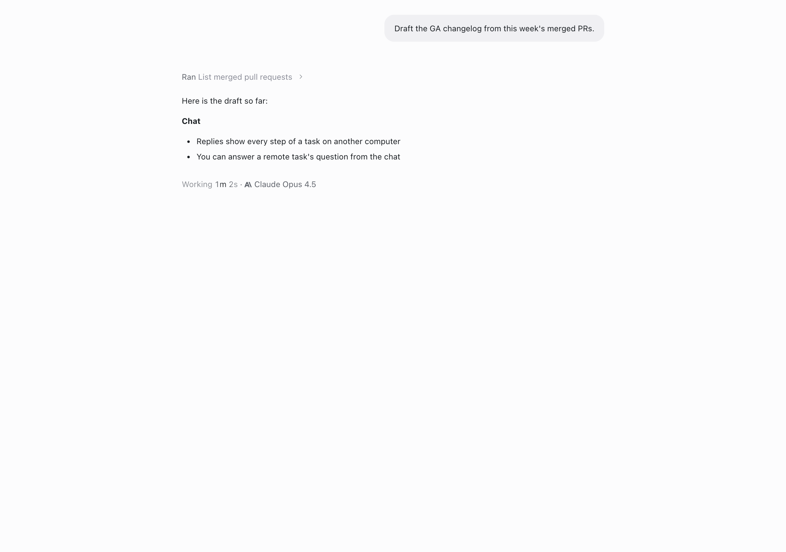
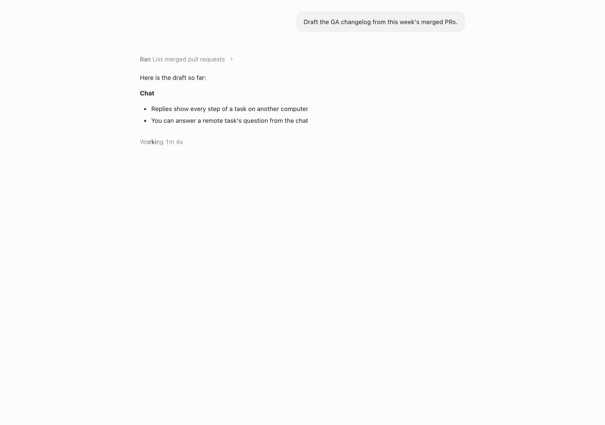
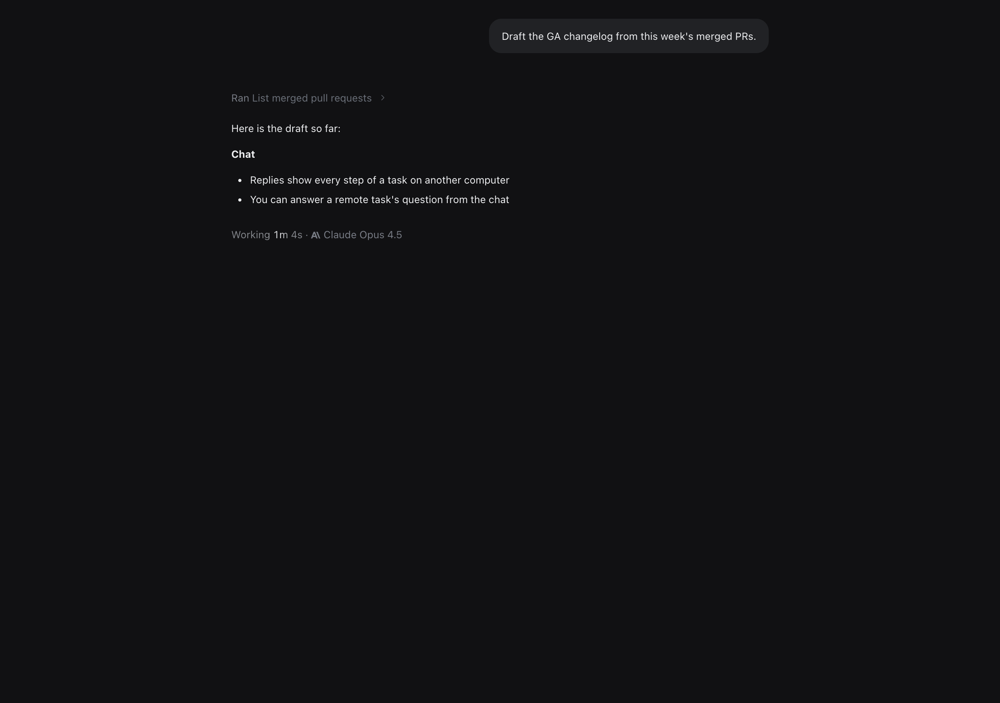

# See a reply's model while it streams

Feature key: `liveReplyModel` · deployments: cloud and self-hosted · default
off · author: [@benjaminshafii](https://github.com/benjaminshafii)

## What it does

While a turn runs, hovering its "Working 1m 2s" line shows which model is
writing it, right after the timer on the same line:
`Working 1m 2s · [provider mark] Claude Opus 4.5`. Before, the model only
appeared under the reply once it had finished.

- Shown on hover of the Working line (always on touch), outside the shimmer.
- It is this turn's model only: until the reply starts there is nothing to
  show, never the previous turn's model.
- It shows as soon as the engine reports the reply's model, which is when
  the reply starts, so it is there during tool runs before any text.
- With Auto, it shows the Auto label until the routing decision arrives, then
  the routed model, the same as the finished reply.
- Screen readers hear "Writing with Claude Opus 4.5".

| Hovered | Not hovered |
| --- | --- |
|  |  |

Dark, hovered:

Screenshots: the real `MessageList` in headless Chrome against this
checkout's Vite dev server, hovered with a real pointer move.

## How to try it

1. Turn `liveReplyModel` on for your organization in `/admin`.
2. Send a message and hover the "Working" line while it runs.

## Turning it off

Rendering only. Off (or the kill switch) removes the caption from the
Working line on the next features refresh. Nothing is stored.

## What to watch

Replies whose model reads differently while running than after (Auto before
routing).
