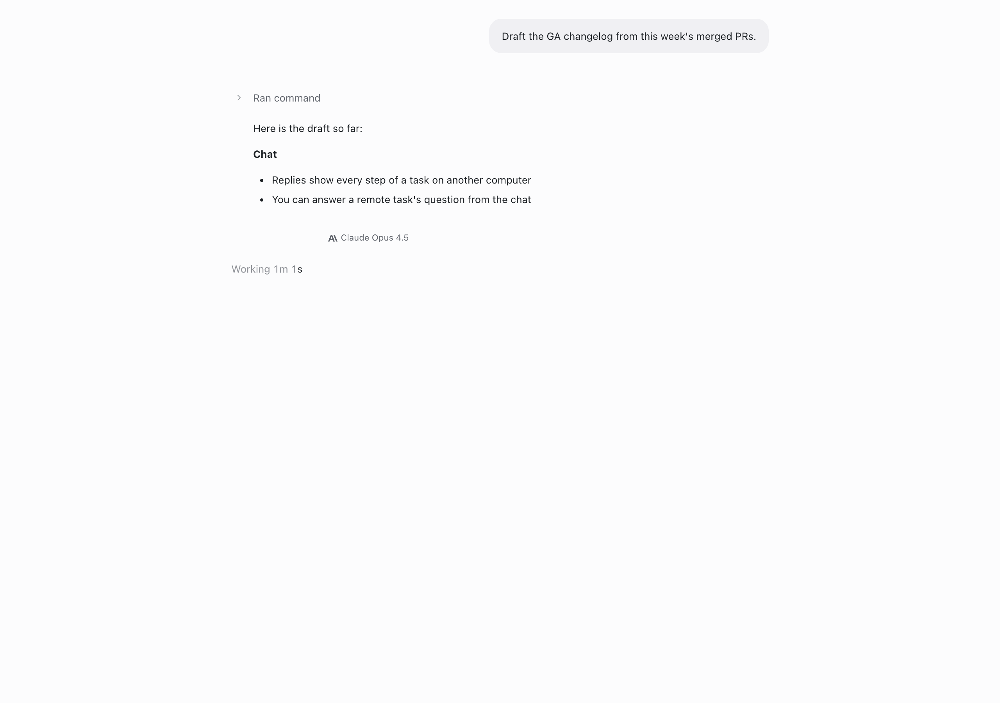
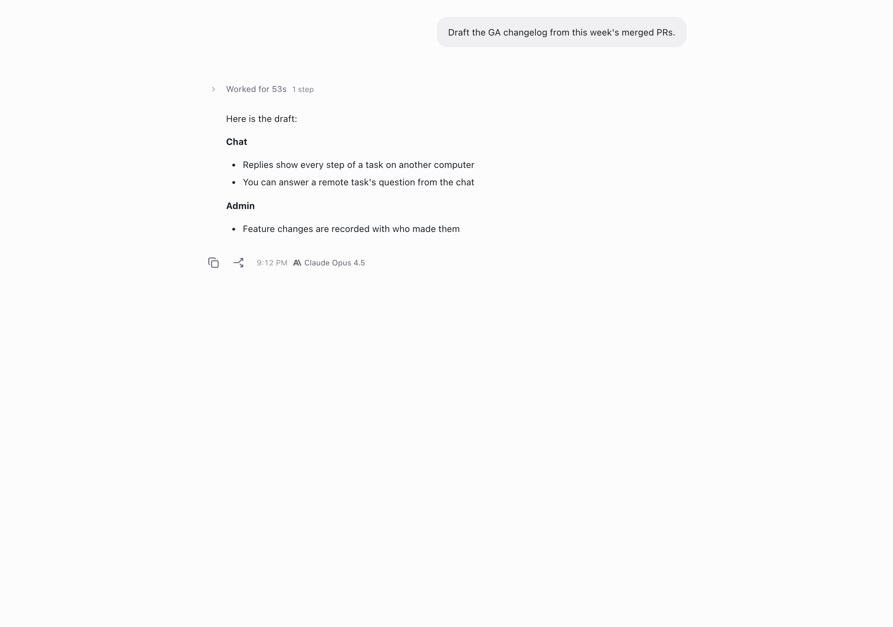
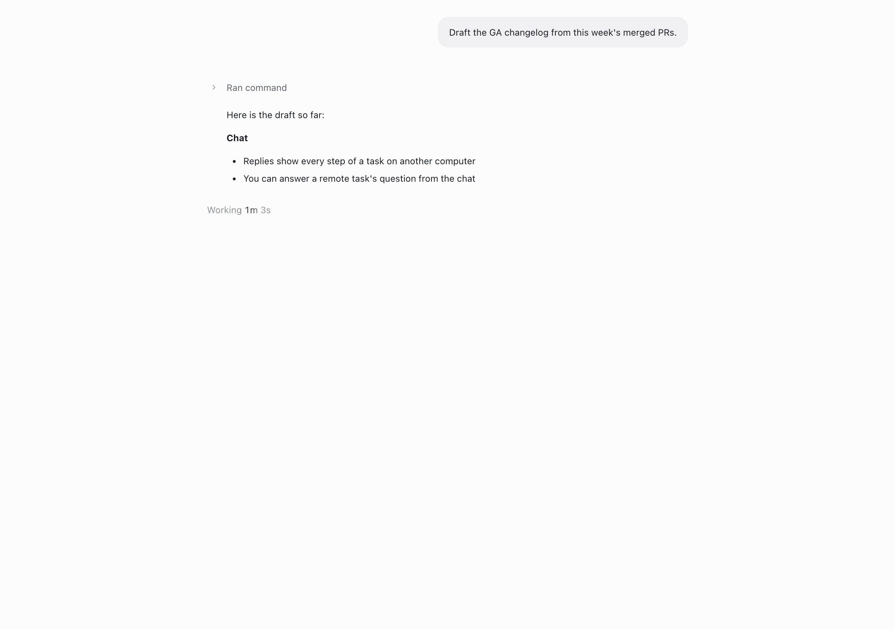

# See a reply's model while it streams

Feature key: `liveReplyModel` · deployments: cloud and self-hosted · default
off · author: [@benjaminshafii](https://github.com/benjaminshafii)

## What it does

Hovering a reply that is still being written shows which model is writing it
("Claude Opus 4.5" with its provider mark), in the same place the model shows
once the reply has finished. Before, the model only appeared after the reply
completed, so people waited a whole turn to learn which model was answering.

- The caption uses the finished footer's hover reveal (hover, focus within
  the reply, always on touch).
- While the reply streams, the reply actions (Copy, Branch, time) keep their
  slot but are invisible and cannot be used, so the caption does not move
  when the reply finishes.
- It shows as soon as the engine reports the reply's model, which is when
  the reply starts, so it is there during long tool runs before any text.
- With Auto, it shows the Auto label until the routing decision arrives, then
  the routed model, exactly like the finished footer.
- Screen readers hear "Writing with Claude Opus 4.5" while streaming and
  "Replied with Claude Opus 4.5" after.

| Streaming, hovered (on) | Finished, hovered |
| --- | --- |
|  |  |

Flag off, streaming and hovered: no model until the reply finishes.

Screenshots: the real `MessageList` in headless Chrome against this
checkout's Vite dev server, hovered with a real pointer move.

## How to try it

1. Turn `liveReplyModel` on for your organization in `/admin`.
2. Send a message and hover the reply while it is still being written.

## Turning it off

Rendering only. Off (or the kill switch) returns to showing the model only
after the reply finishes, on the next features refresh. Nothing is stored.

## What to watch

Layout reports for the footer row while streaming (it now holds its place
under a live reply instead of appearing at the end), and replies whose model
reads differently while streaming than after (Auto before routing).
