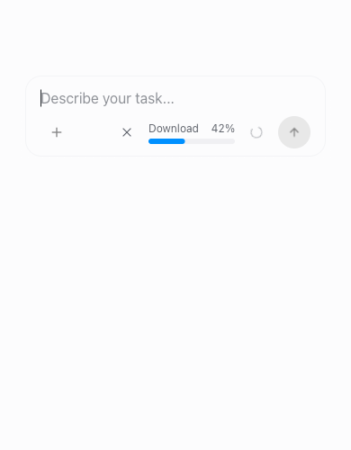

# Local dictation: live text and one-action Send

Feature: `nativeDictation` · cloud and self-hosted · off by default.
Author: reachjalil. This change does not change any live rollout.

On macOS 26 or later, supported devices and languages use Apple’s
`SpeechAnalyzer` with `SpeechTranscriber`. Older systems, unsupported hardware
and languages retain the on-device `SFSpeechRecognizer` fallback.

With the bundled speech helper, click the microphone and speak. Words appear
in the input as they are recognized and revise in place. A compact waveform,
Cancel and Stop sit immediately left of Send in the composer footer. The
waveform responds to microphone amplitude.

Choose Send or press Enter while recording to stop capture, await the final
words, and submit once. Send works even before the first words appear. While
recognition finishes, the button shows a progress indicator; it does not
require a second click or a review step. Stop alone finishes the transcript
for editing without sending. Cancel or Escape stops capture and any pending
Send, preserving words already visible in the draft. Recognition errors or a
finalization timeout also keep the draft for review instead of submitting it.

Speech replaces the original selection or inserts at the original cursor.
Editing the draft, changing chats, hiding the app or disabling the feature
cancels pending recognition and submission, so late words cannot overwrite
newer work. Existing attachments stay in place. Reduced motion replaces the
moving meter with a static Listening label.

[Watch the recording and Send transitions](transitions.mp4).

These screenshots and the motion preview render the real composer in an isolated browser harness.
Speech events are deterministic fixtures and model selection is omitted;
they show the interaction, not an acoustic accuracy result.

## Motion and responsiveness

Recording controls expand beside the stationary Send button in 180 ms and
collapse in 120 ms, with ease-out easing. Setup, waveform and finishing share
a fixed footprint, so phase changes do not move Send or change the toolbar's
height. The outgoing phase stays visible during collapse instead of flashing
a different label. Icons crossfade over 150 ms; audio bars follow each actual
microphone measurement immediately, without repeatedly restarting a slower
transform transition. Press feedback is subtle,
with no bounce or delay before an action takes effect. During startup, the
same bars show a gentle traveling pulse, labeled Starting dictation for
assistive technology. Once capture is ready, the pulse stops and the bars
show measured audio. Downloads keep their measured progress bar.

The first recognized words and visible corrections appear immediately.
Subsequent appended words reveal over a 100 ms window, coalescing incoming
results into the same deadline instead of accumulating a typing queue.
Character boundaries preserve emoji and combining marks. Stop and Send flush
the latest text immediately; Cancel preserves only what was displayed and
fences pending animation frames. Reduced motion applies text immediately.

The main Mic/Stop button remains mounted. Keyboard cancellation returns focus
to it after setup or capture; closed controls are inert and leave the tab order
immediately, even while fading out. Reduced motion disables transitions, press
scaling and the startup pulse, and uses static Starting dictation / Listening labels.

Browser frame sampling verified intermediate opening/closing widths, a fixed
Send position and equal widths for setup/listening/finishing. A 390 px check
covered rapid start/cancel and focus restoration without overflow. Reduced
motion had zero active animations across all phases. The download bar uses
the shared progress primitive and eases between measured values; unknown
progress pulses only while setup is active. A 42% fixture filled 40.3 px of
the 96 px track. Download completion now clears the progress bar before analyzer
preparation, instead of leaving a completed download visible until recording. These are focused
interaction checks, not a device-wide rendering benchmark.

## Local recognition improvements

- Prefer the newer `SpeechTranscriber` model with `volatileResults` and
  `fastResults` for earlier live text. Apple's smaller context window trades
  some accuracy for responsiveness; finalization does not undo that tradeoff.
  Revisions replace overlapping audio
  ranges rather than duplicating words. Retain each latest result even when
  it becomes final without being reissued. `SpeechAnalyzer` finalizes through
  the end of the input stream before a requested Send proceeds.
- Reserve the locale before checking `AssetInventory` status. A new helper
  can otherwise see an already-downloaded language as merely supported and
  request installation again. Skip installation and its UI when installed.
  A compact progress bar and percentage show the request's actual
  `Progress.fractionCompleted`. Until Apple reports a measurable total, the
  bar is indeterminate with no invented percentage. It remains cancellable;
  the microphone starts only after the model and analyzer are ready. The system shares and manages
  these assets. The first download needs a connection; transcription is local.
- Convert the microphone format into the analyzer’s chosen format, copy tap
  memory before queueing it, drain resampling at Stop, and reject an overloaded
  audio queue instead of silently dropping words.
- In the legacy fallback, create the recognition request before starting the audio engine, so the
  first buffer has a destination.
- Finish processing accepted audio after Stop and allow up to five seconds
  for final corrections and punctuation (previously 1.2 seconds). This is a
  maximum wait, not a fixed delay. A timeout retains captured text and asks
  the person to review it.
- In the legacy fallback, supply short recognition hints for OpenWork and common development terms,
  including OAuth, JSON and pull request. Apple documents these as improving
  the likelihood of recognizing domain vocabulary; no accuracy percentage
  is claimed here.
- Use the host's preferred language instead of the page's interface language.
- Derive a bounded 30 Hz level stream from the same audio tap, with a shorter
  24-sample history. Signals at or below -45 dBFS stay flat in the meter;
  this visualization gate never removes audio from recognition. Only the
  waveform subscribes to level updates; the full composer does not rerender
  for every audio buffer.
- Acknowledge drafts published by recognition before checking for external
  edits. A newer result can arrive between React's commit and its effects;
  an older draft echo must not be mistaken for a manual edit and abort capture.
  Actual edits, cancellation and chat changes still fence recognition.

Recognition still requires Apple’s on-device support for the language. A
failed model download or local start gives a recovery message rather than
silently switching to an online transcription service. No audio is saved or
uploaded, and no language model rewrites the transcript. Windows/browser speech and
older builds' system-dictation handoff keep their existing behavior and do not
make an offline guarantee.

## Try and verify

Enable `nativeDictation` through the existing Features controls for a test
organization. Use a macOS build with its signed speech helper and microphone /
Speech Recognition permissions. Dictate a prompt with pauses and a technical
term, choose Send immediately after the last word, and confirm the final word
is included. Use Stop to review another recording, then cancel or edit while
a requested Send is still finishing.

Focused tests cover live revisions, final corrections, selection insertion,
one-action Send/Enter (including an empty initial draft), duplicate-submit
prevention, cancel/error/edit/chat-change fencing, Stop without submission,
Escape without stopping an agent, finite level events, and the existing
browser/system recognition behavior. Native tests cover 24/44.1/48 kHz stereo input, independent buffer ownership,
final samples, silence, level bounds and transcript range revisions. The Swift helper is built
with the macOS 14 deployment target; new APIs are guarded by macOS 26
availability. The build includes them when the selected SDK is 26 or newer,
and retains the legacy path for older SDKs. The isolated
composer is also checked at desktop and narrow widths and with reduced motion.
Packaged microphone/permission acceptance and measured speech accuracy remain
hardware checks; synthetic speech events do not establish either.

Continuity regressions deliver a newer result between React's commit and
effects, exercise burst coalescing with a controlled frame clock, and check
that corrections never retract an unchanged visible prefix. The actual
editor also stayed listening through 150 rapid simulated updates to a
2,482-character draft. Startup and live capture reuse the same bars without
moving Send; a 390 px reduced-motion check had no active startup animations
or horizontal overflow.

## Native smoke check

The production analyzer and converter were exercised on macOS 26.5 using a
synthesized English file, with no microphone recording. The run emitted model
installation, ready, incremental word updates, final corrections, and end
events successfully. The spoken
sample was “Please plan the week. Review the pull request, then check the OAuth
flow.” The latest run rendered “pull” as “poll” and “OAuth” as “O Off”. This proves native processing and finalization, not improved
recognition accuracy; technical vocabulary still needs real-speaker evaluation.
Apple documents `AnalysisContext.contextualStrings` for `DictationTranscriber`,
so the new `SpeechTranscriber` path does not claim those hints are supported.

Reproduce with `apps/desktop/test/native/speech-analyzer-smoke.swift`, compiled
alongside `native/dictation/audio-input.swift`, `transcript.swift` and
`speech-analyzer.swift` with
`-D OPENWORK_SPEECH_ANALYZER`. Pass a synthesized audio file. This is an opt-in
hardware check because Apple may download a system language asset; regular
native unit tests perform no downloads and never open the microphone.

The responsiveness follow-up used the same synthesized prompt paced at its
sample rate: “Plan the week. Review the changes and create a pull request.
Keep the microphone next to the send button.” First text arrived 4.00 seconds
after ready before the change, versus 0.96 and 0.96 seconds in two runs after
it. The final transcript matched across all runs, including the existing
“poll request” mistake. This is one synthetic sample, not a general latency or
accuracy guarantee. Both repeat runs passed the smoke's `--expect-cached`
assertion with no installation events; the baseline emitted them on this same
device. The smoke now reports elapsed time and paces file input for live timing.

A subsequent 90.5-second paced synthetic recording completed with the final
marker, “Orange bicycle finishes the recording.” This did not reproduce a
fixed-duration analyzer cutoff; it does not exercise live microphone routing
or establish the cause of every interrupted recording.

The browser control fixture settled to a flat meter within 0.9 seconds of
quiet events without moving Send. Audio bars have no transform tween; the
existing control transitions and reduced-motion behavior remain. Intermediate
download progress, unknown totals, completion before ready, failure/retry reset
and late-event rejection are covered by deterministic UI/bridge tests. A fresh
asset download and live microphone/packaged permissions were not exercised.

## Acoustic comparison

Compare the legacy and new native flow
on the same consented audio set: ordinary prompts, accents, pauses, technical
names, and immediate Stop. Measure word error rate, final-word retention and
stop-to-text latency. Use those results to decide whether a bundled local model justifies its download, memory and language
coverage costs. Keep the recording and submission interface independent of that choice.

References: [SpeechAnalyzer](https://developer.apple.com/documentation/speech/speechanalyzer),
[SpeechTranscriber](https://developer.apple.com/documentation/speech/speechtranscriber),
[Volatile results](https://developer.apple.com/documentation/speech/speechtranscriber/reportingoption/volatileresults),
[Fast results](https://developer.apple.com/documentation/speech/speechtranscriber/reportingoption/fastresults),
[Result finalization](https://developer.apple.com/documentation/speech/speechmoduleresult/isfinal),
[AssetInventory](https://developer.apple.com/documentation/speech/assetinventory),
[Apple contextual vocabulary](https://developer.apple.com/documentation/speech/sfspeechrecognitionrequest/contextualstrings),
[Apple finishing recognition](https://developer.apple.com/documentation/speech/sfspeechrecognitiontask/finish()),
[Claude dictation](https://code.claude.com/docs/en/voice-dictation),
and [Codex dictation](https://learn.chatgpt.com/docs/prompting#use-voice-dictation).
Design: P1, P5, P8, P11, S6, C6, V6, T5.
