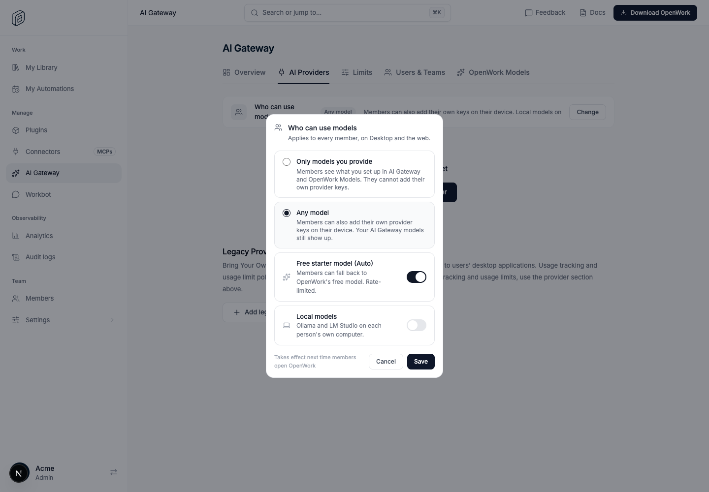
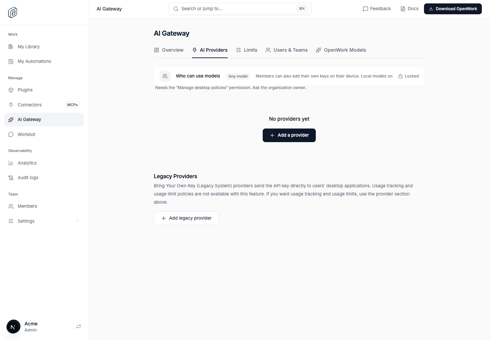
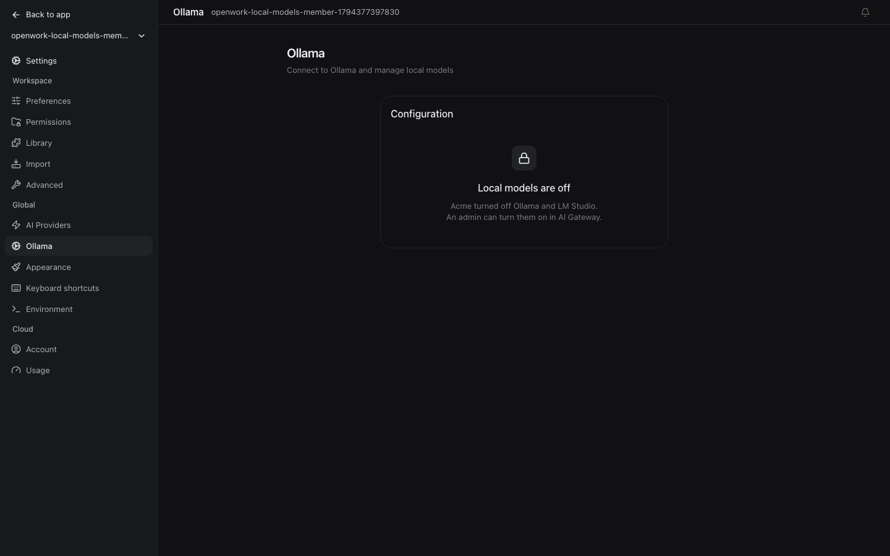

# Limit local models (Ollama, LM Studio)

Feature: `localModelsPolicy` · cloud and self-hosted · off by default
Owner: `benjaminshafii`

## What changes

AI Gateway › AI Providers › **Who can use models** gets a **Local models** switch, next to "Only models you provide" / "Any model" and the free starter model. It is separate from personal keys, so an owner can:

- allow personal keys but not Ollama or LM Studio ("Any model", local off), or
- allow only organization models plus local ones ("Only models you provide", local on), since local models keep data on the person's computer.

Model access is a desktop policy, so changing it needs **Manage desktop policies** (the owner, by default). Anyone else with access to AI Gateway sees the row with a lock and the reason, not a Save button that fails:

On each member's desktop, while local models are off:

- **Settings › Ollama** stays visible, with a lock naming the organization and who can change it; it does not even probe Ollama.
- Ollama and LM Studio models leave the model picker, and a connected Ollama is set aside (and brought back when the switch is on again).
- **Account › App permissions** shows "Use local models: Blocked".
- The local server refuses writing an `ollama`/`lmstudio` provider, signing in to one or sending with one (`organization_local_models_denied`), and both engines drop them (v1 `disabled_providers` or the allowlist, v2 mirror).

Changes reach members the next time OpenWork opens, as the dialog says.

## Compatibility

The key is `allowLocalModels` in the default desktop policy. **A policy saved before it existed inherits `allowCustomProviders`**: "Only models you provide" kept blocking Ollama before this change, and the "Admins may still add their own keys" exception kept allowing it. Existing organizations therefore behave exactly as before until an owner moves the switch, and an existing Restricted policy still reads as Restricted.

- Den sends `allowLocalModels` only with the flag on; off, it sends the provider setting's value (the old behaviour) whatever is stored.
- A desktop talking to an older Den without the key applies the same fallback.
- Saving with the admin exception writes the same local-models value to it, so the exception never re-opens what the owner turned off.

## What it does not cover

Only the provider ids OpenWork's own setup writes (`ollama`, `lmstudio`). A local server someone adds under another name through Connect a provider is a custom provider; "Only models you provide" blocks it, this switch does not. The rule is by id, not address, because OpenWork's own local relays also listen on loopback.

## Revert

Kill the flag: Den stops sending the switch, local models follow the provider setting again, and the dialog hides the switch. Stored values stay; nothing is deleted.

## Evidence

- `evals/proofs/local-models-policy.proof.test.ts`: real isolated Den and a real desktop app in headless Chrome. The owner switches local models off while keeping personal keys; the admin sees it locked; Riley's Ollama page locks, their local server refuses Ollama, App permissions shows Blocked and Allowed; switching back unlocks it.
- `ee/apps/den-api/test/api/local-models-policy.api.test.ts`: flag off/on delivery, inheritance, owner vs admin vs member, organization isolation.
- `apps/server/test/local-models-policy.test.ts`: inheritance and Restricted mode, both engines in all six combinations, server refusals including an older Den.
- `apps/app/tests/local-models-policy.test.tsx`, `ee/apps/den-web/.../model-access-policy.test.ts`.
