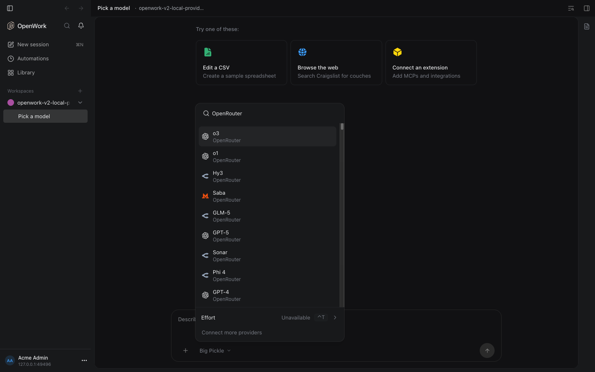
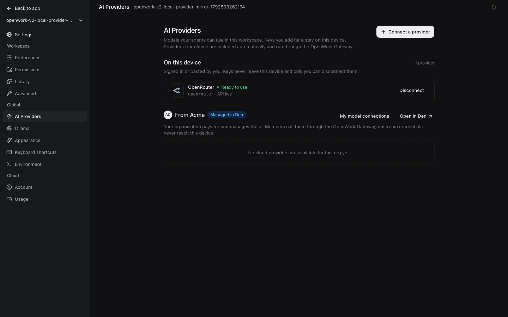
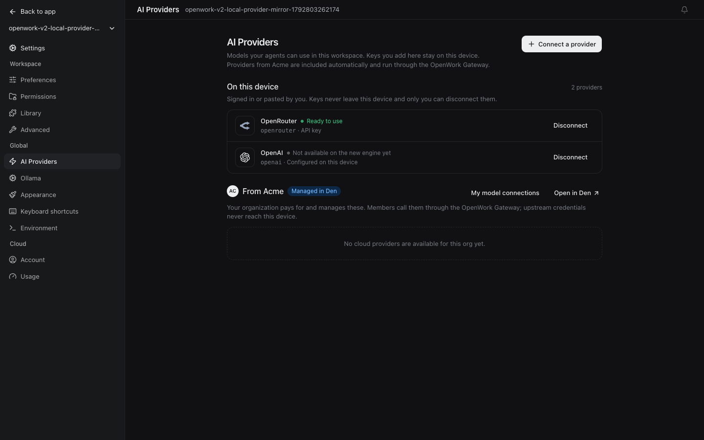
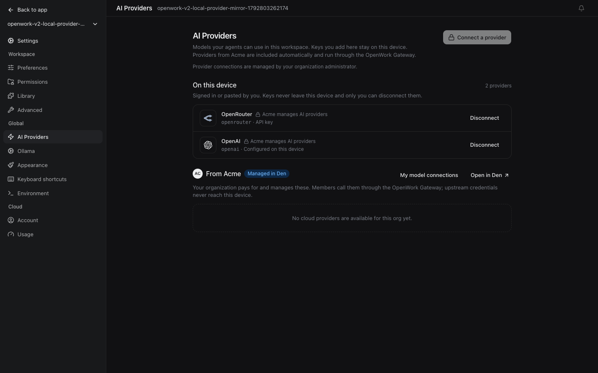

# Providers added on this computer, on OpenCode v2

Generally available on cloud and self-hosted installations, including signed-out
desktops. The former `localProviderMirror` rollout has been removed.
Author `benjaminshafii` · follow-up: ENG-888.

## What happens

People add their own API keys in Settings › AI Providers (OpenRouter, OpenAI,
Anthropic…). OpenWork saves them in OpenCode v1's credential store and mirrors
them into OpenCode v2, the engine chat runs on.

- The mirror translates v1's `Provider.Info` (and still accepts the older
  models.dev shape). The key comes only from `auth.json`; the catalog's copy of
  a key, its `baseURL` and its headers are ignored, and a catalog endpoint is
  used only on the adapter's own origin (`https://openrouter.ai` for
  OpenRouter, for example).
- `GET /experimental/engine-v2-preview/status` reports
  `skippedProviders: [{ id, reason }]`, with `reason` one of `policy`, `oauth`,
  `unsupported`, `metadata` or `credentials`.
- After a key is saved or a provider sign-in finishes, the server mirrors it
  into v2 and disposes v1's instance for that folder in place (never while v1
  runs work, never through the engine pool, which skips a folder whose config
  file did not change), so v1's provider list is fresh on the next read.
  Runtime configuration and environment changes also refresh the mirror live.
- AI Providers lists every provider on this device that the engine mirrored
  (Ready to use) or skipped (with its reason), even when v1's list has not
  caught up, so a provider that works in the picker is never missing.
- A sign-in v2 cannot use yet (ChatGPT, for example) reads "Not available on
  the new engine yet". A provider the organization does not allow keeps its
  row with a lock and the organization's name. A skipped provider never reads
  "Ready to use".

"Only models you provide" (`allowCustomProviders: false`) continues to apply
to the v2 mirror exactly as v1's `enabled_providers` does: only organization
providers (`lpr_`, `ipr_`, `openwork`, and OpenCode Zen unless removed) reach
v2. Both engines use one rule
(`apps/server/src/organization-provider-gate.ts`). GA does not bypass managed
provider policy or change credential and endpoint protections.

## How to try it

On a desktop that runs chat on OpenCode v2, add an OpenRouter key in Settings ›
AI Providers, then open the model picker in a chat and search "OpenRouter".
No organization rollout or sign-in is required. The proof
`evals/proofs/v2-local-provider-mirror.proof.test.ts` drives this path, a second
provider key, an unsupported sign-in, and the organization's provider rule.

There is no rollout-off fallback. Disconnecting a provider removes its key
from the mirror; organization model-access policy still restricts personal
providers without deleting their saved credentials or chats.

## What to watch

- `skippedProviders` in the engine status: a growing `metadata` count means v1
  changed its catalog shape again; `unsupported` lists providers without a v2
  adapter in the mirror (Google, Groq, custom gateways).
- Server log warning "Could not refresh OpenCode v1 providers after a provider
  change." means AI Providers may show a stale list until a restart.
- Out of scope here (ENG-888): sharing a personal provider with the team,
  asking an admin, and signing in again with OAuth on v2.
