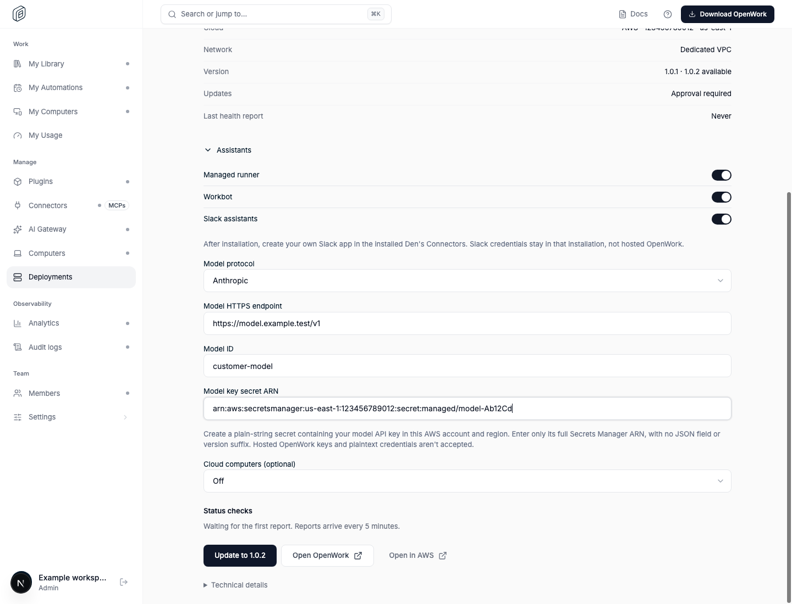
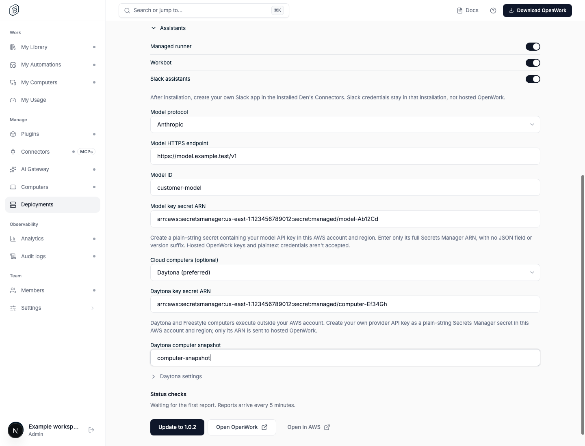
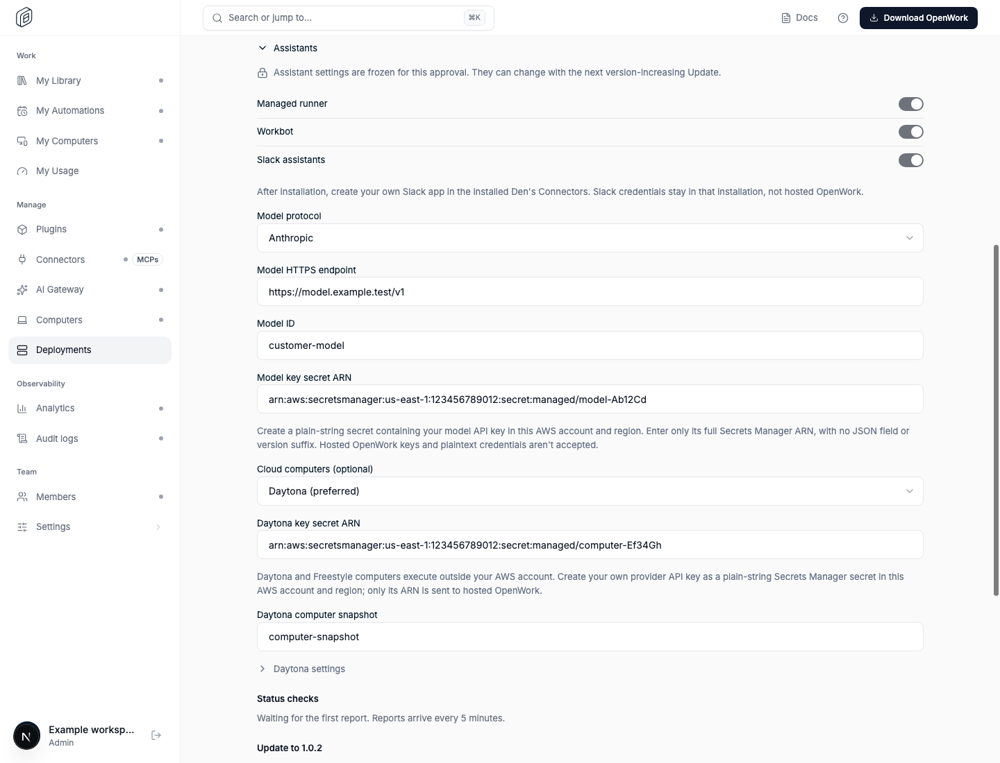
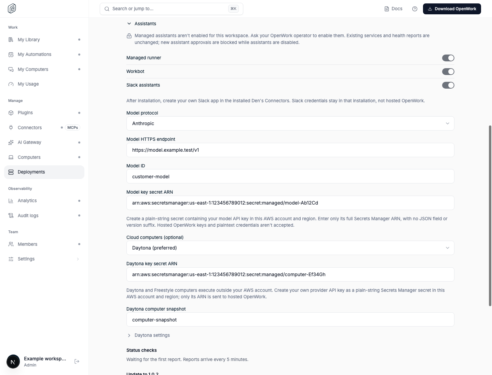
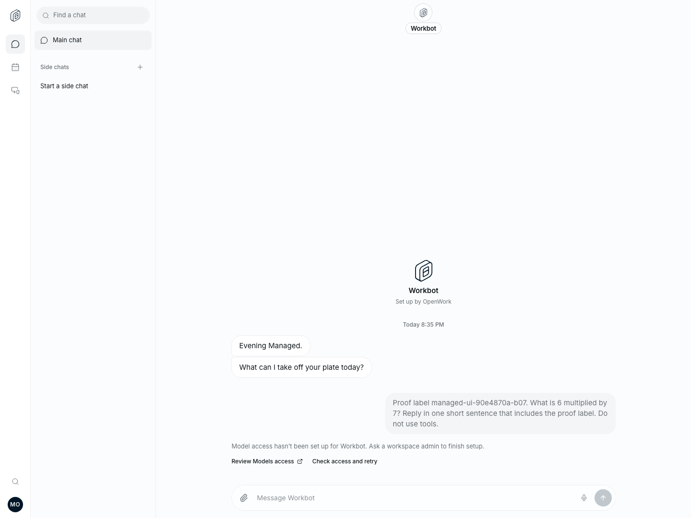

# Managed deployment assistants

- Feature: `managedDeploymentAssistants`
- Deployment: cloud only, off by default
- Owner: `benjaminshafii`
- Prerequisite: `managedDeployments`

An organization owner can include a managed runner, Workbot, Slack assistants and
optional Daytona or Freestyle computers when creating an AWS managed deployment. An existing
installation can change these settings through a **version-increasing Update**;
Retry cannot change them. Google Cloud and external runner URLs are not supported
by this installer profile.

## Inputs and ownership

The AWS target accepts an optional `assistants` object. An omitted object retains
the original deployment profile, with all capabilities off:

```json
{
  "headlessRunnerEnabled": false,
  "workbotEnabled": false,
  "slackAssistantEnabled": false,
  "computerProvider": "off"
}
```

| Field | Values / requirement |
| --- | --- |
| `headlessRunnerEnabled` | Boolean, default `false` |
| `workbotEnabled` | Boolean, default `false`; requires managed runner |
| `slackAssistantEnabled` | Boolean, default `false`; requires managed runner |
| `modelProtocol` | `anthropic`, `openai`, `openai-responses`; required for runner |
| `modelBaseUrl` | HTTPS endpoint; no userinfo, query or fragment; required for runner |
| `model` | Model ID; required for runner |
| `modelSecretArn` | Customer-created plain-string Secrets Manager secret ARN; required for runner |
| `computerProvider` | `off` (default), `daytona` (preferred when choosing computers), or `freestyle`; non-off requires runner |
| `computerSecretArn` | Customer-created plain-string selected computer provider API key secret ARN; required only when computers are selected |
| `computerSnapshot` | Daytona computer snapshot ID; required only for Daytona, not for runner-only or Freestyle |
| `daytonaApiUrl` | Optional HTTPS endpoint, default `https://app.daytona.io/api`; no credentials, query or fragment |
| `daytonaTarget` | Optional managed-installer target, default `us` |

Both secret ARNs must belong to the target AWS account and region and identify a
complete secret, without JSON-field or version selectors. Neither plaintext keys
nor hosted OpenWork credentials are accepted. The installer injects the secret
by reference; hosted OpenWork never reads the secret value. ARN validation cannot
prove the referenced value is plain-string: the customer creates that secret and
ECS resolves the reference while starting the task. The installer does not read
the value; an unavailable or invalid credential fails task startup or the real
provider call instead of being treated as a successful installation proof.

The customer creates their own Slack app from **Connectors in the installed
Den**, after installation. This form does not request Slack tokens. Daytona and
Freestyle computers execute **outside the customer's AWS account**, with separate
provider billing. Computers are optional: runner-only installation requires the
model key but no computer key, snapshot or sandbox account. Selecting Daytona
requires its computer snapshot, not an OpenWork Web image. Model use, runner
storage and backups add charges beyond the core small profile.

The managed installer explicitly selects `us` when Daytona is used and no target
is entered. The shared Terraform module itself currently defaults `daytona.target`
to an empty string; this feature does not change that module default.

## API and MCP

- `POST /v1/managed-deployments`: AWS `target.assistants` configures a fresh install.
- `POST /v1/managed-deployments/:id/launch`: `{ "kind": "update", "assistants": ... }`
  configures an existing installation. The published version must be newer than
  its installed version. Same-version Update, Install/Retry settings changes and
  non-AWS settings are refused.
- `GET /v1/managed-deployments/configuration`: `assistantsAvailable` tells MCP
  clients whether this caller can configure assistants. The same routes and
  permissions enforce assistant rollout for MCP and browser clients.

The deployment row is locked while checking the feature, creating a run and
saving its target. The target is immutable for an active approval/provisioning
run. Reopening an identical pending approval returns its exact run and handoff;
different settings receive `deployment_settings_frozen`. There is no independent
settings write, and expired/superseded installer runs cannot enroll. No database
migration is needed: the settings live in the existing JSON target.

Unconfigured legacy targets keep their existing CloudFormation parameter set.
Explicit assistant configuration sends the twelve bootstrap parameters, including
false/empty values for an explicit configuration. Removing an installed runner,
its disk/backup protection or generated secrets is not an automatic Update:
the installer refuses protected-resource deletion and requires customer-run
manual decommissioning.

## Turning it off

The flag blocks enabling assistants and all new/reopened launches whose stored
settings enable assistants. It never deletes services or stops billable
resources. Existing configuration, installer progress, authenticated enrollment,
allowlisted health reports and authentication continue to work. Previously
issued approval commands cannot be revoked remotely; the customer controls
execution in AWS. Use a reviewed newer Update to add or reconfigure services;
protected disk/secret/backup removal requires manual decommissioning instead.

The UI preserves the current settings behind a lock and names the operator or
workspace owner who can change access. Assistant settings stay frozen while an
approval or installer run is live. Status checks recognize `runner_service`,
`workbot_available`, `runner_storage` and `runner_backups`; a failed optional check
degrades health without masking the core API/database/web checks.

## Local UI evidence

These are real Den web captures in headless Chrome at 1440 × 1100, using a
throwaway local MySQL database, neutral fixtures and dummy installer coordinates.
The existing-install record was arranged locally; no AWS approval command was
executed. They do **not** prove a live managed installation, its authentication,
model execution, Slack delivery or computer execution.

Computers stay optional: with the managed runner, Workbot and Slack enabled,
**Cloud computers (optional)** remains **Off** and no computer key or snapshot
field is required.



Enabled: an owner selects preferred Daytona for an existing installation's newer
Update, supplies its computer snapshot and customer-owned secret references, and
sees both ownership boundaries.



After **Update to 1.0.2**, the real API returned HTTP 200 with the chosen settings
and an `update` run in `awaiting_approval`. The controls are frozen.



After the isolated administrator killed the feature through its public admin
API, the page's configuration poll locked the unchanged settings and removed the
command/approval links without a reload. The managed runner remains selected;
it is not represented as remotely stopped.



## Observed managed AWS runtime boundary

On 17 November 2026, a real isolated managed install and IAM-approved enablement
Update completed with fixed `0.18.67` application digests. Its certificate,
service, EFS backup and secret-preservation checks passed. **The model path did
not:** actual Workbot UI sign-in succeeded, but Send returned HTTP 403
`gateway_not_configured`; the thread remained idle with zero turns. A scheduled
headless Automation likewise failed `provider_unavailable` at model selection.
No AI Gateway was added to disguise that incompatibility.



The infrastructure health panel cannot substitute for a completed model turn.
Full gatewayless qualification remains blocked on a separately reviewed runtime
option and new real application checks. The migration-validator correction is
also a separate change; this installer test's controller used official production
bootstrap followed by its unchanged strict verifier.

## Verification and rollout

Local schema/handoff tests and real Den API tests cover default-off behavior,
secret boundaries, existing-install Update, identical handoff replay, immutable
pending settings, permissions, tenant isolation and kill-switch continuity.
These are not live AWS install, model execution, Slack delivery, computer
execution or backup-restore receipts. Those remain separate qualification gates
for the exact published installer/images before rollout.

Start with a controlled internal organization, turn on both flags, configure a
customer-owned secret reference, and review the generated AWS permissions and
charges before approving. Watch installer milestones and all four optional
health checks; treat absent or stale reports as unverified, not successful.
