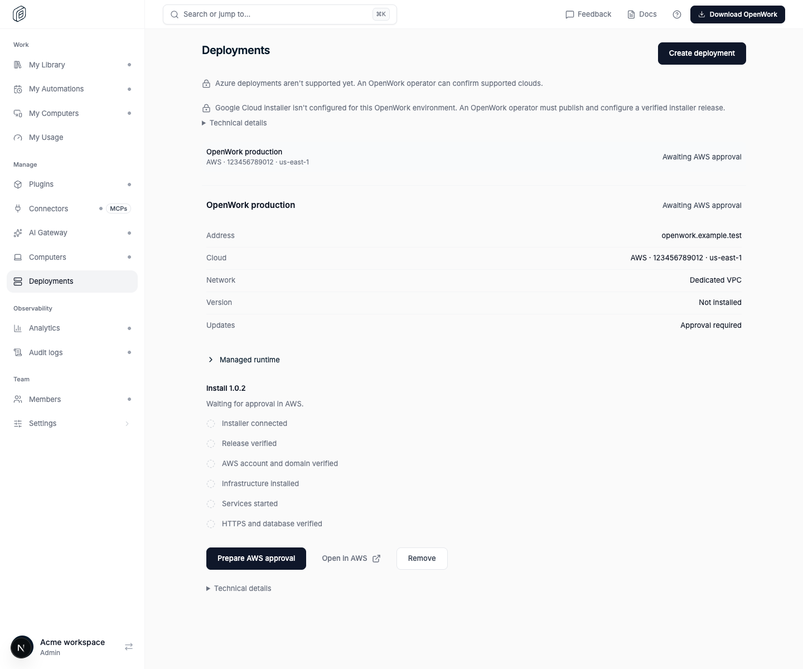
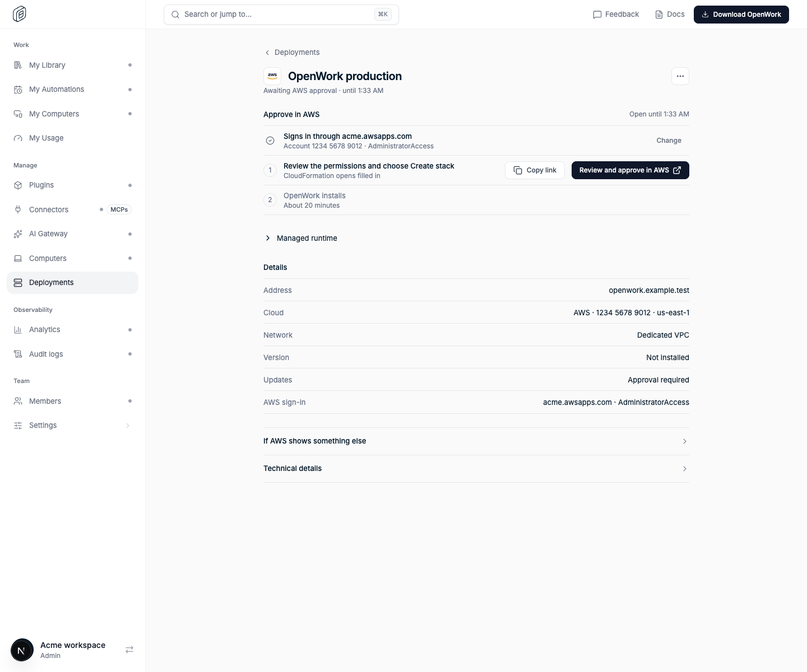
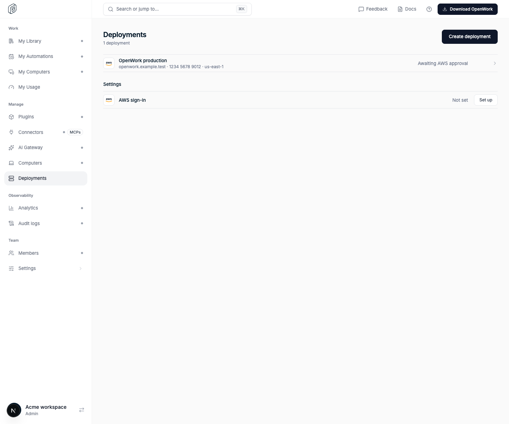

# Deployments: guided AWS approval

- Feature key: `managedDeploymentAwsSignIn`
- Label: Deployments: guided AWS approval
- Deployment: cloud only, off by default
- Owner: `benjaminshafii`
- Prerequisite: `managedDeployments`

Approving an install means opening a link in the AWS console while signed in to
the right AWS account. People who sign in through an AWS access portal (IAM
Identity Center) have no console session until they pick an account and a role
there, so the plain link lands on the root / IAM sign-in page and the prefilled
CloudFormation form is lost.

With this feature on:

- **Deployments is a list.** Each deployment opens as its own page with a back
  link, its state in the header, and secondary actions in a menu.
- **Approve in AWS** lists the steps in order: sign in to the named account,
  review and choose **Create stack** (with **Copy link** to hand the approval to
  a teammate), then the install. The section says until when the approval is
  open. Coming back to the page shows the same approval link again.
- **If AWS shows something else** answers the four cases people hit: a root or
  IAM sign-in page, "Select a role", a different account number, a closed tab.
- **AWS sign-in** (Deployments › Settings, and each AWS deployment's Details)
  saves the organization's access portal URL and role once. Every AWS link Den
  issues afterwards (approval, CloudShell, the stack) opens through the portal
  in the deployment's own account, with the original page as its destination.

| Off | On |
| --- | --- |
|  |  |

## Rules

- The sign-in is one setting for the organization (`managed_deployment_aws_sign_in`),
  saved by someone who can manage deployments
  (`PUT /v1/managed-deployments/aws-sign-in`, `{ awsSignIn: { portalUrl, roleName } | null }`).
  Saving and removing are in the audit log.
- Only `https://*.awsapps.com` and `https://*.app.aws` portals are accepted. The
  URL is trimmed and stored without a trailing slash.
- Links are wrapped only while the feature is on and a sign-in is saved.
  Otherwise Den returns the plain console links, exactly as before.
- Changing the sign-in does not start a new approval: reopening a prepared
  approval returns the same run with the link issued for the current sign-in.
- With the feature off, the earlier single-screen Deployments page is shown and
  a deployment's own URL returns to the list.

## Proof

- `ee/apps/den-api/test/api/managed-deployment-aws-sign-in.api.test.ts`
- `packages/managed-deployments/src/aws-sign-in.test.ts`
- `evals/proofs/deployments-aws-sign-in.proof.test.ts`
