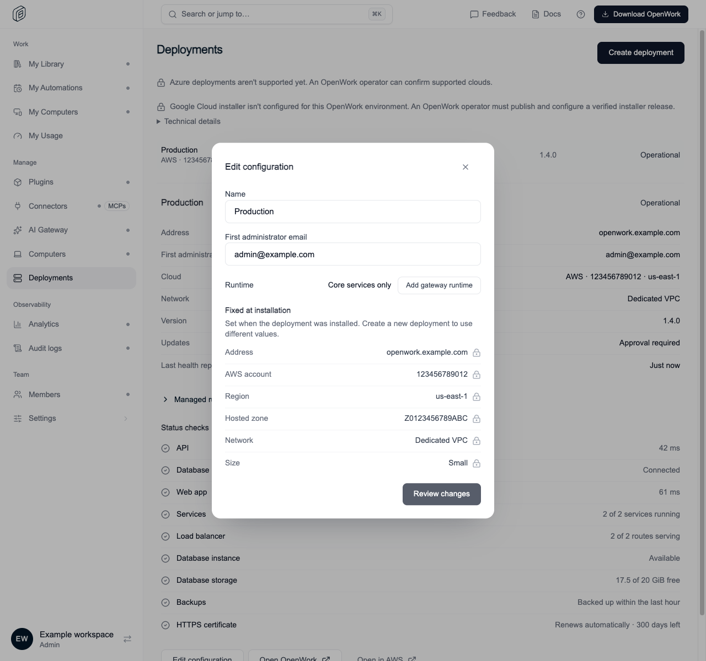
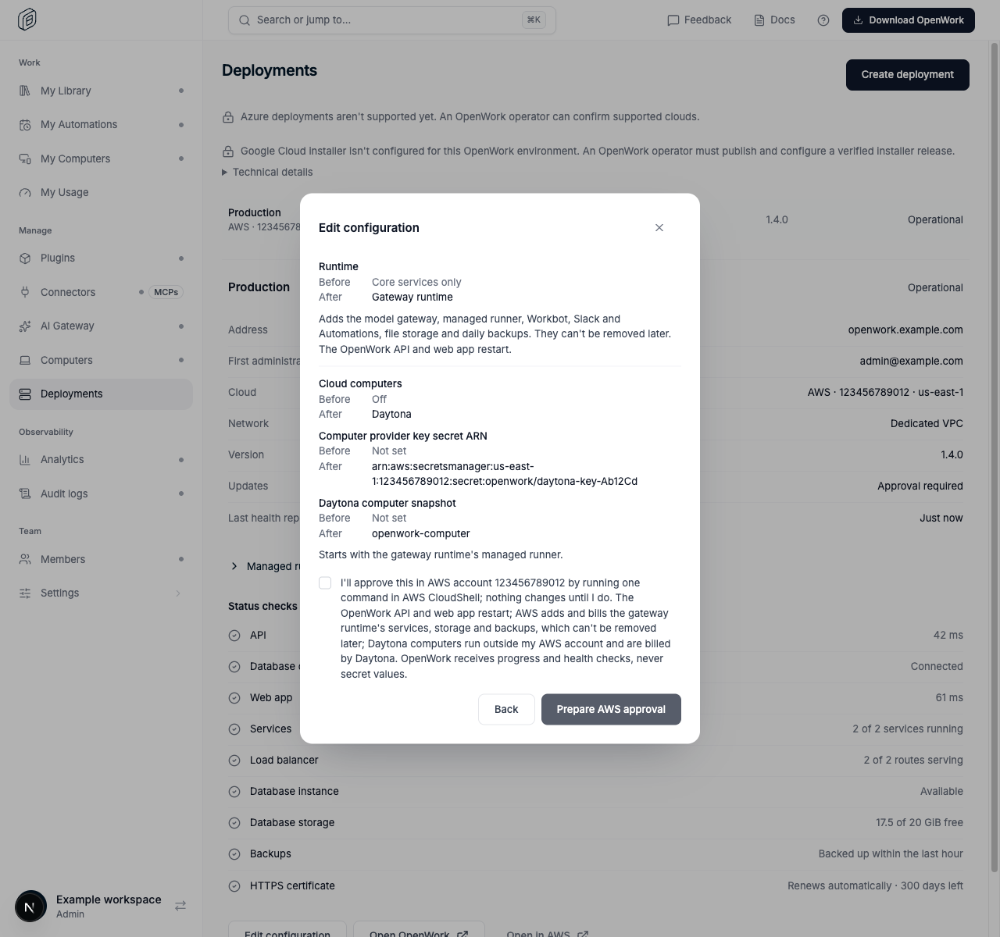
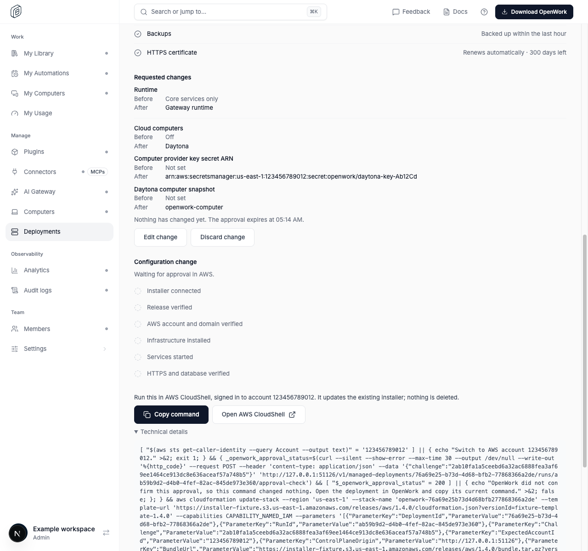

# Configuration changes for installed deployments

- Feature key: `managedDeploymentConfigUpdates`
- Label: Deployment configuration changes
- Deployment: cloud only, off by default
- Author: `benjaminshafii`
- Prerequisite: `managedDeployments`; `managedDeploymentAssistants` as well when
  the deployment has, or the change adds, the gateway runtime

An owner changes an installed AWS deployment's configuration without waiting
for a newer installer. Den prepares the change and returns one command for AWS
CloudShell. Nothing in the customer's account changes until they run it. The
command first asks Den whether the change is still the one to apply and stops
if it is not. Den records the new configuration only after that run has
verified health.

## What can change

| Field | What happens |
| --- | --- |
| Name | Saved at once. Nothing in AWS changes and there is no command. |
| First administrator email | Needs approval in AWS. |
| Runtime profile, legacy to gateway | Needs approval in AWS. Adds the model gateway, managed runner, Workbot, Slack and Automations, file storage and daily backups. Only from the currently published installer. |
| Cloud computers (provider, key secret ARN, snapshot, Daytona API URL and target) | Needs approval in AWS. The managed runner restarts. Only when the resulting profile is gateway. |

Every change that needs approval restarts the OpenWork API and web app,
whatever it changes: each installer run redeploys both services
(`tls_redeploy` in `infra/managed-deployments/aws/runner/runner.py`). The
review and the consent sentence say so for every such change, and add the
managed runner's restart for a change to cloud computers.

The first administrator email decides who can complete first sign-in at
`/setup`, and who becomes owner when the installation has no active owner. An
administrator who has already signed in stays the administrator, and no email
is sent.

## What is fixed at installation

The address, AWS account, region, hosted zone and network cannot change: each
would replace or orphan the customer's data or identity. The gateway runtime
cannot be turned off, because removing it would delete the runner's files,
secrets and backups. A legacy deployment's own runner settings and model fields
are not editable here; turning on the gateway replaces them. Google Cloud
deployments cannot be edited after installation.

A request for any of these is refused by name before anything is prepared. The
installer in the customer's account also refuses a plan that deletes or
replaces data-bearing resources, whatever Den sent.

## The change re-runs the installed installer

A change is one installer run of kind `configure`. It is pinned to the
deployment's latest run that verified health (the base run): the same version,
template URL, bundle URL and bundle checksum, with a new run ID and challenge
and the requested parameters. The installer in the customer's account never
compared versions; a new run ID is what starts it. Den requires all of the
following, and locks editing otherwise:

| Lock | When | What the owner does |
| --- | --- | --- |
| `not_installed` | The deployment has never verified health. | Remove it and create it again with other values. |
| `run_in_progress` | An install, retry or update awaits approval or is provisioning. Or a configuration change has been confirmed by its command or is being applied, however long ago (see "Once the command has asked, the change is held"). | Finish it first. |
| `installer_unknown` | No run verified health, or its version is not the installed version. | Update the deployment. |
| `unfinished_run` | An install, retry or update was prepared after the base run, approved or not. Its command may have replaced the installer stack or part of the infrastructure, so the recorded configuration is no longer provably what is installed. | Finish it with Retry or Update. |
| `installer_unavailable` | The base run's template URL or bundle URL is not an exact object version (`?versionId=`). Both must be, including when the base run is the published release: an unversioned address can be republished with other bytes. | Update the deployment once a release pinned to object versions is published. |
| `aws_only` | The deployment is not on AWS. | Nothing; not supported. |

Turning on the gateway runtime also requires the base run to be the currently
published release (`gateway_needs_current_installer` otherwise), because older
installer templates do not have the runtime's parameters. Update can turn it
on in the same step as the newer installer.

The run reports to the API's current public origin, like Retry and Update.

### Parameters an older installer template does not have

The command's parameters are built by today's code and sent to the template
the deployment installed. Den never reads that template, so it sends only what
the stored record shows the template was given:

- The runtime profile and runner parameters are sent only when the stored
  target has `runtimeProfile` or `assistants`.
- The five network parameters (`NetworkMode`, `VpcId`, `ServiceSubnetIds`,
  `LoadBalancerSubnetIds`, `EcsClusterArn`) are sent only when the stored
  target has `network`. Deployments created before network choice existed
  were stored without it and installed from a template with no network
  parameters. Every deployment created since is stored with `network`, and
  every template since has the five parameters with the dedicated network as
  their defaults, so leaving them out of a later template changes nothing.
  The network cannot be edited, so a change never adds the key.

Install, Retry and Update are unchanged: they run the published template and
send the network parameters as before.

What this does not prove: that every historical template accepts every other
parameter today's code sends, or that a template has no parameter today's code
leaves out (CloudFormation resets an omitted parameter to its default). If a
template lacks a parameter that is sent, CloudFormation refuses the whole
update before it changes anything, and the change stays confirmed and held
(see below). Only the published template is exercised by tests and installs.
Run a change against each older release still in use in an isolated account
before enabling the feature for a customer on it.

## Requested and applied are separate

- Preparing a change writes the request to the run (`configuration_change`):
  who asked, the base run, the recorded and the requested email and target,
  and the list of changes. The deployment's `owner_email` and `target` are not
  touched.
- The command carries the requested values. A target that did not change is
  sent exactly as stored, so a historical record keeps omitting the runtime
  parameters its installer template does not have.
- The installer enrolls and reports its six milestones as for any run.
  Enrollment gives a configuration change a new three-hour deadline, counted
  from enrollment, and returns that stored deadline to the installer. When
  the sixth milestone, `health_verified`, succeeds, the same transaction marks
  the run ready and copies the requested email and target onto the deployment.
  A failed milestone changes only the run.
- That transaction locks the deployment row and checks the run is still the
  active one, so a run replaced a moment earlier records nothing. This holds
  for install, retry and update runs as well.

After a failed change the deployment shows the failed run and its recorded
configuration is unchanged; AWS may be partly changed. The dashboard offers
"Review and try again" with the failed request. Retry on the launch route
still re-applies the recorded configuration at the published release.

## The command asks OpenWork before it changes AWS

A configuration change's command has three steps, each run only if the one
before it succeeded:

1. It checks the AWS account, as Retry and Update do.
2. It sends the run's challenge to
   `POST /v1/managed-deployments/:deploymentId/runs/:runId/approval-check`
   with `curl` and continues only on HTTP 200 from that address. A refusal, a
   redirect (not followed), a timeout, an unreachable API or a missing `curl`
   all stop it with "OpenWork did not confirm this approval, so this command
   changed nothing."
3. It runs `aws cloudformation update-stack`.

The check answers 200 only when the run is the deployment's active
configuration change, still awaits approval, has not passed its deadline, and
`managedDeployments` and `managedDeploymentConfigUpdates` (and
`managedDeploymentAssistants` for a change that involves the gateway runtime)
are on for the organization and the person who asked. A command that was
replaced, discarded, expired or turned off therefore stops before step 3.

Retry and Update commands are unchanged and make no such call.

### Once the command has asked, the change is held

The first 200 claims the change. Den writes the time into the run's
`last_seen_at` under the deployment and run locks, the same locks every
request that replaces or discards a change takes. From then on:

- The change cannot be edited, replaced or discarded, and Retry and Update
  are refused (`run_in_progress`, `deployment_run_in_progress`). The view
  shows it as `applying` with `run.state` still `awaiting_approval` and
  `run.lastSeenAt` set.
- It has three hours from the claim to enroll. Asking again inside that time
  answers 200 and changes nothing: the deadline does not move, so the same
  command can be run again after a failed `update-stack`.
- The same request sent to the API again reads the same run and command back
  while the deadline lasts. It writes nothing; a request with a different
  name or values is refused.
- Turning the feature off afterwards does not withdraw it. Its stack may
  already be updated, so its installer enrolls and finishes like a change
  that was already applying. The check itself answers 409 once the feature is
  off.

So a check and a request to replace or discard the same change never both
succeed: whichever takes the deployment lock first decides, and the other is
refused. A command that Den has replaced or discarded cannot reach
`update-stack` through this flow.

What the check is not:

- It is an authorization, not a cloud identity. Whoever holds the command
  holds the challenge and can claim the change from anywhere, without an AWS
  session. The installer's enrollment is still the only step that proves the
  AWS role, and nothing is recorded as applied without it.
- It does not make the stack update and Den's record one atomic step. After
  a 200, the feature can be turned off or the person who asked can lose
  access before `update-stack` runs; the change still proceeds.
- It does not bind someone who edits the command. Running the
  `aws cloudformation update-stack` part alone skips the check. That updates
  the installer stack's parameters and starts the installer, which stops at
  enrollment unless the run is still the active one.

### A held change has no automatic release

A passed deadline says nothing about what AWS did, so it releases nothing. A
change stays held, and the deployment accepts no other change, Retry or
Update, until its installer reports the sixth milestone or a failure. This
applies to a change that was claimed and never enrolled, and to one whose
installer enrolled and stopped reporting. The view keeps showing `applying`
with `run.expired` true.

That includes a command that was claimed and then abandoned: a closed
CloudShell, an `update-stack` that CloudFormation refused, or someone who
called the check and did nothing else. After three hours the check answers
409 and the installer can no longer enroll. An installer that enrolled and
then went quiet past its deadline has its token refused, so it cannot report
a late failure either. Den has no way to tell "the stack was never updated"
from "the stack was updated and the installer could not reach Den", and
unlocking on a guess could start a second installer run beside one that is
still working. One abandoned command can therefore block a deployment's
changes, Retry and Update indefinitely.

There is no product action that clears this state. An OpenWork operator has
to confirm in the customer's AWS account what the installer stack and its
last build did, then mark the run failed in the database. Until an explicit,
audited action for that exists, treat it as an operator procedure and tell
customers to run the command to the end once they start it.

## One change at a time

- The view's `configuration.revision` covers the name, email, target, active
  run and installed version. A request carries the revision it was read at; a
  different one answers `configuration_changed`.
- Asking again for the change that is awaiting approval returns the same run
  and command, whatever revision is sent, so a lost response can be resent.
  Only that read is exempt from the revision. A request that also carries a
  different name is a write and needs the current revision, so someone with
  an older view cannot undo a teammate's rename by reopening the approval.
- A different request replaces a change whose command has not asked OpenWork
  yet. The replaced run cannot be confirmed and cannot enroll.
- Asking for the recorded configuration while a change awaits approval, or
  after its approval expired unclaimed, withdraws it: the run is marked
  failed and the deployment shows the run it showed before. This is how a
  wrong handoff is discarded instead of blocking Update for three hours.
- A change that was claimed or is being applied cannot be replaced or
  withdrawn, at any age.

## Kill switch

| State when the feature goes off | What happens |
| --- | --- |
| No change in flight | The route answers 404 and views lose the `configuration` block. The dashboard is the screen without this feature. |
| Change prepared, command not run | The route answers 404, so the command cannot be reopened. If it is run, the approval check answers 409 and the command stops before `update-stack`. If someone runs only the `update-stack` part, the installer's enrollment is refused after its AWS identity is verified, the change is withdrawn, and the deployment shows its previous state; the installer stack's parameters were changed by that hand-run command and the next real run sets them again. |
| Change claimed by its command, installer not enrolled yet | It is not withdrawn: the stack may already be updated. The installer enrolls and the change finishes. If it never enrolls, the change stays held (see "A held change has no automatic release"). |
| Change provisioning | It finishes. At `health_verified` the configuration is recorded: the customer approved it and their infrastructure changed. |
| Change failed after reaching AWS | The failed run stays visible. Retry re-applies the recorded configuration at the published release. A half-added gateway runtime is completed by turning the feature back on, or by an Update that selects the gateway profile. |
| Change applied | It stays. |

The approval check, and enrollment of a change that was never claimed, check
the feature for the organization and the person who asked for the change.
Turning `managedDeploymentAssistants` off blocks requests on a
gateway deployment and requests that add the gateway, including reopening one.
Turning `managedDeployments` off blocks the route; installer enrollment,
milestones and health reports keep working.

## API

`POST /v1/managed-deployments/:deploymentId/configuration-changes`, permission
`deployments.manage`. Not available to agents through MCP.

```json
{
  "expectedRevision": "<configuration.revision from the deployment view>",
  "configuration": { "provider": "aws", "name": "…", "domainName": "…", "ownerEmail": "…", "target": { "…": "…" } }
}
```

`configuration` is the complete document a create takes, so a fixed field that
differs is refused by name. An omitted `runtimeProfile` keeps the recorded one.
`planDeploymentConfigurationChange` in `@openwork/managed-deployments/configuration`
decides what is accepted and what each change does; the dashboard calls the
same function before sending.

Results (`outcome`):

- `saved`: only the name changed.
- `withdrawn`: the pending change was discarded.
- `approval_required`: `command` and `handoff` for AWS CloudShell, `expiresAt`
  (three hours) and `changes`. The shape is also a valid launch result. The
  stack update is the last step of `command` and its `--parameters` value is
  literal JSON.

Refusals are `{ error, message, field? }`; `message` is the sentence shown to
the person.

| Status | `error` |
| --- | --- |
| 400 | `field_not_editable`, `gateway_cannot_be_removed`, `computers_need_gateway`, `legacy_runtime_not_editable`, `invalid_configuration` (each with `field`), `configuration_aws_only`, `no_changes` |
| 403 | the permission refusal |
| 404 | `deployment_not_found` (also another organization's deployment), `feature_disabled` with `feature` |
| 409 | `not_installed`, `run_in_progress`, `unfinished_run`, `installer_unknown`, `installer_unavailable`, `gateway_needs_current_installer`, `configuration_changed` |
| 503 | `release_not_configured` |

With the feature on for the caller, each deployment in list, create and launch
responses carries `configuration`: `revision`, `lock` (null when editable),
`gatewayAvailable`, and `change` for a change that is awaiting approval,
applying, failed or expired. With it off the responses are unchanged and no
additional query runs.

`change.state` keeps its four values:

| `change.state` | Run | Meaning |
| --- | --- | --- |
| `awaiting_approval` | awaiting approval, `lastSeenAt` null, not expired | The command has not asked OpenWork. Can be edited or discarded. |
| `expired` | awaiting approval, `lastSeenAt` null, expired | The command was never run and can no longer be. Can be discarded or prepared again. |
| `applying` | awaiting approval with `lastSeenAt` set, or provisioning; `expired` true or false | Claimed by its command or enrolled, with no final report. Held. |
| `failed` | failed | The installer reported a failure. Can be reviewed and tried again. |

### The approval check

`POST /v1/managed-deployments/:deploymentId/runs/:runId/approval-check`, no
session, body `{ "challenge": "<the run's challenge>" }`. Called by the
command, not by people or agents; not available through MCP. Every answer
carries `Cache-Control: no-store`. It never enrolls an installer and issues no
token.

| Status | Body | When |
| --- | --- | --- |
| 200 | `{ "ok": true, "expiresAt": "…" }` | The change is current. The first 200 claims it and sets `expiresAt` three hours ahead; later ones return the same `expiresAt`. |
| 404 | `deployment_not_found` | Unknown deployment or run, a run that is not a configuration change, or a wrong challenge. |
| 409 | `approval_not_current` | Replaced, discarded, already enrolled, past its deadline, or the feature is off. Nothing is written. |
| 429 | `rate_limited` | More than ten checks a minute for one run. |

## Audit

The route is a tenant change. Evidence is appended in the request's
transaction when a change is requested
(`managed_deployment.configuration_change_requested`, with the run ID,
installer version and the run it replaced), when the deployment is renamed
(`managed_deployment.renamed`), and when a change is withdrawn
(`managed_deployment.configuration_change_withdrawn`). Secret ARNs are
references, never secret values. Application is recorded on the run: its
request, its `ready` state and its timestamped milestones.

The approval check is declared as a tenant signal
(`managed_deployment.run.approval_check`), attributed to the deployment's
organization once the challenge matches. The claim itself is the run's
`last_seen_at`.

## Rollback is roll-forward only

Migration `0203` adds `configure` to the run kind and the `configuration_change`
column. That it only adds does not make an older API or dashboard safe to run
against the data this feature writes:

- A completed change leaves a `configure` run as the deployment's active run
  for good, and a view of that deployment carries `run.kind: "configure"`. A
  build that does not know the kind fails to produce or parse that view.
- Audit events of three new kinds stay in the organization's audit log.
- A run that is awaiting approval, claimed or applying needs the rules above.
  A build without them would let Retry or Update replace it.

Turning the feature off does not remove any of this, and neither does waiting
for every change to finish: the completed runs and audit events stay. So
neither is a way back to an older build.

The supported floor is this release. Deploy it everywhere with
`managedDeploymentConfigUpdates` off before the feature is turned on for
anyone. From the first prepared change on, deploy only builds that read these
rows; to undo a bad release, turn the feature off and ship a fix forward. No
compatibility with builds older than this release is claimed or tested.

## Dashboard

**Manage › Deployments**, on an installed AWS deployment. With the feature off
the screen is unchanged and has no edit control.

**Edit configuration** opens with the current values. The values chosen at
installation are listed as locked rows, with the reason:



**Review changes** lists each value before and after and what the change does
to the running installation. **Prepare AWS approval** is locked until the
owner ticks the consent sentence:



The deployment then reads **Awaiting AWS approval**. **Requested changes**
shows the request, the six installer steps are all pending, and the command
is on the page (**Copy command**; its text is under **Technical details**).
The deployment still records the old configuration:



States of a requested change, and what the page offers in each:

| State | Status | Actions |
| --- | --- | --- |
| Awaiting approval | Awaiting AWS approval | **Show approval command** (when the command is not on the page, for example after a reload), **Edit change**, **Discard change** |
| Applying | Applying configuration change | none; the six steps fill in |
| Failed | Configuration change failed | **Review and try again**, prefilled with the failed request. The failure sentence names that action, not Retry. |
| Approval expired | the deployment's health | **Prepare again**, **Discard change**. No step list: nothing started. |

The command on the page belongs to one run. It is shown only while that run
is the deployment's active run and still awaits approval, so a change that
someone else replaced or withdrew, or that expired, never leaves its command
next to another change's summary (`currentHandoff`).

Someone who can view deployments but not manage them sees **Edit
configuration**, and the actions of a requested change, locked with the
permission they need and who can grant it.

## Try it

No AWS account is needed to see the whole flow:

```bash
pnpm evals:e2e managed-deployment-configuration --local
```

`evals/proofs/managed-deployment-configuration.proof.test.ts` installs a
deployment against a local Den, turns the feature on, adds the gateway
runtime and Daytona computers through the dashboard, and plays the customer's
AWS account over HTTP: it reads the run and challenge from the command the
page shows, enrolls and reports the six milestones. Den's one call to AWS,
the replay of a signed request to STS, is answered inside the Den API process
by `evals/packages/labs/src/managed-deployment-aws-identity-preload.mjs`,
which refuses every other request to an amazonaws.com host. The screenshots
above are from that run.

On a real installation:

1. In `/admin`, turn on `managedDeployments` and `managedDeploymentConfigUpdates`
   for an internal organization (and `managedDeploymentAssistants` to add the
   gateway runtime), then reload **Manage › Deployments**.
2. As the owner, select an installed AWS deployment. **Edit configuration**
   is in the row of buttons under its status checks. An admin who is not the
   owner sees it locked.
3. Change the first administrator email, click **Review changes**, tick the
   consent sentence and click **Prepare AWS approval**. The deployment reads
   **Awaiting AWS approval** and still shows the old email under **First
   administrator**; **Requested changes** shows the new one.
4. Click **Copy command** and run it in AWS CloudShell in the deployment's
   account. The status becomes **Applying configuration change** and the six
   steps fill in as they happen; after the last one the status returns to the
   deployment's health and **First administrator** shows the new email.

API behaviour is covered by
`ee/apps/den-api/test/api/managed-deployment-configuration.api.test.ts`, which
runs against a local database and never contacts AWS. It also runs the
command in a shell with stand-in `aws` and `curl` programs, to show that a
replaced, discarded, expired, redirected or switched-off approval never
reaches `update-stack`.

## Not yet proven

- The approval command has been run by a shell against stand-in `aws` and
  `curl` programs and a local Den, not in AWS CloudShell against a real stack.
- No configuration change has been run against a historical installer
  release in AWS (see "Parameters an older installer template does not
  have").
- A held change that never reports has only the operator procedure above.

Adding the gateway runtime at the installed version has not been run against a
live AWS account. The template and module read as additive, but the added IAM
policy, the certificate expansion and the service rollouts have only been
exercised through a version-increasing Update. Run it in an isolated account
before enabling the feature for a customer who will add the gateway this way.
