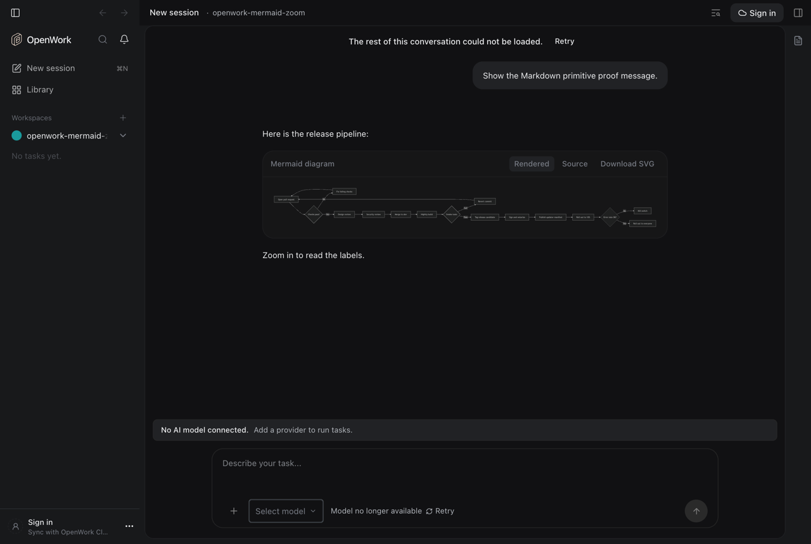
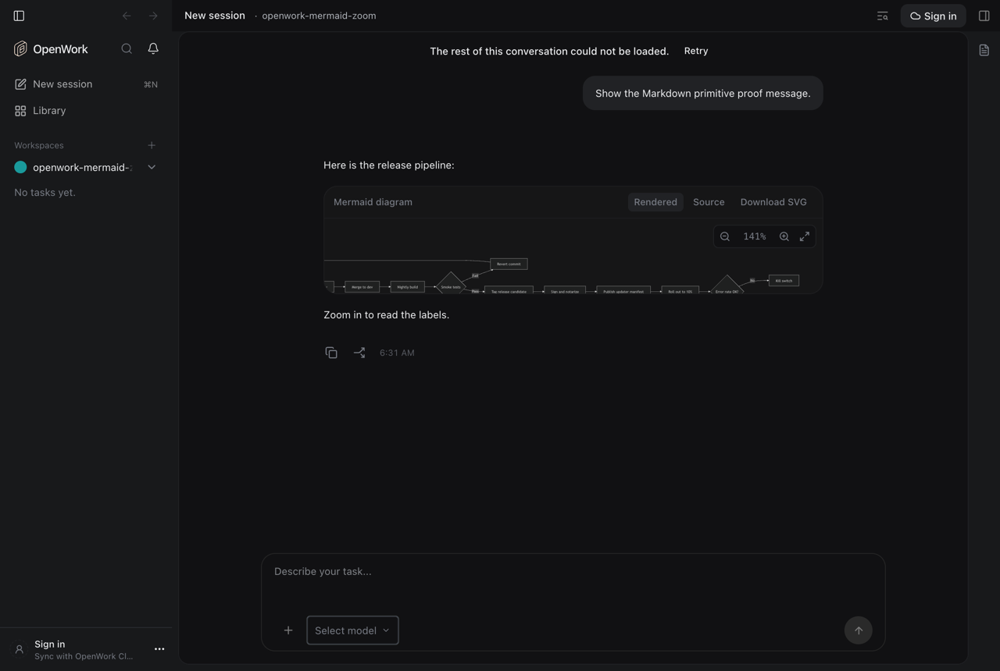
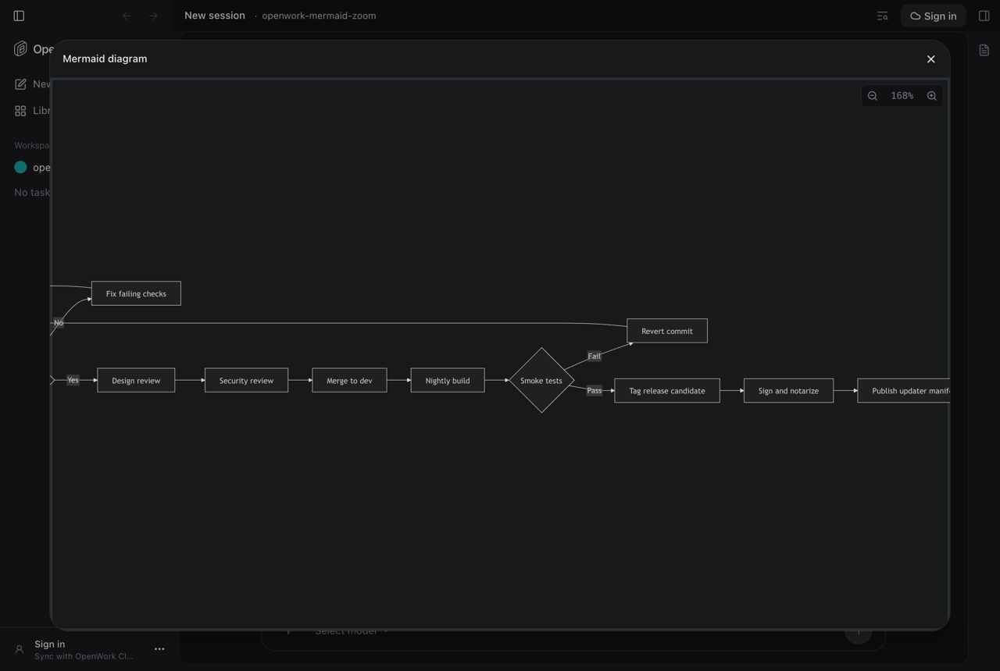

# Zoom into diagrams (`mermaidZoom`)

> **GA:** Available without a feature flag. The former rollout key is retired.
> Off/on screenshots below are historical comparisons, not current deployment options.

- **Retired rollout key:** `mermaidZoom`
- **Deployments:** cloud and self-hosted (`everywhere`), generally available (no flag)
- **Author:** @benjaminshafii

## What people get

Mermaid diagrams in chat messages and in Markdown or `.mmd` file previews can be
zoomed and panned, so wide or dense diagrams are readable.

- Hovering a rendered diagram (or focusing it) shows a small toolbar: zoom out,
  the current zoom (click to reset), zoom in, and open full screen. It stays
  visible while the diagram is zoomed, and always on touch screens.
- Cmd/Ctrl+scroll and trackpad pinch zoom around the pointer. Plain scrolling
  still scrolls the conversation.
- Once zoomed, drag to pan. Double-click zooms in (Shift+double-click zooms out).
- Keyboard, with the diagram focused: `+` / `-` zoom, `0` resets, arrow keys pan.
- Full screen opens the diagram in a dialog fitted to the window. There plain
  scrolling pans too. `Esc` closes it and returns focus to the diagram.

The Rendered / Source / Download SVG controls are unchanged.

| Historical before GA | Default, zoomed and panned inline | Default, full screen |
| --- | --- | --- |
|  |  |  |

## How it works

`useMermaidEnhancer` (`apps/app/src/components/markdown/mermaid.ts`) still
renders and sanitizes every diagram. It puts the sanitized
SVG in a React-owned slot (`data-openwork-mermaid-interactive`) and
`MermaidZoomPortals` mounts `MermaidZoomViewport` there. The zoom math lives in
`mermaid-zoom.ts` and is covered by `apps/app/tests/mermaid-zoom.test.ts`.
Interactive rendering is always enabled; no feature provider is required.

## Availability

Generally available. The rollout flag is retired; organization/member overrides,
operator locks and old kill-switch rows no longer disable this behavior.
Authorization, provider setup, consent and runtime compatibility still apply.

## Try it

Run `pnpm world up dev-app-web --detach -- --browser`. Ask for a large
flowchart, or open an `.mmd` file.
