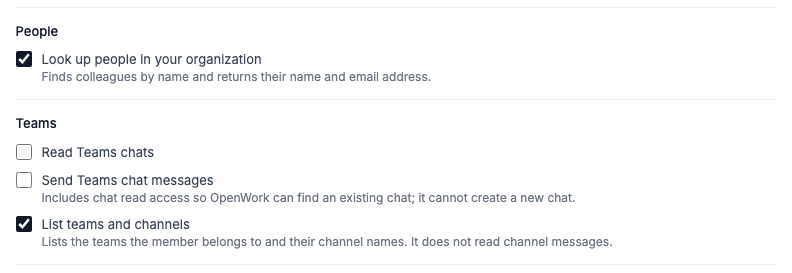
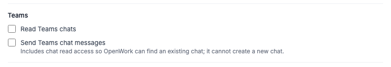

# Microsoft 365 read resources

`microsoft365ReadResources` is off by default in cloud and self-hosted deployments. Owner: `benjaminshafii`.

| Tool | Returns |
| --- | --- |
| `listMicrosoft365MailFolders` | Top-level, non-hidden Outlook folders and their item and child counts. |
| `listMicrosoft365MailFolderChildren` | A folder's immediate child folders and their counts. |
| `listMicrosoft365MailFolderMessages` | Message summaries, sender, preview, read and attachment status, and links. Supports unread-only reads. |
| `getMicrosoft365Profile` | The connected member's name, sign-in and mail addresses, job title, and office location, when available. Uses the existing `User.Read` scope. |
| `searchMicrosoft365People` | Basic directory profiles matching a name: names, mail and sign-in addresses, and IDs. |
| `listMicrosoft365JoinedTeams` | The teams the member belongs to, with names, descriptions, and IDs. |
| `listMicrosoft365TeamChannels` | A team's channels, with names, descriptions, membership types, and links. Does not read channel messages. |

The folder tools use the existing Outlook mail read permission. The new opt-in permissions are `directoryRead` (`User.ReadBasic.All`) and `teamsChannelList` (`Team.ReadBasic.All` and `Channel.ReadBasic.All`).

With the feature on, the connector offers the two permissions:

With the feature off, they are not offered unless already selected:

To try it, enable the feature for a test organization in `/admin`. In the Microsoft 365 connector's **What your AI can do** settings, select the permissions you want to try, then connect or reconnect the test member to grant them. Ask the agent to list Outlook folders, find a colleague by name, or list teams and the channels of one of those teams. For a list, use its `nextPageToken` to continue if one is returned.

When the feature is off, the new routes return `404 feature_disabled`, MCP hides the tools, and the checkboxes are hidden unless already selected. A connector with an already-selected permission keeps requesting its scopes until an admin clears it. These reads don't store Microsoft 365 content; the existing audit trail records the action, not the payload.

Watch for `409 needs_connection` when a permission is off or a member needs to connect again, and `502 microsoft_graph_error` for upstream failures.

## Add a resource

Add one row to `microsoft-graph-resources.ts` and a test. The registry supplies the route, schema, request, response mapping, audit declaration, and discovery gate. If a resource needs a new Microsoft scope, add an opt-in connector permission for it.

## Unverified against a live tenant

No real Microsoft 365 tenant was exercised. Still to verify: people search results and paging, `InefficientFilter` behavior of the unread filter, joined-teams and channel paging, and consent for the three new scopes.
