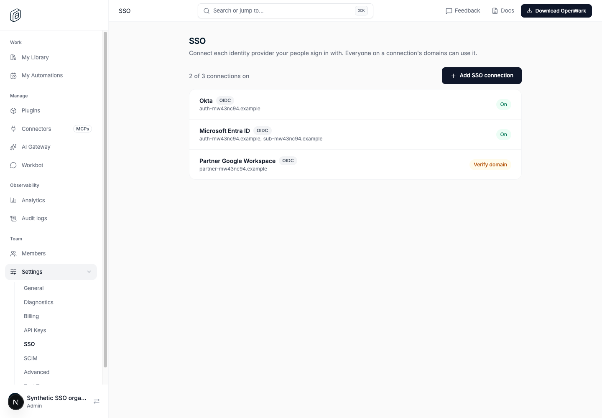
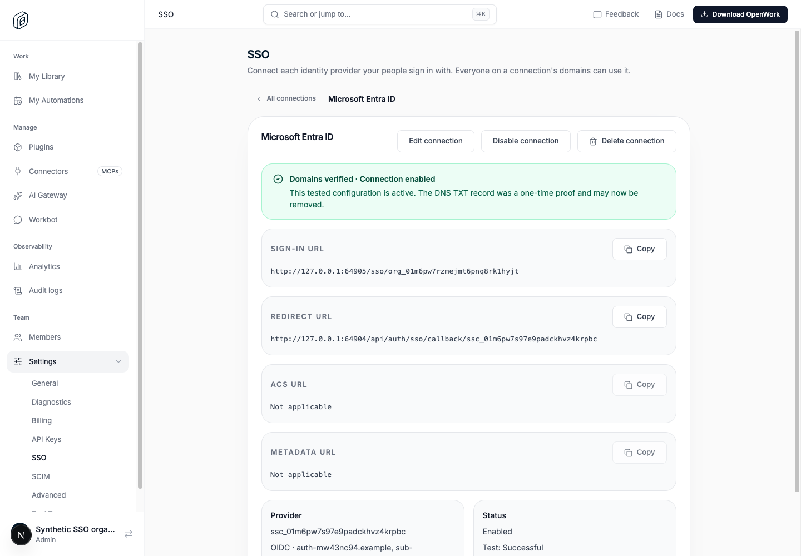
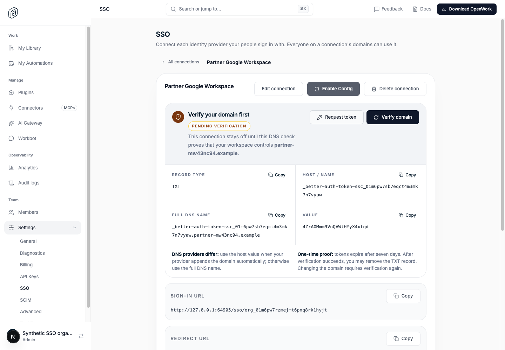
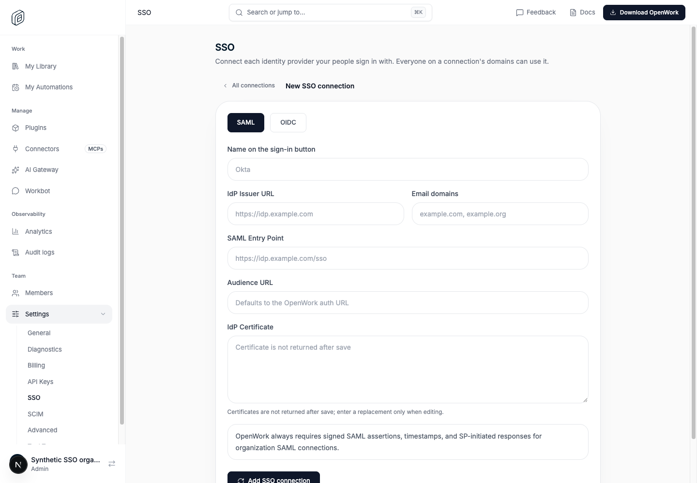
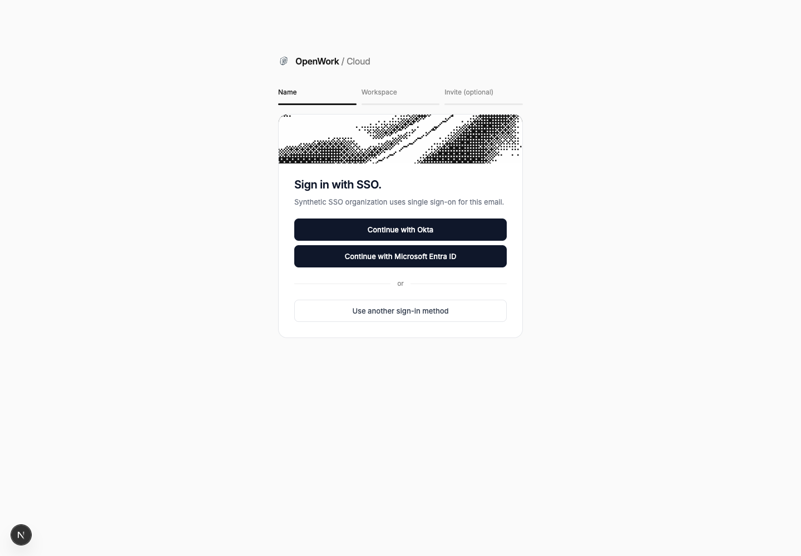
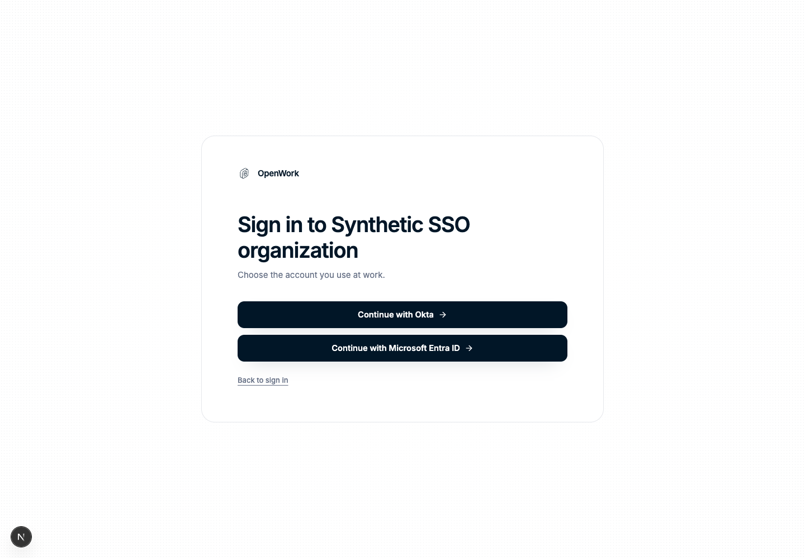

# SSO: several connections per organization

- Feature: `multipleSsoConnections`
- Deployments: cloud and self-hosted; default **off**
- Owner: `OmarMcAdam`
- Read on the organization that owns the connections.

## What changes

Off: an organization has one SSO connection with one email domain. The SSO page
edits that connection.

On:

- **Several connections.** The SSO page lists every connection with its state
  (On, Verify domain, Not tested, Test failed, Ready to enable) and one row per
  connection. **Add SSO connection** adds another; opening a row manages that
  connection alone: edit, verify its domains, test, enable, disable, delete.
  The other connections keep signing people in meanwhile.
- **Several domains per connection.** A connection lists one or more email
  domains (`example.com, example.org`). One DNS TXT value verifies them all;
  it is published at each domain's record name, and every domain must have it.
- **Several identity providers per domain.** Two connections may cover the same
  domain (for example Okta for employees and Microsoft Entra ID after an
  acquisition). A connection whose domains another connection of the
  organization already verified needs no new DNS record.
- **A name per connection** ("Okta"), shown on sign-in buttons. Without one,
  Den names it after its identity provider (Okta, Microsoft Entra ID, Google
  Workspace, ...) or its issuer's host. Renaming never disables a connection.
- **Sign-in shows one button per identity provider** for the email:
  `GET /v1/auth/login-options` returns `ssoProviders` (enabled connections on a
  verified domain that cover the email's domain, oldest first), and Den Web
  shows "Continue with Okta", "Continue with Microsoft Entra ID". The
  organization's SSO link (`/sso/<slug>`) does the same from
  `GET /v1/auth/sso-options`. With one provider both go straight to it, as
  before.
- **Any of the organization's providers counts** for "Require SSO" and "Ask for
  SSO again": SSO proof is recorded per organization, whichever connection
  signed the person in.

## API

New, behind the flag (404 `feature_disabled` when off):

| Route | Does |
|---|---|
| `GET /v1/sso/connections` | Every connection, oldest first |
| `POST /v1/sso/connections/saml` · `/oidc` | Add a connection (`name`, `domains`) |
| `GET` · `PATCH` (`{ name }`) · `DELETE /v1/sso/connections/:id` | Read, rename, delete one |
| `POST /v1/sso/connections/:id/saml` · `/oidc` | Replace one's configuration |
| `POST /v1/sso/connections/:id/test` · `/enable` · `/disable` | Lifecycle of one |
| `POST /v1/sso/connections/:id/request-domain-verification` · `/verify-domain`, `GET .../metadata` | Domain proof, SAML SP metadata |

Public: `GET /v1/auth/sso-options?organizationSlug=` (rate limited per IP).

Unchanged: `/v1/sso/*` keeps managing the organization's **oldest**
connection, so older clients keep working. Test start and cancel stay keyed by
the test's own id (`/v1/sso/test/:intentId/*`).

## How it is built

- `sso_connection.organization_id` is no longer unique (migration
  `0183_multiple_sso_connections`, which also adds `name`). The new
  organization index is created before the unique one is dropped.
- The first connection keeps the provider id `openwork-sso-<organizationId>`.
  A connection added next to others uses its own id (`ssc_...`) as its Better
  Auth provider id: the organization-derived id plus a suffix would exceed the
  63-character DNS label Better Auth uses for verification records.
- Domains are stored lower case, comma separated, on `sso_connection.domain` and
  the provider's `domain` (Better Auth's multi-domain format, which its sign-in,
  email checks and DNS verification already read). Den matches them with
  `FIND_IN_SET` as exact domains, as before.
- A Better Auth `/sign-in/sso` that names only an organization, a domain or an
  email gets the provider Den chose added (`providerId`): the oldest ready
  connection, preferring one that covers the email's domain. Better Auth alone
  would pick any connection of the organization, including a disabled one.
- Audit: adding, replacing, enabling, disabling and deleting a connection emit
  the existing `sso_connection.*` events per connection; renaming emits
  `sso_connection.renamed`. Connection snapshots now include `name`.

## How to try it

1. Platform admin › Organizations › the organization › Features: turn on
   **SSO: several connections per organization**.
2. Settings › SSO: **Add SSO connection** twice, for two identity providers on
   the same domain. Verify, test and enable each.
3. Sign out and enter an email on the domain: one button per identity
   provider. Open `/sso/<organization slug>`: the same choice.

## Turning it off

The kill switch or the organization override hides the connection list and the
connection routes on the next request. Nothing is deleted:

- Every enabled connection **keeps signing people in**: sign-in, login options
  and `/sso/<slug>` read what is configured, not the flag, so nobody is locked
  out.
- The SSO page goes back to the single-connection screen, which manages the
  oldest connection. The others can only be managed again with the flag on
  (or deleted by an operator).
- Names and multi-domain values stay stored and keep working.

## What to watch

- 404 `feature_disabled` on `/v1/sso/connections*` for organizations that
  should have the flag.
- `/v1/auth/sso-options` 429s (limit 120 a minute per client address): the SSO
  link then falls back to the organization's oldest ready connection.
- Support reports of a sign-in going to the wrong identity provider: check
  which connections cover the email's domain (`sso_connection.domain`) and which
  are enabled and verified.
