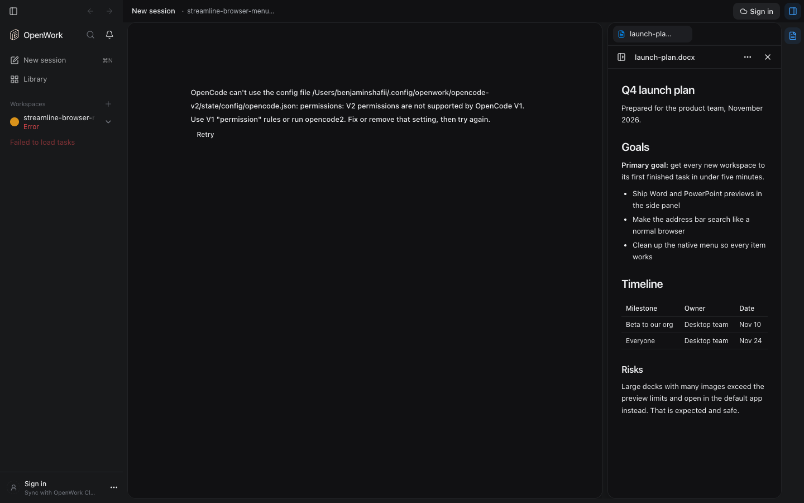
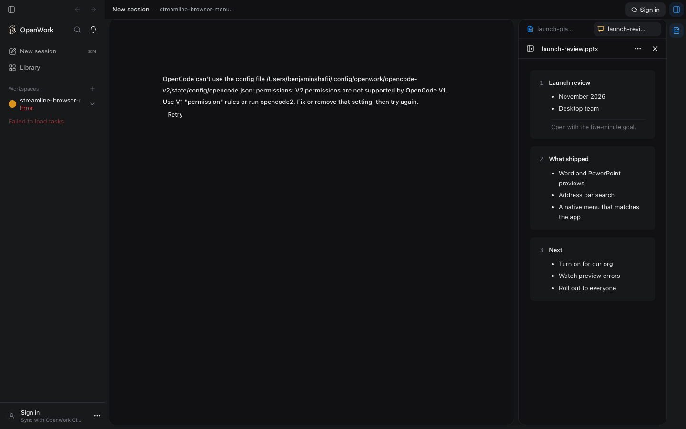
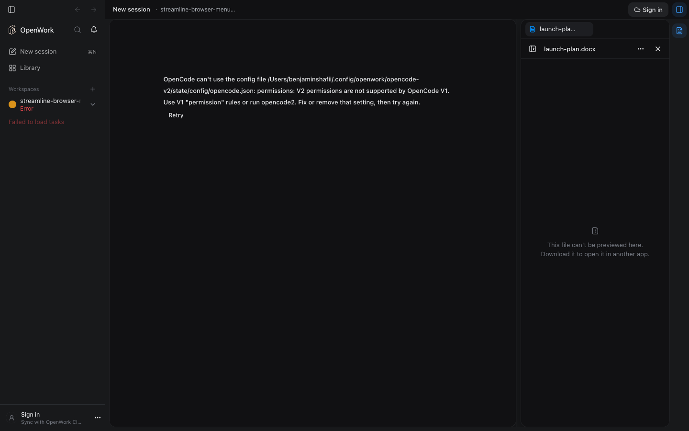

# Word and PowerPoint previews

Feature key: `officeDocumentPreview` · deployments: cloud and self-hosted · default off · author: @benjaminshafii

## What people get

Opening a `.docx` or `.pptx` file in the desktop side panel (from a file link in
chat or the workspace file list) shows what the file says instead of
"Preview unavailable":

- **Word**: a reading column with the title and headings, bold, italic and
  underlined text, bulleted lists and tables, in document order.
- **PowerPoint**: one block per slide, in presentation order, with the slide
  title, its text and its speaker notes.

Layout, images, charts and fonts are not reproduced. **Open in default app**
(local workspaces) and **Download** remain for the full rendering.

| On, Word | On, PowerPoint | Off |
| --- | --- | --- |
|  |  |  |

## How it works

`apps/app/src/react-app/domains/session/artifacts/office-preview.ts` reads the
package in the renderer with the bounded ZIP and XML readers from
`@openwork/workbook` (12 MB compressed, 10 MB inflated, 128 parts, no DTDs). It
stops after 200,000 characters and says "Showing the beginning of this file."
A file over 12 MB is not downloaded; a damaged or unusual file shows
"This file can't be previewed here." with Open in default app. Nothing is sent
anywhere and the file is never modified.

## Turning it off

Off, `.docx` and `.pptx` files show "This file can't be previewed here." with
Open in default app or Download, and the panel no longer downloads them just to
say so. No data is stored, so turning it off or on takes effect the next time a
file is opened.

## Try it

Turn the feature on for your organization in `/admin`, ask the agent to write a
Word or PowerPoint file, then click it in the reply. In a dev build,
`window.__openworkControl.execute("eval.artifact_tabs.open_file", { path })`
opens any workspace file in the panel.

## What to watch

Reports of files that open with missing text (tracked changes, text boxes and
SmartArt are not read) or that show "can't be previewed" while they open fine in
Office (packages with more than 128 parts, such as image-heavy decks).
