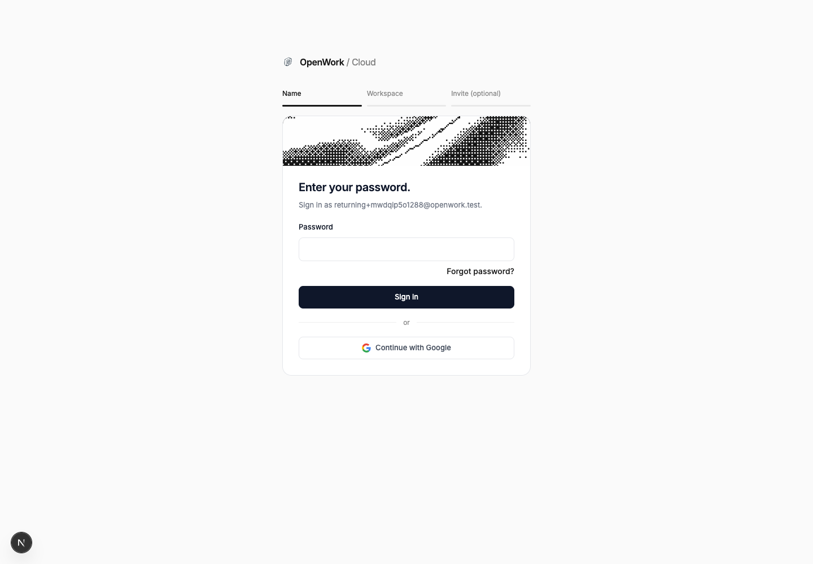
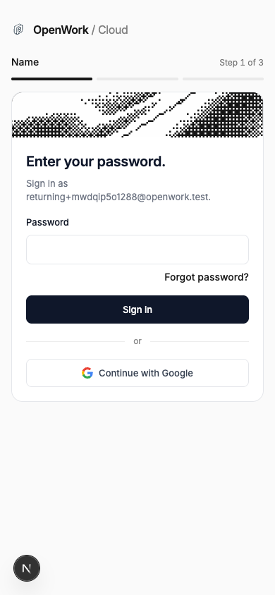

# Google on the password sign-in step

> **Generally available:** `passwordSignInGoogle` is retired; its enabled behavior is standard on Cloud and self-hosted. Actual settings, permissions, billing rules and consent remain enforced. Rollout/off-state instructions below are historical; see [the retirement guide](../globally-enabled-retirement/README.md).

- Feature: `passwordSignInGoogle`
- Deployments: cloud and self-hosted; off by default
- Owner: @benjaminshafii

## What changes

After entering an email that resolves to the password step, a person can choose
**Continue with Google** below the unchanged password form and reset link.
The button uses the existing Google sign-in and account-linking policy. It passes
the entered email as Google's `loginHint`; this is a convenience, not an email
restriction. Picking a different Google identity can still open or create a
different account, just like the existing Google entry points.

The API offers the button only when Google client ID and secret are configured
and the deployment rollout is enabled. The client also respects `hideSocialAuth`
and the allowed social providers. SSO responses, invitation screens that hide
social auth, remembered sign-in, and existing Google/GitHub steps are unchanged.
No account, session, password, or SSO policy changes are part of this feature.

Verified-email password accounts can link Google through the existing policy.
Unverified accounts must verify their email or reset their password first;
this feature does not weaken that check or merge different users.

## Rollout and rollback

This is a **deployment-wide, pre-authentication** feature. There is no active
organization at sign-in: organization/member overrides do not control this UI.
Use a staging deployment first, then the deployment-wide rollout in `/admin`.
Self-hosted operators may use the generated `passwordSignInGoogle` Helm option.

Turning it off or using the kill switch restores the old password-only step on
the next email lookup. An already open step may keep its button until refreshed.
In-flight Google sign-ins continue normally; already linked Google accounts
remain linked, and all existing sign-in methods keep working.

## Verify

- `evals/proofs/password-sign-in-google.proof.test.ts`: flag off/on/off in a fresh
  browser, unchanged password sign-in, and the new button at desktop/mobile size.
  Clicking the new button proves that the browser sends `provider: google` and
  the expected `loginHint` through the real sign-in request. It does not prove
  a live Google callback (the Google client used in this proof is synthetic).
- `ee/apps/den-api/test/api/password-sign-in-google.api.test.ts`: public API
  rollout/configuration/routing boundaries.
- `ee/apps/den-api/test/account-linking-policy.test.ts`: verified accounts link;
  unverified accounts are rejected; SSO boundaries remain enforced.

Watch Google OAuth failures, account-linking refusals and support reports of
wrong-account selection. The hint is not a claim that account mismatch is solved.

## Verification record (12 Nov 2026)

Node 24.22.1, disposable local MySQL, real Den API/web and headless Chrome.
No production settings or customer data were changed.

- New login-options API tests: **8 passed**, no skips.
- Existing account-linking policy tests: **11 passed**, no skips.
- Existing per-organization SSO API tests: **7 passed**, no skips.
- Feature registry tests: **12 passed**, no skips.
- Den API and Den web typechecks: **passed**.
- Changed frontend files' ESLint, feature sync check, Node source-import check
  and `git diff --check`: **passed**.
- Browser proof: **1 passed**, no skips; desktop/mobile rendering, real outgoing
  Google request with email hint, real password sign-in, and kill-switch rollback.
- Negative UI control: temporarily substituted the base `17c82f531d` auth panel
  while retaining the feature API/scaffolding. The same proof **failed** at
  “Continue with Google” (only Forgot password and Sign in existed), then the
  feature panel was restored. This isolates the UI change; it is not a claim
  that the full unmodified base tree knows the new flag.

Broader eval checks are **not green**: spec lint reports the existing timer in
`gateway-claude-desktop.proof.test.ts:66`; eval typecheck reports an unsupported
`timeoutMs` click option in `local-models-policy.proof.test.ts:70`. Both also
reproduce in the clean base control (the typecheck control has additional
workspace-resolution diagnostics). Neither changed proof/world has diagnostics.
Do not treat this as a full-repository green verdict or a live Google callback
verification.

## Real UI evidence

Flag off:

Flag on:

Narrow browser (390 pixels):

Design: reuse existing social button/divider (P5), keep password primary (P7),
use Google's real logo (V5). The off state is the existing flow, not a locked
Google option: people cannot enable a deployment rollout at sign-in.
