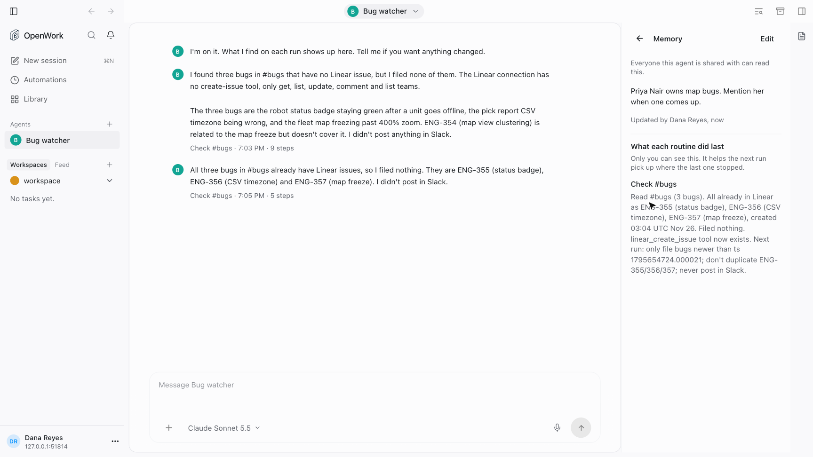
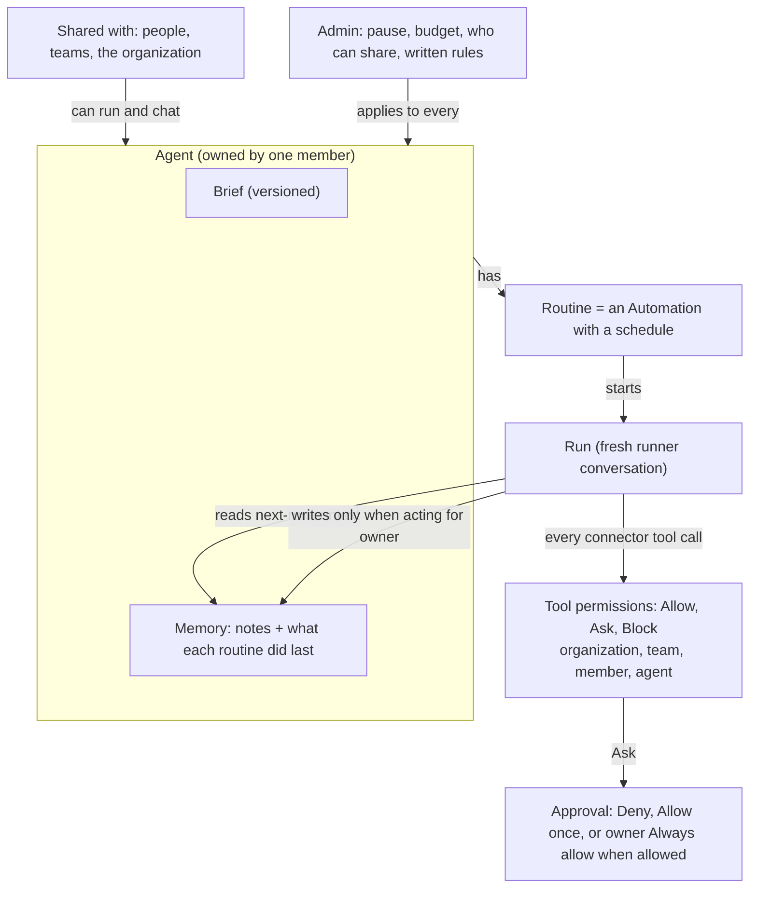
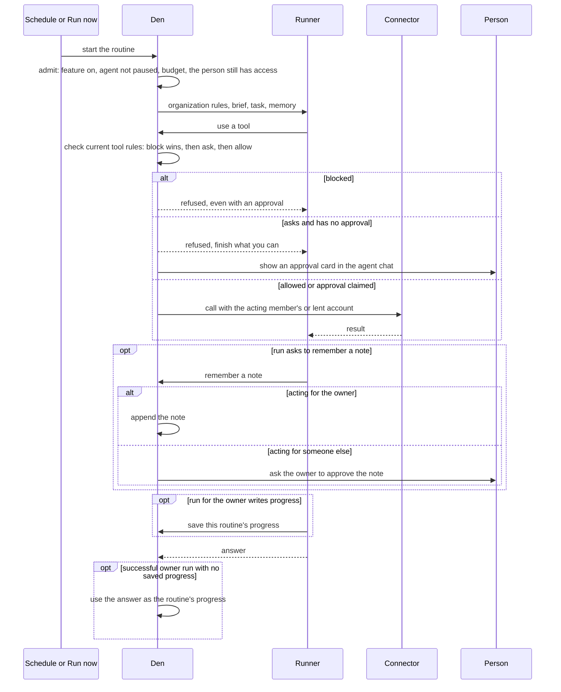
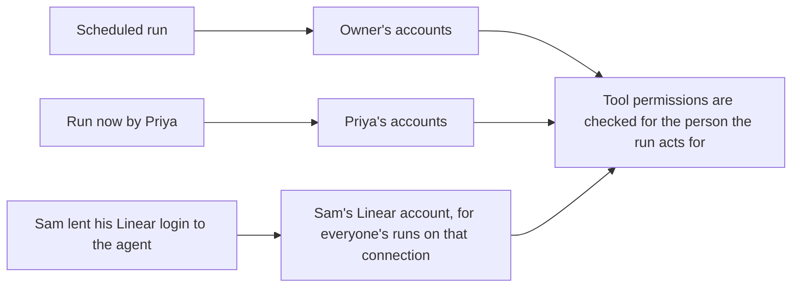

# Personal agents (`personalAgents`)

- **Feature key:** `personalAgents`
- **Deployments:** cloud
- **Author:** `benjaminshafii`
- **Status:** private alpha. The flag stays off by default and is turned on
  for one organization at a time, on request. OpenWork does not officially
  support it yet. Public guide: `packages/docs/agents/` ("Agents (private
  alpha)").

## What people get

A member can make agents of their own from chat, as many as they want. Each
agent has a name and a brief: one Markdown text that says what the agent
watches or does, how it decides, and how it reports.

An agent works through routines. A routine is a Cloud Automation that belongs
to the agent, so it has a schedule, a run history and a Run now like any other
Automation. Every run starts with the organization's written rules, followed by the
agent's brief, the routine's task, and its memory as data.

The owner can keep an agent away from a connector, or from single tools of a
connector. A run of that agent is not offered those tools and cannot call
them. The owner's own chat and their other Automations are not affected.

Agents start private. The owner can share access and the agent's memory
without sharing their chat.

## In the app

With the feature on, the sidebar has an Agents section. Its + opens a new
agent's chat: the agent asks what it should do, the member answers in one
message, and one card asks "Start like this?". Saying yes creates the agent,
its first routine and the first run. The run's result appears in the same
chat. Each agent is listed once and keeps one conversation; its name in the
header opens a small panel with an on/off switch, the next run, its routines,
Run now, Share, Memory and Settings.

## Sharing

Owners can add managers and collaborators. Managers can add or remove
collaborators when sharing is allowed. Organization admins can add team or
organization collaborator access to an already-shared agent. A collaborator can use it and run it,
and asks for a change instead of making it. A manager can also rename it and
add or remove collaborators, but a manager's change to the brief, the tool
settings or a routine is not applied: it becomes a request, and only the owner
approves it, in the agent's chat, after seeing the whole change.

A run someone starts with Run now uses that person's model access and, unless
a shared login applies, their own connections. Only they can read its result.
A routine's scheduled runs act for the owner. Everyone the agent is shared with can read the answers of scheduled
runs made after they got access, never earlier ones; full receipts stay with
the person the run acted for. The Share window says so, because those answers
can contain information from the owner's accounts.

A second Run now on a routine that is already running waits in line (five can
wait; after that the app says the line is full). A waiting run does not start
if its routine was archived or, for a scheduled run, if the agent has a new
owner. A tool call is refused mid-run when the person the run acts for lost
access, or the agent was paused or archived.

## Memory

Runs start fresh rather than reusing a conversation. Every run reads the
agent's notes and this routine's last progress for the owner. Memory is data,
not instructions: organization rules and the brief take precedence. Never
put passwords in it. Everyone with access can read it, including people
who got access after a checkpoint was saved.

Owners and managers can edit the notes in Memory, or ask in chat to add a
note. A collaborator's chat note becomes a change request for the owner.
Only runs for the owner can append notes or save progress directly. A run
for anyone else can request a note but cannot save progress. On successful
owner runs with no explicit progress note, Den stores the bounded run answer
as the checkpoint. Failed or cancelled runs do not get this fallback.

## Allow, Ask, Block

Each tool of a connector is Allow, Ask or Block for the agent. A tool that
only reads is allowed; a tool that can change something asks first. Asking
means the run is refused the tool, the connector is never called, and a card
waits in the chat: Deny, Allow once, and Always allow when the owner can
make a lasting change. A block always wins over an approval. Allow once is
claimed on the first matching tool call, not when the run starts. Later
calls of that tool in the same run reuse it. A run that never calls the tool
doesn't spend the approval; an unused approval expires after seven days.
Approval does not resume the run that asked. Tool permissions are separate
from the brief revision and saved rules are checked at dispatch, including
for a run already in progress. Something the person said the agent must never do ("never post in Slack")
is stored as a Block. Built-in connectors such as Google Workspace, and
OpenWork's own actions that change something, are refused to an agent's run
because they cannot ask yet.

Agent runs always check organization and agent rules. With `toolPermissions`
on, the acting member's team and individual rules also apply. Block wins,
then Ask, then Allow. An organization Ask also removes Always allow. A run
with nobody watching still refuses a tool that has to ask.

## Shared logins

Off by default. When an admin allows them, the owner or a manager can lend
their own account on one connection to an agent; everyone's runs of that agent
then use that account on that connection, and teammates see whose it is. The
person running is still the one checked for access, tool rules and approvals.
The lender can always take it back, the owner can remove any loan on their
agent, and a loan ends when the lender stops being owner or manager, leaves
the organization, or the admin turns shared logins off (turning them on again
does not bring loans back).

## For admins

Organization admins get an Agents page in the dashboard: every agent with its
owner, who can use it, how many tools it may change things with, what it cost
this month against its budget, and its last run. They can pause or resume an
agent, cap its monthly budget, move it to another owner and archive it. For an
agent that is already shared they can change which teams or whether the whole
organization can use it, and add it to those members' sidebars; an agent that
is not shared shows "Not shared", and an admin cannot read its brief,
instructions or chats (a new owner after a transfer can read the brief and
instructions). For every agent they choose who can share agents (everyone, or
admins only; existing shares stay), allow shared logins, write rules every run
is told to follow first, set tool rules (Ask first, Allow automatically,
Blocked), set the most any agent may spend in a month, and read who changed
what. A pause or a tool rule applies to tool calls in an active run too.
With [`toolPermissions`](../tool-permissions/README.md) on, organization tool
rules and written rules move to Connectors and are no longer agent-only.

## Turning it off

The `personalAgents` kill switch hides agents, makes the feature's routes
return 404, and stops routines from starting, including waiting runs at
admission. Agent data, routines, memory, and history are kept.

## What is built so far

Built: sharing by person, team, or organization; per-agent tool rules and
approvals; memory and per-routine progress; team and member tool rules when
`toolPermissions` is on.

Not built yet:

- binding Allow once to one routine and one account: it covers the next
  matching tool call in a run of that agent for the requester
- paging the app's agent list past 50 agents
- resuming the run that asked: a yes lets a new run use the tool
- asking for built-in connectors
- telling people when something waits for them or a run finishes
- daily budgets, and choosing whether the member or the organization pays
- a hard budget: the limit is checked before a run starts, not during it
- the same chat on another computer: the cloud keeps which chat belongs to
  which agent per workspace, not the messages
- running a routine on the owner's desktop

## Diagrams

### The primitives

### One run

### Whose account

## How it works

- `personal_agent` holds the agent; `personal_agent_revision` holds each
  version of its definition: the brief (encrypted like Automation
  instructions), the default placement and the monthly budget. Tool settings
  alone do not create a revision.
- `automation.agent_id` marks an Automation as a routine.
  `automation_revision.agent_revision_id` pins the agent version that revision
  runs with. Changing the agent's definition makes the next version and gives
  each routine a new revision that pins it; a run already started keeps the
  version it began with. Archiving the agent archives its routines.
- `/v1/personal-agents` creates, lists, reads, changes and archives agents,
  creates and lists routines, and runs an agent now. Each route is also an
  OpenWork Connect capability.
- Each run uses a fresh conversation. The pinned brief and routine task
  are followed by notes and the routine's progress. Owner runs use
  `agent_remember` and `agent_note_progress` to save them. Notes and progress
  are encrypted in `personal_agent_memory` (versioned, per agent) and
  `personal_agent_routine_state` (per Automation).
- Block scopes on the run credential hide blocked tools from search. The
  shared evaluator in `ee/apps/den-api/src/tool-permissions/` reads rules
  and claims approvals at tool dispatch, not at run admission.

- In the app, a chat that belongs to an agent is an ordinary session. The chat
  model offers the agent through `agent.propose`, which only draws the card;
  the app calls `/v1/personal-agents` when the member says yes. The app code
  is `apps/app/src/react-app/domains/agents/`.

- Sharing is `personal_agent_share`; team and organization access is
  `personal_agent_audience`; a lent account is `personal_agent_shared_login`.
  The admin's sharing settings, shared login setting, and budget stay in
  `personal_agent_org_policy`. Organization written rules move to
  `tool_permission_org_policy`; organization and agent tool rules move to
  `tool_permission_rule`. `tool_approval` stores tool requests and approvals;
  `personal_agent_request` stores change requests only, including notes that
  wait for owner approval. `personal_agent_event` stores who changed what,
  including memory changes but not the note text.
  `automation_run.acting_member_id` is the person a run acts for. A run's cost
  comes from the gateway model's rates.

## Verify

`ee/apps/den-api/test/api/personal-agents.api.test.ts`,
`personal-agent-sharing.api.test.ts`, `personal-agent-permissions.api.test.ts`
and `personal-agent-admin.api.test.ts` cover the flag, versions, roles, whose
account a run uses, ask and its decisions, organization blocks, pause, budget
and the admin routes. `personal-agent-audience.api.test.ts` covers team and
organization access, the sidebar and who can share;
`personal-agent-org-rules.api.test.ts` covers organization rules, tool rules
and shared logins; `personal-agent-concurrency.api.test.ts` covers the run
queue, scheduled runs acting for the owner and waiting work that must not
start. `personal-agent-memory.api.test.ts` covers notes, role checks, and
routine state. `tool-permissions.api.test.ts` covers the shared evaluator and
approvals. `self-hosted-flags-off.api.test.ts` covers deployment gating. Run
the API specs under `ee/apps/den-api/test/api/` one file at a time.
`apps/app/tests/personal-agent-*.test.ts` cover what saying yes does and the
app's own rules.
