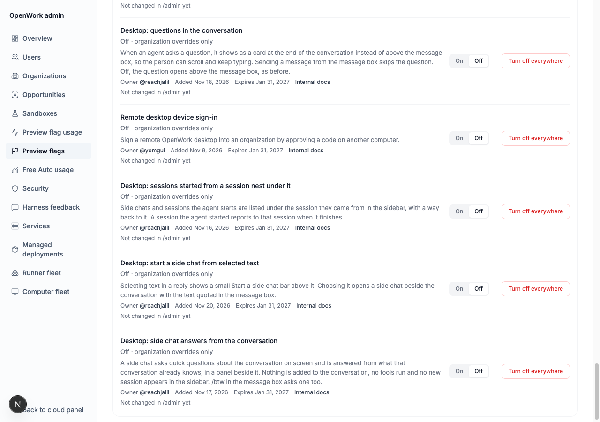

# Preview flags

A preview flag gates unfinished work. It is declared once, in
`packages/features/src/previews.ts`, with the person who owns the decision and
the day that decision is due. By then the work ships or is cut.

| What it is | Where it lives |
| --- | --- |
| Unfinished work | A preview flag in `packages/features/src/previews.ts` |
| A key that shipped or was cut | `packages/features/src/retired.ts` |
| What a deployment can do once its infrastructure is installed | A capability, never a preview flag |
| What an organization chooses for itself | An organization setting |

## What the check enforces

`pnpm features:check` runs on every pull request and fails when:

- a preview has no `owner` or no `expiresOn`;
- `expiresOn` has passed, or is more than 183 days away;
- the exports in `previews.ts` are out of alphabetical order;
- a key is both a preview and retired;
- the capability catalog depends on a preview without a recorded gap, or
  names a key that is retired.

It warns for the last 14 days before a preview expires. An expired preview
fails the check for every pull request until someone ships it, cuts it, or
sets a new date and says why.

## Names that did not change

Published desktops, saved exports and operator configuration keep working:

- `GET /v1/org` still answers `features`, and still answers `true` for keys
  that shipped.
- Operators still lock a preview with `DEN_FEATURE_<KEY>` or Helm
  `config.features.<key>`. A lock for a retired key is ignored with a warning.
- Config files still call the area `settings.features`. A file may also say
  `settings.preview_flags`; exports always write `settings.features`.
- The `/admin` API still answers `author`, next to `owner` and `expiresOn`.

## In /admin

Platform admins see each preview's owner and expiry under Preview flags.

Adding, rolling out and retiring a preview: `.opencode/skills/add-a-feature`.
