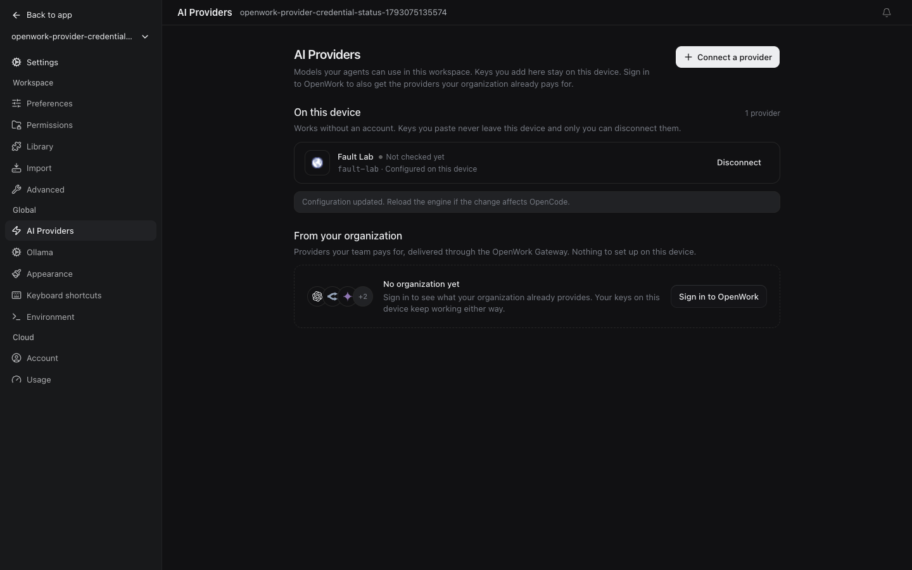
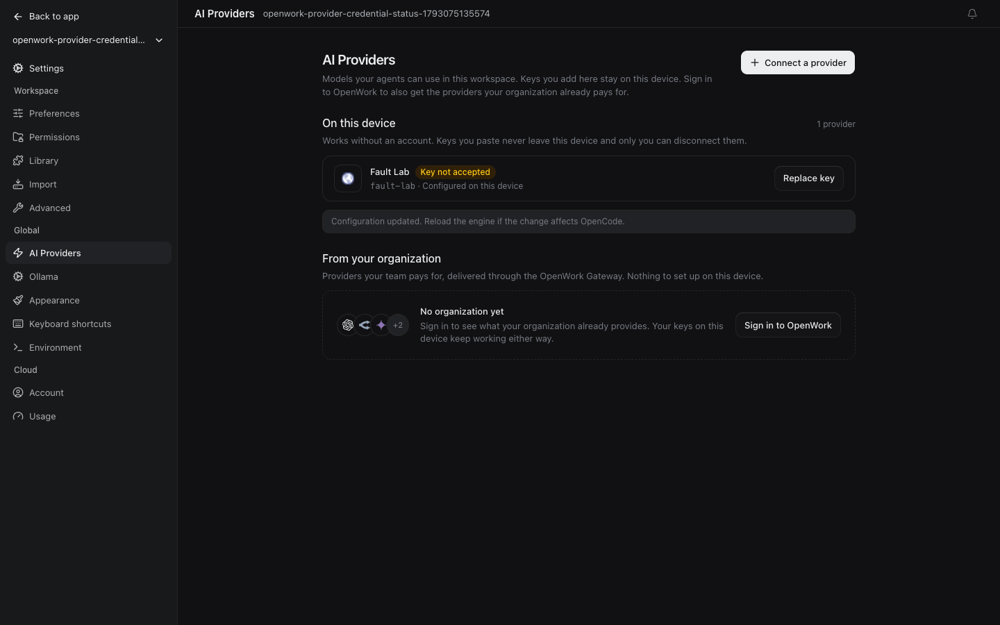
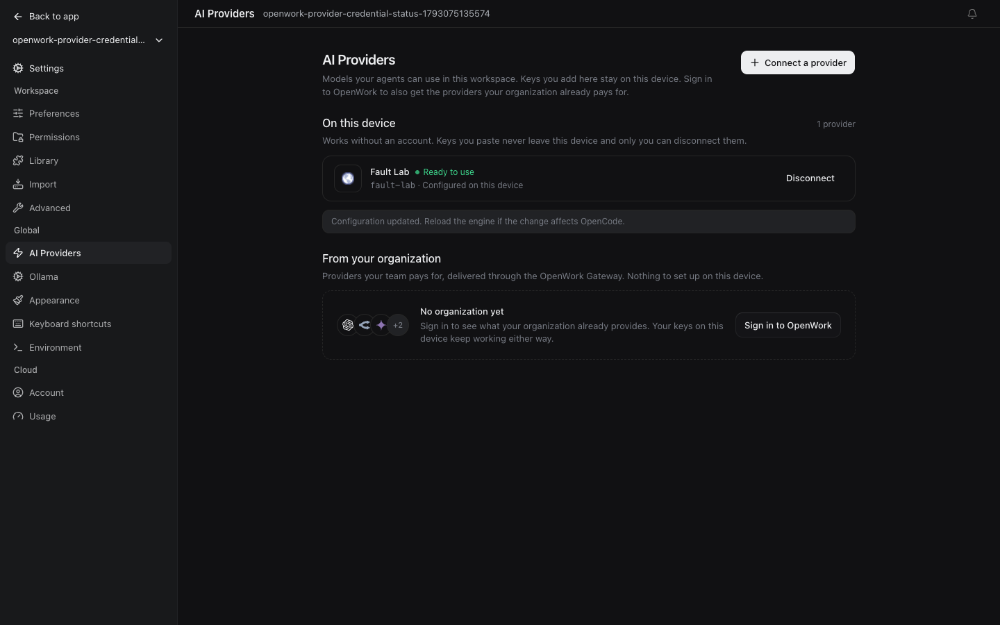

# AI provider credential status

- Feature: `providerCredentialStatus`
- Deployments: cloud and self-hosted
- Default: off
- Owner: `benjaminshafii`

AI Providers distinguishes a saved credential from one that has actually
answered a request. Catalog discovery, importing an organization provider,
and saving a key do not verify inference authentication.

| Evidence | State | Recovery |
| --- | --- | --- |
| No successful inference request | Not checked yet | Use the provider in a chat |
| Successful request | Ready to use | None |
| Inference 401 or recognized invalid/expired credential | Key not accepted | Replace key (personal), update environment credential (environment), contact your admin (organization) |

Existing policy locks, engine availability and cloud synchronization states
keep their precedence. Access-denied 403, rate limits, timeouts, cancellation,
network failures and Gateway member sign-in requirements are not upstream
credential rejections.

## Try it

Enable the feature for a test organization in `/admin`, or on the deployment
for a signed-out desktop. Connect a provider, send a chat, then reopen
Settings > AI Providers. A newly saved key reads **Not checked yet**. A rejected
key offers recovery rather than claiming readiness. Replacing it clears the
old verdict; a later successful request earns **Ready to use**.

`evals/proofs/provider-credential-status.proof.test.ts` exercises this flow
with native OpenCode v2 and a loopback-only fault provider. No paid or real
provider keys are used, and the fault server records credential labels rather
than Authorization values.

### Saved but not verified

### Rejected by the provider

### Verified by a successful request

## Evidence and lifetime

Only outcomes and credential-change revisions are persisted locally, scoped
to workspace and runtime provider ID. No keys, request payloads, provider
response bodies or error text enter the health store. Rejection survives
navigation and reload when browser persistence is available; blocked or full
storage never interrupts chat. Durable assistant outcomes recover missed
lifecycle events, ordered by their completion time so reading an older chat
cannot overwrite a newer verdict. Saving a replacement or completing a new sign-in
clears the verdict across workspaces sharing the same credential store;
removal also clears it before an environment fallback is discovered. Remote
hosts keep separate credential revisions. A request already running at
replacement time cannot verify or reject the replacement: evidence uses the
engine's start time, not when the renderer first observes a busy run. A run
without a trustworthy start time remains unverified. Organization provider
version or organization-context changes also clear the old verdict when their
inventory refreshes.

This is observed client-side health, not a credential validation endpoint or
a fleet-wide health guarantee. An externally changed environment or key on
another client is not detected until a configuration refresh or a request
provides new evidence. The app never probes a provider merely to display the
status. Chat error copy and upstream Gateway mappings are unchanged.

## Turning it off

The kill switch restores the previous provider statuses and actions. It does
not alter credentials, catalogs, model selections, sessions or in-flight work.
Stored observations remain harmless local data, reusable when re-enabled.
Watch for incorrect attribution after model switches, false rejections on
non-authentication errors, and recovery actions on the wrong provider.

Design: P1 (report observed state), P5 (reuse rows and buttons), C6 (recovery
beside failure), V2 (existing neutral and attention tokens).
