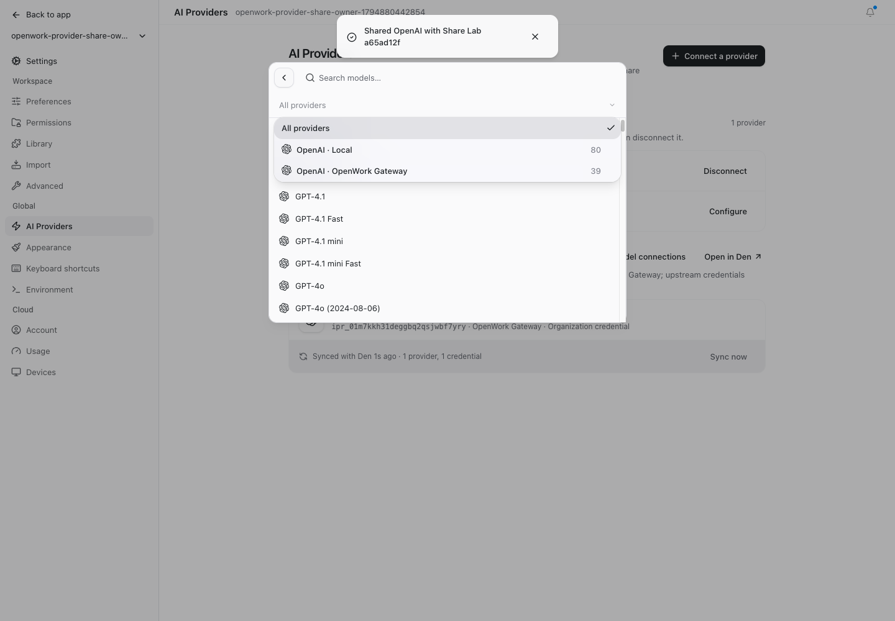
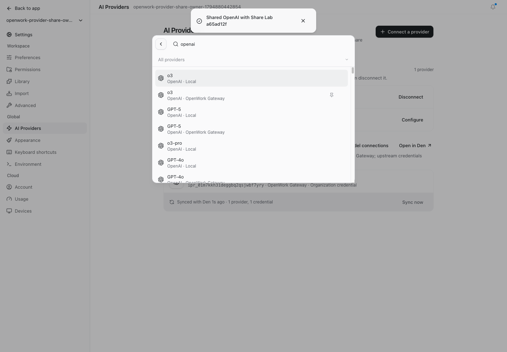
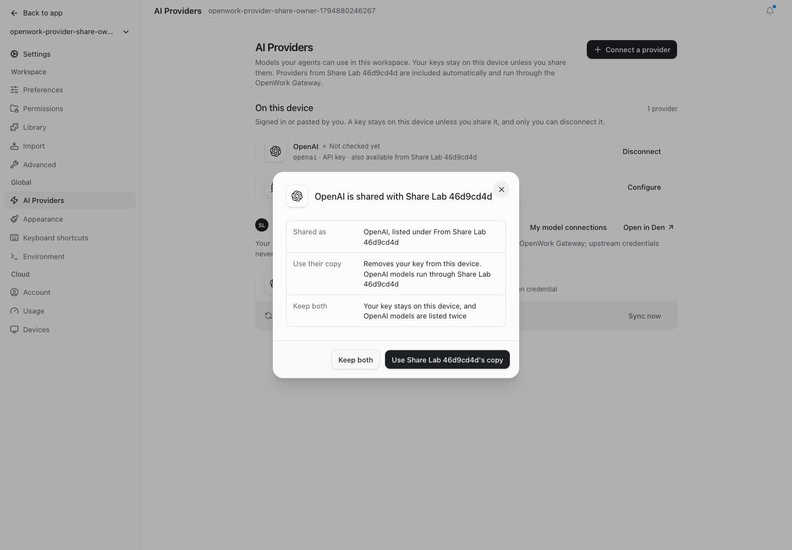

# Exact provider search and guided provider sharing

Feature key: `providerFilterSyncFix` (cloud and self-hosted, off by default).

## What changes

**Model picker search.** Typing a provider name with or without a model name
(`ow anthropic`, `sol 6.1 ow anthropic`) lists only models that match every
word, served by every provider named. When nothing matches, the list is empty
and says so. With the feature off, the picker falls back to models from other
providers under a "has no models here" line.

**Every provider is one choice away.** The model picker and the Cmd+K Models
list have a provider selector with each provider's model count. A device key
and the organization's copy of the same provider are told apart by where they
run ("OpenAI · Local", "OpenAI · OpenWork Gateway"), in the selector, in group
headings and on each row. Escape closes the selector, not the palette.

**Sharing a provider from this device.** Settings › AI Providers › Share keeps
its confirmation open until the provider is listed under the organization on
this device, then shows where it is. If it has not arrived, the dialog says so
and offers to check again, instead of a success message. With the feature off,
Share closes with a success message as soon as OpenWork Cloud accepts the key.
When the provider has arrived, the dialog asks which copy this device keeps:
the organization's (the key saved on this device is removed) or both.

## Who it is for

Anyone who picks models by typing, and people who manage AI Gateway and share
a key saved on their device with their organization.

## How to try it

1. Turn `providerFilterSyncFix` on for the organization in `/admin`.
2. Open the model picker and type a provider name and a model that provider
   does not serve: the list is empty.
3. In Settings › AI Providers, press Share on a provider with a pasted API key
   and confirm: the dialog ends on the organization row.

## Turning it off

Search and Share behave as before. Nothing stored changes; providers already
shared stay shared.
