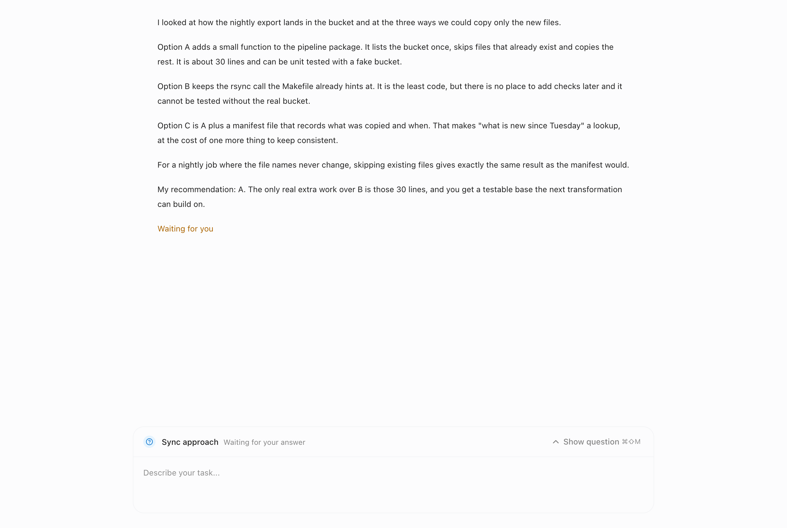

# Minimize a pending question (`questionMinimize`)

- **Feature key:** `questionMinimize`
- **Deployments:** cloud and self-hosted (`everywhere`), off by default
- **Author:** @benjaminshafii

## What people get

When an agent asks a question, the question opens above the message box and
can cover most of the conversation the person needs to read before answering.
With this feature on, the question has a **Minimize** button next to
**Dismiss**. Minimizing folds the question to one line above the message box:
its header, "Waiting for your answer", and a **Show question** button.

The question stays pending the whole time. Minimizing sends nothing to the
agent, and it is not Dismiss.

**Show question** reopens it exactly as it was: the same question of a
multi-question request, every option picked, and any text typed in the custom
answer.

**⌘⇧M** (**Ctrl+Shift+M** on Windows and Linux) minimizes and reopens the
question. The chord is shown on the button. `esc` does what it did before; it
does not minimize or dismiss the question.

Keyboard focus stays on the same button when the question folds and reopens.
Opening takes 200 ms and folding 150 ms, and both are instant when the system asks for reduced motion.

## New questions and other chats

- A **new question** always opens fully, even if the previous one was
  minimized, and starts with nothing picked.
- **Leaving the chat and coming back** shows the question as it was left:
  minimized or open, with the same picks and typed text. This is kept in
  memory for the 50 most recent questions and is gone after the app restarts,
  when the question opens fully again.
- Answering or dismissing a question forgets what was kept for it.

## Where it applies

- Questions in a chat on this computer (the panel above the message box).
- Questions from a task running on another computer (the answer card in the
  task panel and in the full task view). That card keeps its state while it is
  on screen; a new question there also opens fully. The chord works there while
  keyboard focus is inside the card.

Approval requests ("Allow this?") are not questions and cannot be minimized.

## Off

Off, the question is always fully open with only **Dismiss**, the chord does
nothing, and nothing is kept between chats. It is safe to turn off at any
moment: a minimized question simply shows open again.

## Try it

Turn the feature on for an organization and ask an agent something that makes
it ask a question with options. Pick an option, type a custom answer without
sending, minimize, scroll the conversation, then reopen.

`apps/app/tests/question-panel.test.tsx` covers minimizing and reopening with
picks, typed text and the current question kept, the chord, a new question
opening fully, returning to a chat, and the unchanged panel when off.
