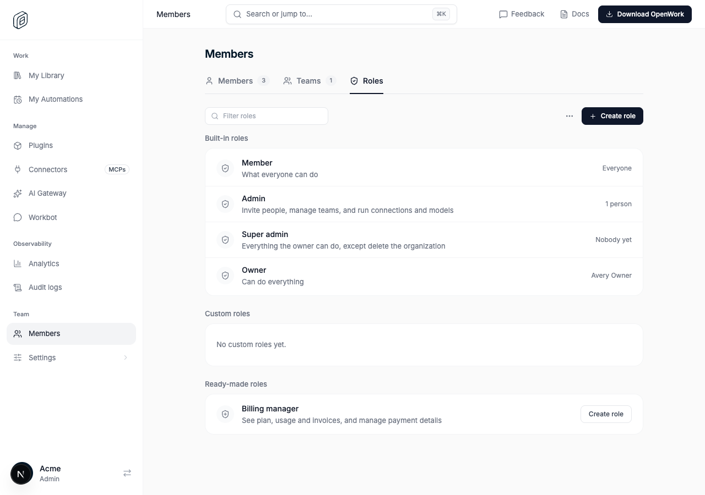
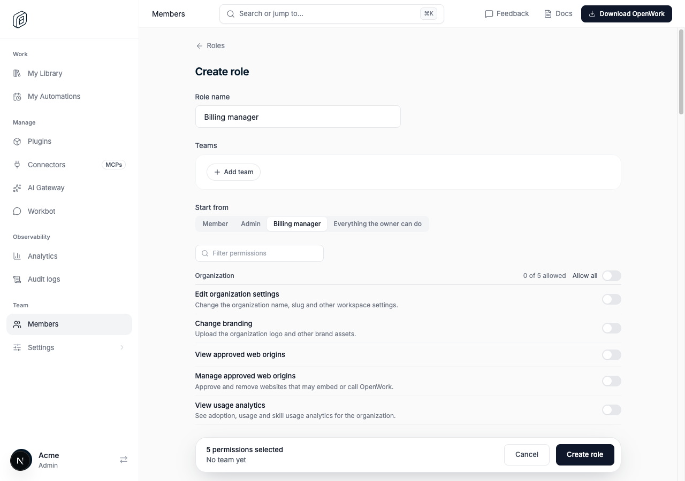
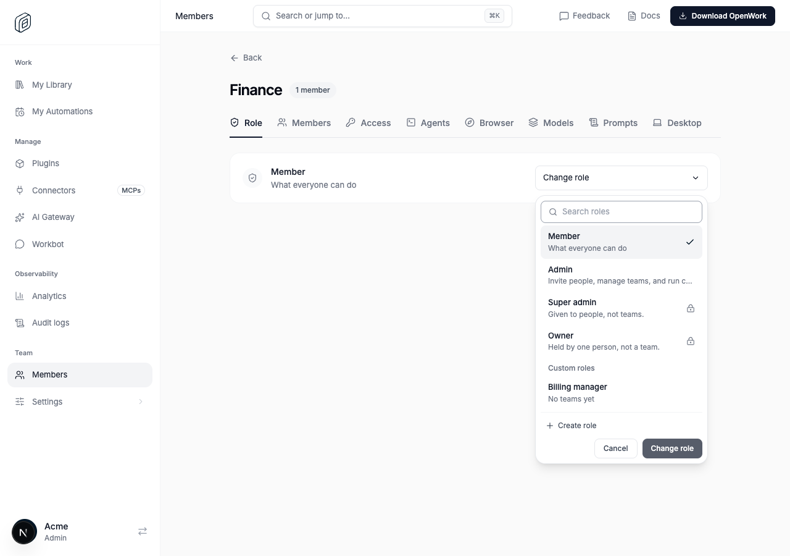

# Ready-made roles and one role list

- Feature key: `readyMadeRoles`
- Deployments: cloud and self-hosted
- Default: off
- Author: `benjaminshafii`

## What changes and for whom

For people who manage an organization's members in Den web.

- **Members › Roles** gets a **Ready-made roles** section: roles we suggest, with their name and permissions filled in. The first is **Billing manager** (view billing, start a subscription, view invoices, open the billing portal, view Gateway usage). **Create role** on its row opens the Create role form already named and switched on. Once a custom role has that name, the row is gone: the role is listed under **Custom roles** like any other.
- **Create role** gets **Start from**: Member (nothing extra), Admin, Billing manager, or everything the owner can do. A starting point only turns on what the person creating the role holds themselves; when it leaves something out, the form names the permission and says why. Switches changed by hand survive changing the starting point.
- The role pickers (**Invite**, **Edit role**, a team's **Change role**) list every role the Roles tab lists, in the same order. A role that can't be given there is shown with a lock and the reason (Super admin is given to people, not teams; Owner changes by transferring ownership) instead of being left out.

A ready-made role is not a new kind of role. Creating one calls the same `POST /v1/permissions/sets` as any custom role, so nothing changes in den-api, in how permissions resolve, or in what an existing member can do.

Not behind the feature (no behavior change, so it ships with the code): every screen now reads role names, one-line summaries and order from one place, `ee/apps/den-web/app/(den)/_lib/role-catalog.ts`. `roleList` builds the list and `roleOptions` builds a picker's rows from it. Before, the Roles tab, the two pickers and the labels on people and teams each had their own copy, which is how a role could exist in one place and be missing in another. The visible effect is wording: Member reads "What everyone can do" everywhere, and Member and Admin show their summary in the Invite and Edit role pickers as Super admin already did.

## How to try it

1. Turn `readyMadeRoles` on for a test organization in `/admin`.
2. As the owner, open **Members › Roles**. **Billing manager** is under **Ready-made roles**.
3. Press **Create role** on its row, then **Create role** on the form. It is saved with five permissions.
4. Open a team, **Role › Change role**. Billing manager is under **Custom roles**; Super admin and Owner are locked with the reason. Give the team Billing manager: its members can open **Billing › Invoices**.
5. As an admin without **Manage permissions**, open **Members › Roles**: Billing manager is listed with **Create role** locked.

## Turning it off

Off (or the kill switch): the Ready-made roles section, Start from and the locked rows in pickers disappear. Create role starts empty again and pickers leave out roles they can't give. Roles already created from a ready-made role are ordinary custom roles: they stay, keep their teams and permissions, and stay editable. `?start=billing` on the Create role address is ignored.

## What to watch

- `/admin` › Features counts a use each time someone creates a role from a ready-made starting point.
- `POST /v1/permissions/sets` errors (`permission_not_held` would mean the form offered a permission its creator doesn't hold; the form filters these out).

## Adding a role

Add it to `BUILT_IN_ROLES` or `READY_MADE_ROLES` in `role-catalog.ts`. The Roles tab, the pickers and Create role pick it up from there, and the compiler asks for what a screen has to decide about it (for a built-in role: who holds it, on the Roles tab). `role-catalog.test.ts` and `team-roles.test.ts` fail when a picker and the Roles tab disagree, or when a team can pick a role that Change role can't give.

## Screenshots

Real local Den with the feature on, from `evals/proofs/ready-made-roles.proof.test.ts`:

- **Members › Roles**: Billing manager under Ready-made roles.
  
- **Create role**, opened from that row: named, starting from Billing manager, five permissions selected.
  
- A team's **Change role**: the same roles, with Super admin and Owner locked and why.
  
