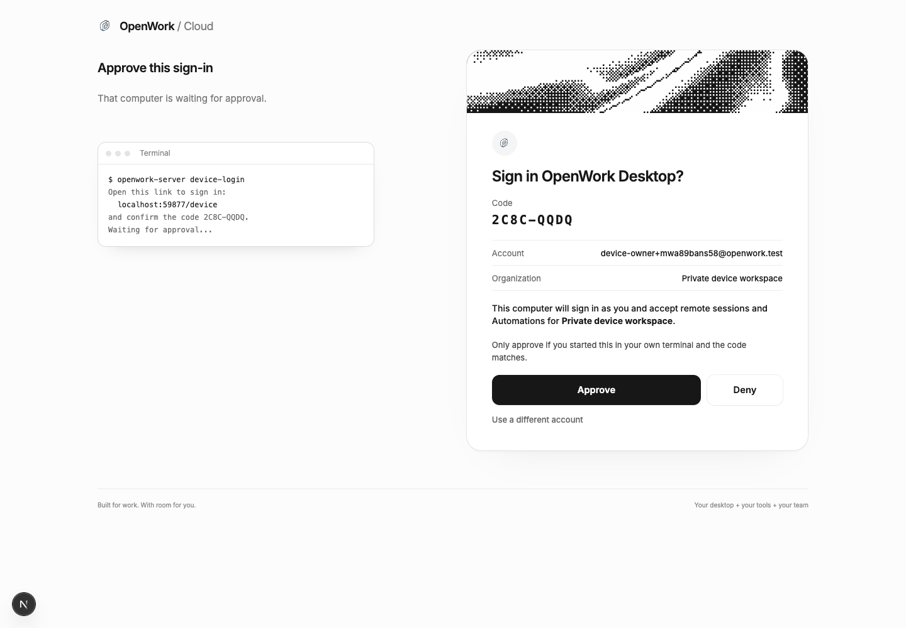

# Remote desktop device sign-in

- **Flag:** `remoteDesktopDeviceLogin`
- **Deployments:** cloud and self-hosted; **default off**
- **Owner:** [yomgui](https://github.com/yomgui)
- **Client ID:** `openwork-desktop-device`

A running remote desktop can request its own Den session without receiving a
browser session, a CLI credential file, or a pasted sign-in link. It reuses Den's
existing device authorization and explicit `/device` review page.



Real Den approval page with an isolated synthetic account; the displayed user
code is public and expired. This image illustrates the UI, not native-install
verification.

## Enable and try

Use a Den API, Den web and desktop from the release shipping this feature. Enable
**Remote desktop device sign-in** for **everyone** on the deployment's `/admin`
Features page. An organization-only override cannot enable anonymous code starts.
A self-host operator may instead set the generated Helm value
`config.features.remoteDesktopDeviceLogin: true`
(`DEN_FEATURE_REMOTE_DESKTOP_DEVICE_LOGIN=true`). Kill switches take precedence.
Decision and redemption also require the approving member/organization's flag.

On the remote computer, start/activate the OpenWork desktop, then run its normal
packaged executable with `login`. No separate Node installation, PATH setup or
launcher is required. The command contacts the already-running desktop; it does
not open another app window, take its single-instance lock, or open a local
browser. Approval always happens in a browser on another device.

### macOS: installed app

For an installation in `/Applications`, use the command for your flavor:

```sh
# Public
"/Applications/OpenWork.app/Contents/MacOS/OpenWork" login

# Cloud
"/Applications/OpenWork Cloud.app/Contents/MacOS/OpenWork Cloud" login

# Enterprise
"/Applications/OpenWork Enterprise.app/Contents/MacOS/OpenWork Enterprise" login
```

If you installed it elsewhere, change `/Applications` accordingly.

### Linux: extracted installation

For the public app extracted to `$HOME/Applications/OpenWork`:

```sh
"$HOME/Applications/OpenWork/openwork" login
```

For the other flavors, use the matching executable in your extracted directory:

```sh
"$HOME/Applications/OpenWork Cloud/openwork-cloud" login
"$HOME/Applications/OpenWork Enterprise/openwork-enterprise" login
```

These directory names are examples; use your actual extraction directory. The
executable names are `openwork`, `openwork-cloud` and `openwork-enterprise`.
For an AppImage, extract it with `./OpenWork.AppImage --appimage-extract` (using
the actual downloaded filename), then run `./squashfs-root/openwork login`
(or its flavor's executable); do not guess its temporary mount path. The short
command uses a headless temporary parent on Linux, so an SSH shell does not need
`DISPLAY`. The already-running desktop still needs its normal graphical session.

Append `--force` to deliberately replace an existing desktop sign-in. Append
`--base-url https://den.example.test --api-base-url https://api.example.test`
when selecting an explicit Den destination. If you separately installed the
server CLI, the equivalent entry point is `openwork-server login`.

The executable delegates to its bundled `server/dist/cli.js` in Electron Node
mode and preserves the real HOME and discovery-file selection. Its temporary
Electron parent profile is isolated from the running desktop and removed when
the command finishes. It forwards interrupts once and waits for the CLI's cleanup;
it does not pass Den credentials in arguments or introduce another IPC service.

#### Advanced: invoke the bundled CLI directly

Only for troubleshooting, the public macOS equivalent is:

```sh
ELECTRON_RUN_AS_NODE=1 \
  "/Applications/OpenWork.app/Contents/MacOS/OpenWork" \
  "/Applications/OpenWork.app/Contents/Resources/app.asar/server/dist/cli.js" \
  login
```

On Linux, set `APP` to the extraction directory:

```sh
ELECTRON_RUN_AS_NODE=1 "$APP/openwork" \
  "$APP/resources/app.asar/server/dist/cli.js" login
```

Substitute both bundle/executable names for other flavors; the relative CLI path
stays the same. Do not set Node mode when starting the GUI.

The command prints a full browser link on its own line, for example:

```text
To sign in, open this link in a browser on any device:
https://den.example.test/device?user_code=ABCDEFGH
Then check the code ABCD-EFGH and choose the organization.
Waiting for approval…
```

Open the printed link on any device. Sign in, compare the code and approve only
if you started the request. With multiple organizations, nothing is preselected:
choose an organization before Approve becomes available. With one organization,
it is shown without a picker. The remote desktop adopts the approved organization,
without its usual in-app organization chooser. Success reports only the account
and organization:

```text
Signed in as person@example.test in Example organization.
```

This confirms desktop sign-in, not remote execution readiness.

Every start awaits fresh anonymous deployment discovery, including the configured
Den and explicitly supplied matching URLs. A pending or failed background feature
query is unknown, not an OFF answer. Network/5xx discovery failures get at most
three bounded reads with short pauses; device-code creation is not replayed.
If Den remains unreachable, the command reports `Couldn't reach <Den host>. Check
the network and try again.` and exits 1. An explicit deployment OFF response
reports that device sign-in is unavailable and exits 4.

The shell uses the desktop's existing authenticated `127.0.0.1` control bridge.
The desktop must be running; a server-only process without a desktop renderer
cannot enroll itself. During startup, the command waits up to 20 seconds for the
bridge and both device sign-in actions to become ready. It does not open a second
GUI or replay a potentially executed start request. If the app cannot be reached,
start OpenWork and run the command again (on macOS: `open -a OpenWork`; use the
installed flavor's app name when applicable). An unsafe profile is reported
separately; waiting or starting the app does not bypass owner-only custody checks.
`OPENWORK_UI_CONTROL_DISCOVERY` can select one explicit
profile's discovery file; otherwise the production profile is used, never an
implicit development-profile fallback. The command checks POSIX ownership and
permissions, refuses symlinks/untrusted directories/non-loopback destinations,
and never prints raw bridge receipts. POSIX discovery files are written with mode `0600`, including when replacing an
older permissive file. The shell command intentionally fails closed on Windows
with “Use the sign-in link instead.” Verifying owner-only Windows ACLs is a
separate follow-up. No named pipe or Windows custody implementation is included.

Only the user code, verification link, public status and final account/org cross
the shell boundary. The private device code and Den bearer remain in the app's
existing authentication/enrollment path. The local control bridge credential is
separate from a Den session. No tokens belong in command arguments or URLs.

Packaged `file://` renderers use the app's existing Electron main-process Den
HTTP transport, just like link handoff. This is internal app transport—not a
new shell IPC path—and does not relax Den CORS or trust `Origin: null`.
Device code/token requests refuse redirects and retain cancellation/deadlines.
Private request bodies and credentials are never exposed to control callers,
engine configuration or plugins.

## Turn it off

Use **Turn off everywhere** in Features for the immediate server kill switch.
New desktop starts are rejected, pending desktop decisions and redemptions cannot
issue a session, and polling terminates with unsupported/failed. Codes are not
restarted under `openwork-cli`. Approval metadata is captured only from the
successful atomic claim and kept in request-scoped state, cleared in `finally`.
The session insert then rechecks membership and rollout policy under lock. If a
later guard refuses issuance, the one-time code has already been consumed: the
person must restart the command. It is never reused or rebound to a default org.
Existing completed sessions are not revoked by a rollout change. Explicit sign-out/revocation remains separate.

Existing CLI/plugin device sign-in, desktop sign-in links and
`auth.exchange-grant` are never gated by this flag and retain their behavior.
An older or malformed discovery endpoint fails closed: **use the sign-in link
instead**. Missing discovery data or a transport error is not an explicit OFF
answer. The cached background signal stops an admitted pending flow only for a
newer explicit OFF observation; unknown state and an older cached OFF cannot
override live ON admission. Den still enforces policy on every decision/redemption.

Exit codes: success `0`, failure (including startup/network errors) `1`, denied `2`, expired `3`, unsupported `4`,
interrupted/cancelled `130`. Interrupting stops the local poll; it does not revoke
an unredeemed server-side authorization, which expires normally. Shell status
and cleanup are correlated with that command's public invocation ID, so an old
command cannot cancel or report the newer attempt that superseded it. The ID is
not a credential and is never sent to Den.

## Shared enrollment and regression coverage

`apps/app/src/app/lib/den-handoff.ts` extracts the existing durable commit into
one shared enrollment function: bootstrap persistence/read-back, serialized
activation, supersession and rollback are reused rather than copied. Existing
link handoffs and `auth.exchange-grant` retain their organization-choice behavior
and are not gated. Only this new device path supplies an explicit browser-approved
organization.

`ee/apps/den-api/test/api/sso-callback.api.test.ts` extends the existing real-SSO
fixture to cover the new client: a password session cannot approve an SSO-required
organization, and a fresh device session inherits the approving session's actual
provider and original authentication time. It does not change SSO policy.

## Watch and limits

Watch code-start/decision/redemption failures and desktop enrollment failures.
Never log request bodies, device codes or bearers. An approved organization is the initial active org, **not an org-locked
credential**. This is a new general Den session, not OAuth access/refresh tokens,
DPoP, VM attestation or an independently named/revocable device.

Follow-ups remain separate: reporting remote execution readiness in the terminal,
`logout` and `status` commands, OAuth device
authorization, DPoP-bound audience/org claims, rotating refresh tokens with reuse
detection, Devices/revoke UI, and the Better Auth security upgrade. No schema
migration is part of this feature.
