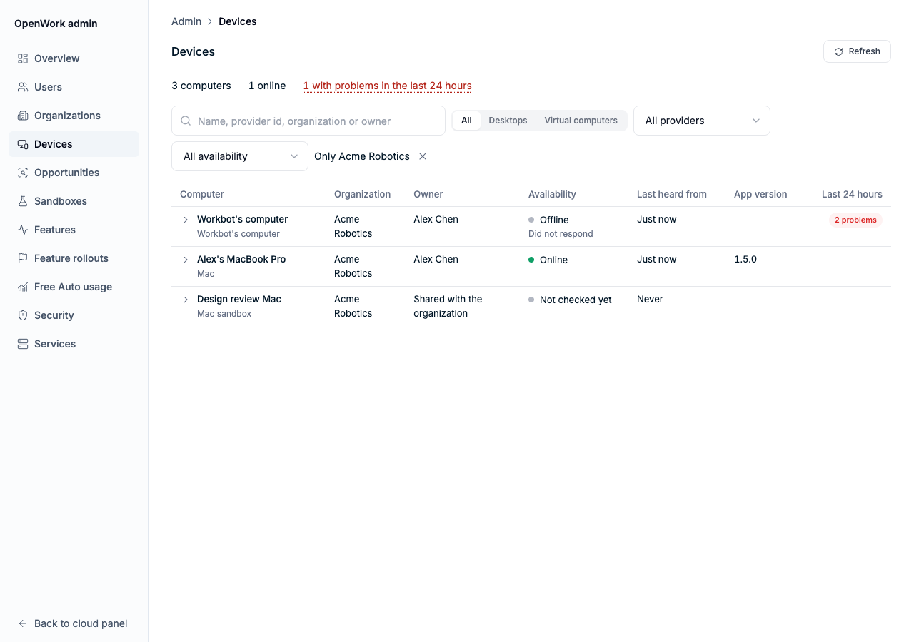

# Devices (`remoteDevices`)

- **Key:** `remoteDevices`
- **Deployments:** cloud and self-hosted
- **Default:** off
- **Author:** @benjaminshafii

## What changes

OpenWork had three unrelated notions of "a computer": the desktops that
register as runners (`automation_runner`), Workbot's cloud computer for each
chat (known only to the headless runner), and VMs a desktop reaches through
environment variables. Nobody could see them in one place, and when one
misbehaved there was nothing to look at.

With the feature on, Den keeps one registry of the computers a member can
reach, and three surfaces read it:

| Surface | What a person gets |
|---|---|
| Desktop, **Settings › Devices** | Their computers and cloud computers, whether each is online and what it needs. Add a virtual computer, rename it, remove it from the list. |
| Workbot, **Devices** | The same list, read-only, with **Open** on Workbot's own computer. |
| `/admin` **› Devices** (not flagged) | Every device across organizations, with the last report, its events, its runner or conversation row and the owner's feature state. Also `den_devices_list` and `den_device_detail` on the admin MCP. |

## What a device is

One row per organization, provider and the provider's own id
(`remote_device`, `packages/types/src/den/remote-devices.ts`):

| Kind | Provider | Who writes it |
|---|---|---|
| `desktop` | `openwork_desktop` | The signed-in desktop, `PUT /v1/remote-devices/this-computer`, on launch, on change and every five minutes. Its id is the runner row id (`rnr_…`), so the desktop and its runner are one entry and `computerId` is what `remote-session:targets` already uses. Desktops that only registered a runner (older app versions) are copied in when someone lists devices. |
| `vm` | `workbot` | Workbot's server, `POST /v1/workbot/devices/computer`, when a view is opened, the computer is paused, resumed, rebuilt or handed back, when it cannot connect (a fixed code), and when its chat is deleted. |
| `vm` | `freestyle`, `daytona` | A desktop configured to reach the VM (`OPENWORK_COMPUTER_FREESTYLE_VM`, `OPENWORK_COMPUTER_DAYTONA_SANDBOX`) reports it with its readiness, or a member registers it by hand. |
| `vm` | `mac_host`, `other` | A member registers it by hand (`POST /v1/remote-devices`), for themselves or, with the Manage desktop policies permission, for the whole organization. |

`availability` is worked out when the list is read
(`remoteDeviceAvailability`): a desktop is online for ten minutes after it was
last heard from (its report or its runner's presence, whichever is newer);
Workbot's computer shows paused once it has been idle that long, because the
runner pauses it without telling Den; a hand-registered VM nobody has probed
is "Not checked yet". Desktops unheard from for 30 days leave the list, as
their runner rows do.

Each device keeps its last 200 events for 30 days (`remote_device_event`):
fixed names, one plain sentence, fixed codes.

## What it does not do

- **It grants no access.** Registering a VM names it; it stores no provider
  credential and changes nothing at the provider. Workbot's computers stay
  governed by the runner and `computerUse` / `browserUse` / `remoteComputers`;
  a desktop reaching a VM still needs its own key
  (`docs/computer-use/adapters.md`, "Not yet"). Brokering VM access through
  Den is the follow-up this registry is the base for.
- **It stores nothing from a computer's screen**, no file paths, window titles
  or conversation text: names, versions, state and readiness sentences the
  desktop already shows in Settings › Computer use.
- A member sees their own computers and the ones shared with the whole
  organization, never another member's. A desktop that names another member's
  VM id neither changes it nor gains it.

## Turning it off

Use the kill switch or turn the organization off in `/admin`. The member
routes answer `404 feature_disabled`, both Devices pages disappear, desktops
stop reporting on their next tick and Workbot's server stops reporting on the
next request. Stored rows stay and reappear when it is turned back on.
Computer use, remote tasks and Workbot's computer never depended on the
registry and work as before. `/admin` › Devices keeps working either way.

## How to try it

1. Turn `remoteDevices` on for an organization in `/admin`.
2. Sign in to OpenWork Desktop as a member and open Settings › Devices: this
   computer is listed as online within a few seconds. Turn Screen Recording
   off for OpenWork with Computer use on: the row says what is missing.
3. In Workbot, open the Computer view, then Devices: Workbot's computer is
   listed; pause it and the row says Paused.
4. Add a virtual computer by the id its provider shows.
5. Open `/admin/devices`, search for the member, and open a device.

## What to watch

- Den: request rate on `PUT /v1/remote-devices/this-computer` (one per signed-in
  desktop every five minutes, rate-limited at 60 per member per ten minutes)
  and on `POST /v1/workbot/devices/computer` (one per viewer renewal, every 45
  seconds while a Computer view is open; repeats write nothing).
- `/admin` › Devices › "with problems": warnings and errors in the last 24
  hours. A burst of `failed` events with `desktop_unavailable` across
  organizations means the runner's provider, not one person's computer.
- Tests: `ee/apps/den-api/test/api/remote-devices.api.test.ts`.
