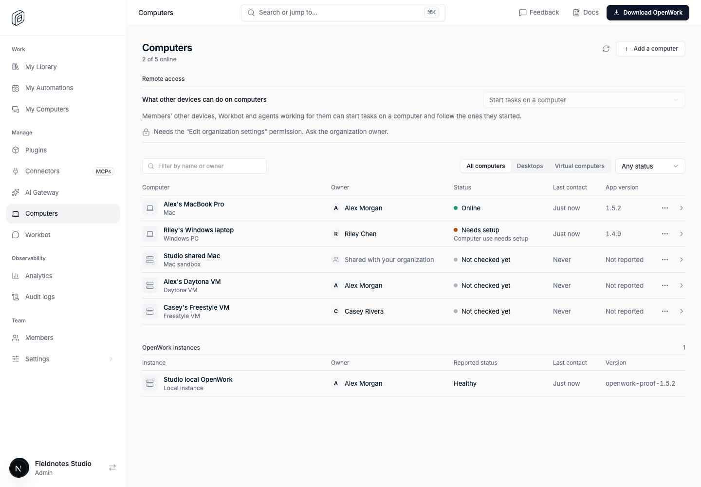
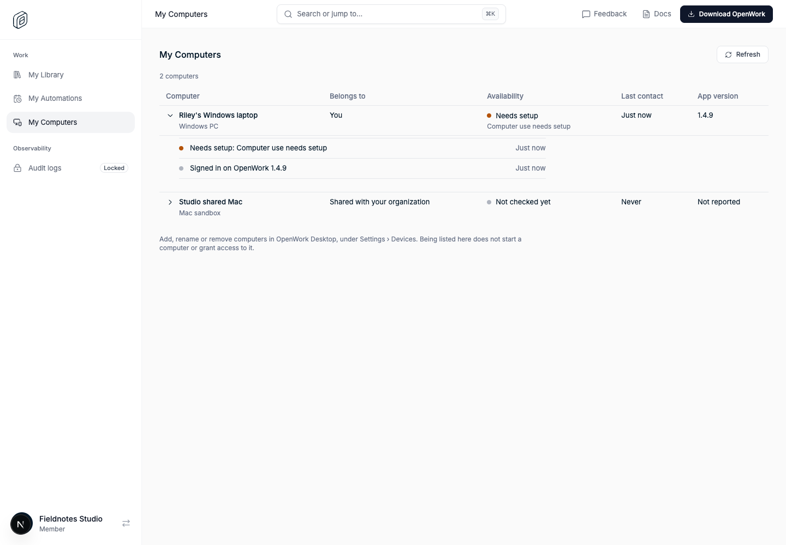
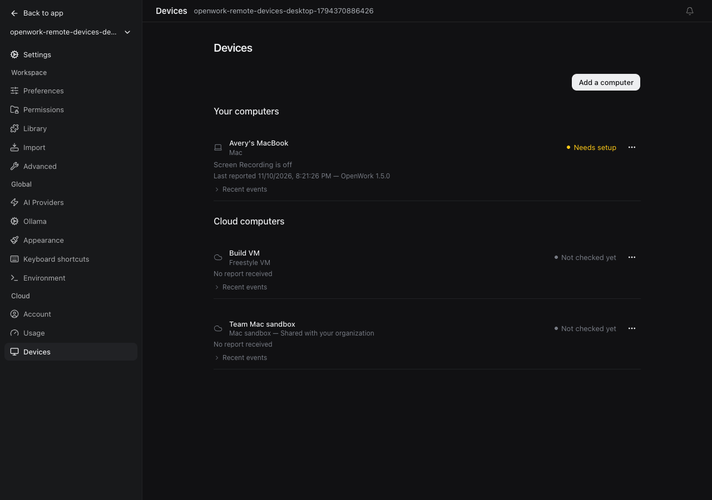
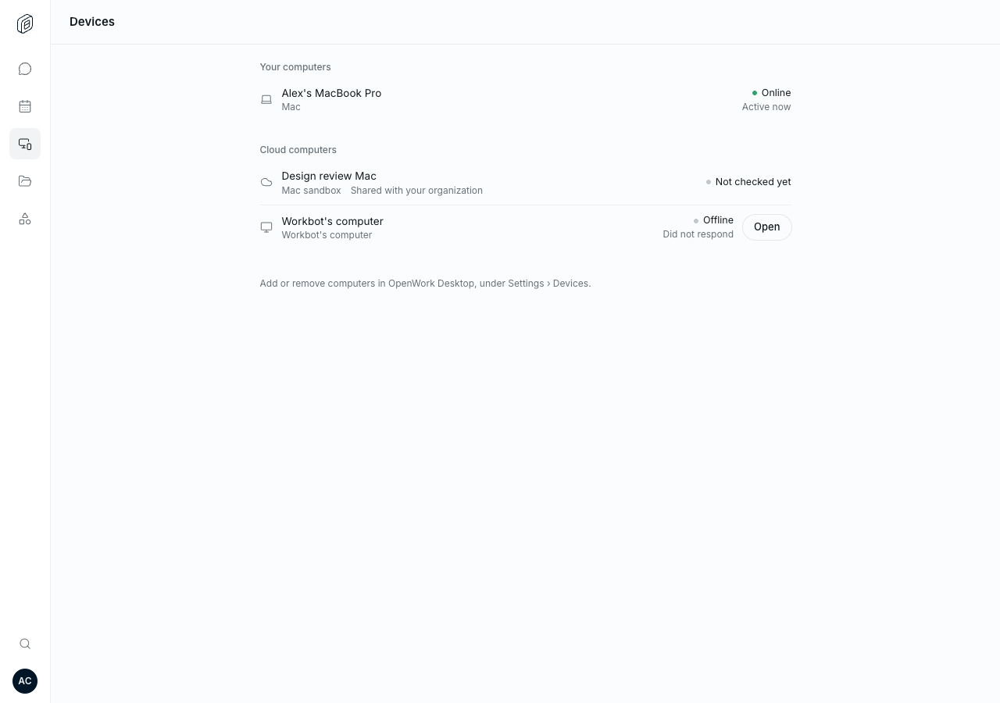
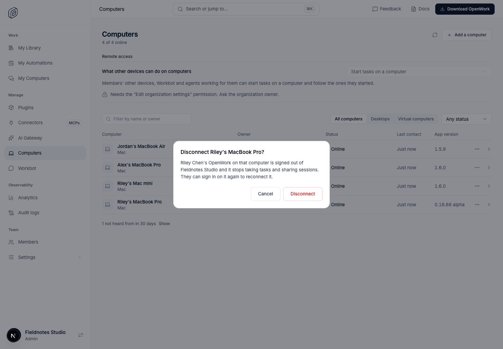

# Computers in Den (`remoteDevices`)

- **Key:** `remoteDevices`
- **Deployments:** cloud and self-hosted
- **Default:** off
- **Author:** @benjaminshafii

## Where it lives

**Regular Den → Manage → Computers**, at `/dashboard/computers`, inside the
selected organization. This is a customer organization management page, not
OpenWork's internal `/admin` panel.

Organization owners and admins have **View computers** (`computers.view`) by
default. They see the team's reported computers across all members, with the
owner, type, status, last contact, version and supported inventory. They can
inspect reported adapters, permissions/readiness and runner capabilities
without impersonating a member. Registered OpenWork instances are included
from Den's existing worker inventory; the page never exposes their tokens,
provider reference blobs, endpoints or filesystem paths.

The misplaced platform-admin Devices page and tools originally introduced in
this PR have been removed. Existing, unrelated diagnostics are unchanged.

## Every member: My Computers

**Regular Den → Work → My Computers**, at `/dashboard/my-computers`, is every
member's own view: the computers they have connected to OpenWork and the ones
shared with their organization, with what each is, whether it can be reached,
when it was last heard from, its OpenWork version, and its recent activity in
plain sentences. It needs only the `remoteDevices` feature, no permission. A
member can rename a computer they registered, disconnect a signed-in desktop
of their own and remove an entry that will not come back; adding one stays in
OpenWork Desktop. It reads
the same member-scoped routes as Desktop and Workbot, so a member never sees
another member's computers or the team's registered instances there. Owners
and admins also get a link from it to the team page.

## Member views stay personal

Den **My Computers**, Desktop **Settings → Devices** and Workbot **Devices**
show only the member's own computers and computers registered as shared
with the organization. An organization admin's team-wide visibility in Den
does not make the admin's personal Desktop or Workbot list impersonate other
members.

## What other devices can do on a computer

A signed-in desktop can take tasks from its owner's other devices, Workbot and
agents working for them. Who decides:

- **Its owner**, per computer, in **Desktop → Settings → Devices**: Nothing,
  Start tasks here, or (with `remoteSessionAccess`) also open sessions started
  there.
- **The organization**, on **Manage → Computers → Remote access**: Off for
  everyone, start tasks, or the wider choice. The narrower of the two applies
  and the computer enforces it.
- With [`remoteTasksOptIn`](../remote-tasks-opt-in/README.md) a computer takes
  nothing until its owner allows it.

**My Computers** shows what applies on each computer and why; a computer's
detail on **Manage → Computers** shows the same for admins.

## Disconnecting a computer

A signed-in desktop can be **disconnected**: by its owner from any of their
devices (Den **My Computers**, or **Settings → Devices** on another of their
desktops), and by anyone with **Disconnect team computers**
(`computers.disconnect`: admins by default, and it asks for a recent sign-in)
from **Manage → Computers**.

Disconnecting takes effect at once and on the server:

- Den refuses that install as the member's computer: its runner token, a new
  runner token, its live event stream and its own report all answer
  `403 computer_disconnected`. It takes no remote tasks, shares no sessions
  and reports nothing.
- Sessions on it that were opened from elsewhere are disconnected, queued and
  claimed work for it is failed, and a scheduled run it held is released.
- Where Den knows the sign-in the desktop uses, and it is not the one making
  the request, that sign-in is ended, so OpenWork is signed out on that
  computer. A desktop shares its sign-in with the browser that signed it in, so
  that browser is signed out too. The result says which happened.
- The computer stays in the lists as **Disconnected**.

Only a new sign-in on that computer reconnects it. An older sign-in, including
the one that performed the disconnect, stays refused.

The desktop app recognises the refusal: it stops retrying, says the computer
was disconnected and offers to sign out and in again.

**Remove from list** is a separate action that only hides an entry. It is
offered where the entry will not simply come back: a disconnected desktop, a
former member's computer, a registered virtual computer, or a desktop not
heard from for 30 days.

## The team list

**Manage → Computers** leaves out desktops nobody has heard from for 30 days
(old installs of the same computer, mostly) behind a "not heard from in 30
days · Show" line, names an owner who has left as **Former member** instead of
showing a placeholder address, and shows versions as release and channel
(`0.18.66 alpha`), with the full string in the detail.

## Sources and identity

`remote_device` has one row per organization, provider and provider identity.
It stores metadata, not provider credentials:

| Source | How it appears |
|---|---|
| Desktop | The signed-in app reports its stable install identity, versions and computer readiness on launch, on change and every five minutes. Den uses the same scoped runner identity as remote tasks. Older runner registrations are included even before they send a device report. |
| Workbot | The computer route reports viewer and lifecycle activity, or a fixed failure code. Each computer remains scoped to its actual conversation owner. |
| Configured VMs | A desktop configured to reach a Freestyle or Daytona computer reports the provider ID and observed readiness, never its key. |
| Registered VMs/Mac sandboxes | Members register metadata for themselves; sharing with the organization needs the existing Manage desktop policies permission. Registration makes no provider call. |
| Registered OpenWork instances | Den's existing organization-scoped worker/runtime inventory supplies instance metadata and last reported activity. No duplicate provider provisioning or access store. |

A desktop counts as online for ten minutes after its latest report or runner
contact. A stale virtual-computer report is **Not checked yet**, never an
assumed pause that Den did not observe. Reports and state are not independent
live provider health checks. Desktops unseen for 30 days leave the reported
computer list. Each device retains its latest 200 events for 30 days, with
fixed codes and bounded diagnostic metadata.

## Authorization

- Team-wide reads use the selected organization context and require both
  `remoteDevices` and `computers.view`, checked server-side.
- A device from another organization is not readable through the team detail
  route, even when its ID is known. Caller-supplied filter parameters cannot
  select a different organization's inventory.
- Disconnecting or removing another member's computer needs
  `computers.disconnect`, the feature, the same organization and a recent
  sign-in. A member can only disconnect their own. Both are recorded in the
  audit log, as is the sign-in that was ended.
- Ordinary members cannot read team-wide inventory. Their existing personal
  routes still return only owned/shared computers.
- A desktop cannot take over another member's entry or change a shared entry
  without permission. Workbot cannot report a forged conversation identity.
- Audit declarations cover tenant reads and reports without recording secrets,
  screen content or files. Owner and inventory metadata are visible to the
  organization's authorized administrators, not to arbitrary members.

## Not provisioning or an access broker

Adding a Freestyle VM or Mac sandbox names it in OpenWork. It does **not**
provision, start, stop or delete the machine, grant credentials, or make a
previously inaccessible computer controllable. Existing computer adapters,
runner authorization and remote-task transports remain authoritative. Nothing
here enumerates an external provider account or imports machines automatically
from a Mac host.

## Turning it off

Disable `remoteDevices` for the organization or use its kill switch. Computers
in Den and the member Devices views disappear, gated reads return
`404 feature_disabled`, and desktop reports stop on their next check. Stored
records remain. Existing computer use and remote tasks work as before.

## Verification

- `ee/apps/den-api/test/api/remote-devices.api.test.ts`: organization RBAC,
  all-member visibility, personal visibility, cross-organization isolation,
  report identity, shared-write restrictions, races and event retention.
- `evals/proofs/den-computers.proof.test.ts`: actual regular Den navigation, the
  organization-admin Computers page, and an ordinary member's My Computers
  page with only their own and shared computers.
- `ee/apps/den-api/test/api/computer-disconnect.api.test.ts` and
  `evals/proofs/den-computer-disconnect.proof.test.ts`: disconnect by an admin
  and by the owner, the refusals a disconnected desktop receives, the ended
  sign-in, reconnecting by signing in again, permissions and isolation,
  removal, and the folded-away old installs.
- `evals/proofs/remote-devices-desktop.proof.test.ts` and
  `evals/proofs/remote-devices-workbot.proof.test.ts`: preserved personal views.

All live tests use disposable local databases. No production feature overrides
are part of this PR.
