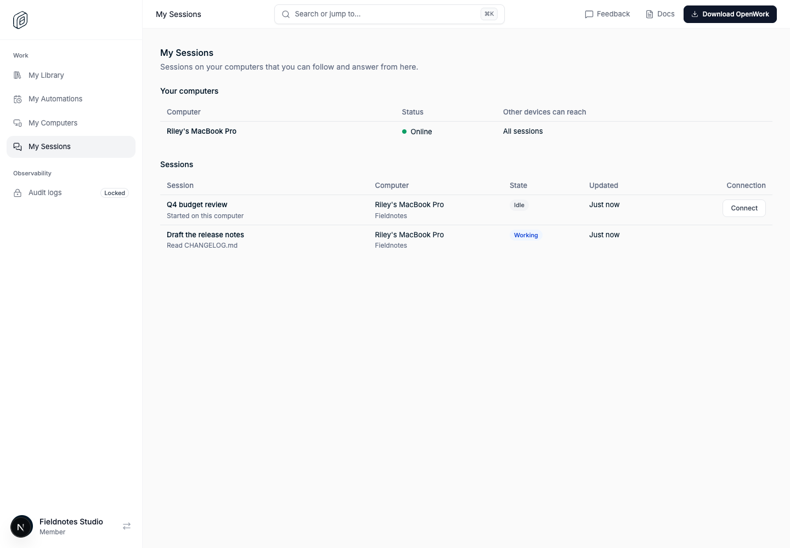
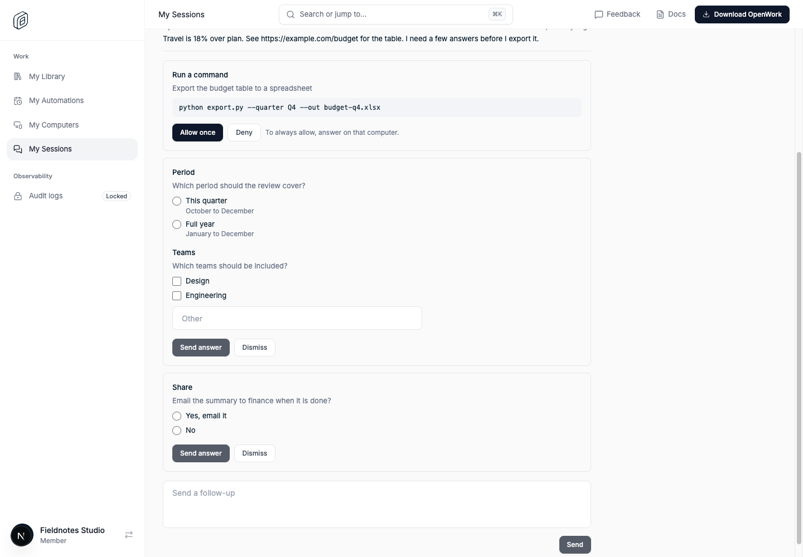
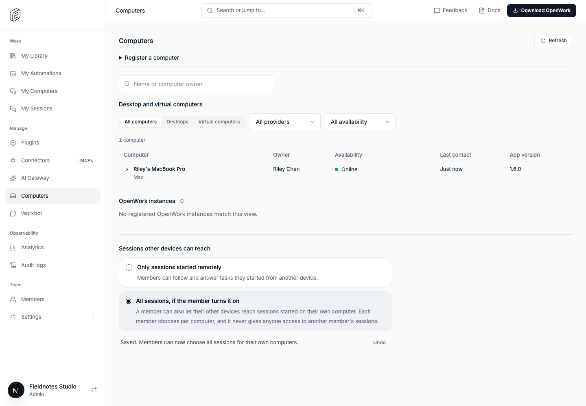

# Sessions on my computers (`remoteSessionAccess`)

- **Key:** `remoteSessionAccess`
- **Deployments:** cloud and self-hosted
- **Default:** off
- **Author:** @benjaminshafii
- **Builds on:** [Computers in Den](../remote-devices/README.md) and
  [remote task answers](../remote-session-answers/README.md)

## What people get

A member's other devices (another computer, Den, Workbot, an agent working for
them) could already follow, continue, stop and answer a task on one of their
computers, but only a task that was started remotely. This adds:

1. **A choice of which sessions can be reached**, made twice:
   - the organization sets the most a member may allow (**Manage → Computers**,
     "Sessions other devices can reach"): *Only sessions started remotely*
     (default) or *All sessions, if the member turns it on*;
   - each member chooses per computer in **Desktop → Settings → Devices**:
     *Only sessions started remotely* (default) or *All sessions on this
     computer*.

   The narrower of the two applies. Reaching a session that was started on the
   computer itself therefore needs both to opt in.
2. **My Sessions in Den** (**Work → My Sessions**, `/dashboard/my-sessions`): the
   member's own sessions across their computers, what each is doing, and the
   controls to open one, answer what it waits on, send a follow-up and stop it.
3. **Every open request can be answered.** A session's open permission requests
   and questions are all listed, any of them can be answered by itself, and a
   question can be dismissed, as on the computer.

## How a session started on the computer is reached

Remote reach has always gone through a *remote-session command* the caller owns:
Den routes read, send, stop and answer through it, and the computer keeps the
matching receipt in a local journal and refuses everything else. That stays the
only path. A session that was started on the computer gets such a command
through **attach**:

1. While its effective access is `all`, the computer reports its sessions to Den
   (`PUT /v1/session-runners/sessions`: workspace, id, title, last change,
   whether a turn is running; at most 100, newest first).
2. The member (or an agent in their chat, `remote-session:attach`) asks to attach
   to one (`POST /v1/remote-sessions/attach`).
3. Den queues a command of kind `remote_session_attach` for that computer. The
   computer checks its own policy again, checks that the session is in the named
   workspace, records the receipt and changes nothing about the session.
4. From then on the session is reached like a remotely started one.

Attaching is read-only: no prompt is sent and the session's title, model and
history are untouched.

## Where the policy is enforced

- **On the computer.** The owner's choice is stored there
  (`<userData>/session-runner/access.json`); the ceiling arrives with every work
  poll and is never stored, so signing out or losing Den falls back to
  `created`. The runner core reads the access in force on every attach, every
  request and every progress report. After an attach, turning the choice off (or
  the ceiling dropping) refuses read, send, stop and answer for that session
  with `session_access_denied` and stops its progress reports. Sessions that were
  started remotely are never affected by the policy.
- **Disconnecting.** Turning the choice off on the computer, lowering the
  ceiling, or the computer no longer knowing a connection disconnects the
  sessions that were opened this way. They show as *Started on this computer*
  again once access is back and have to be connected again. The computer also
  keeps a record of the attach commands it has taken, so a connection it has
  dropped is never served through the older path that predates the journal.
- **In Den.** Attach is refused unless the feature is on, the ceiling is `all`,
  the computer is the caller's own, it runs an app that understands the policy,
  and it reported `all`. Requests through an attached session are refused again
  when any of that stops being true. With a ceiling of `created`, Den stores no
  session list, whatever a computer sends.

## Who can do what

- Everything is scoped to the signed-in member's **own** computers. Another
  member, an admin or an owner gets `unknown_computer` for someone else's
  computer and never sees its sessions; there is no team view of sessions or
  their titles.
- The ceiling is changed by whoever may **Edit organization settings**
  (`organization.update`: owners by default; admins once granted it).
- `remote-session:attach` and `remote-session:answer` are offered to an agent
  only in a person's own chat, never to Automations or Workflows, and need write
  scope.

## Answers

- `read` returns `pendingItems`: every open permission and question (up to
  five at a time), including a question a finished turn left open.
- `answer` takes the request id of any of them. `kind: "dismiss"` closes a
  question without answering it.
- A remote answer still never approves **always**: *Allow once* and *Deny* only.
  To always allow, answer on that computer.

## Limits

- Computers running an older app keep working exactly as before: they are shown
  as needing an update for this choice and never receive an attach or a
  dismissal.
- The standalone OpenCode client does not offer `all`.
- Cloud sessions are not listed in My Sessions; Den keeps no record of them.
- A form that only opens a link still cannot be answered remotely, but it can
  now be dismissed. Long computer-use requests and permission setup can still
  only be approved on the computer.
- Without `remoteSessionPush`, an attach can take up to a minute to be picked
  up, like a new remote task.
- After a computer has taken an attach, an **older** app on it cannot read the
  local journal and stops taking remote tasks for that account until the app is
  updated again. The journal is left untouched.

## Turning it off

Disable `remoteSessionAccess` for the organization or use its kill switch. My
Sessions and the organization setting disappear, the new routes answer
`404 feature_disabled`, computers are told nothing about a ceiling and so fall
back to remotely started sessions only, and sessions reached through an attach
are refused. Remote tasks started remotely work as before.

## Verification

- `packages/remote-sessions/test/access.test.ts`: the computer-side rule
  (refusal, attach, receipt checks, withdrawal after attach, crash replay,
  journal compatibility, dismissal).
- `apps/desktop/test/session-access.test.mjs` and `session-attach.test.mjs`: the
  stored choice, the ceiling, session reports, attach through the real desktop
  adapter (workspace check, no change to the session), every open request in a
  read, dismissal, and the record that keeps a dropped connection off the older
  path.
- `apps/app/tests/devices-view.test.tsx`: the Settings → Devices choice in each
  state (locked by the organization, not in effect, confirmation before
  widening, feature off).
- `ee/apps/den-api/test/api/remote-session-access.api.test.ts`: the feature gate,
  the ceiling and who may change it, reports, the list, attach, enforcement
  after attach, isolation between members.
- `evals/proofs/den-my-sessions.proof.test.ts`: the real Den web and API with a
  synthetic computer speaking the runner protocol: default policy, the owner
  raising the ceiling, the member opting in, attach, answering three open
  requests out of order, a follow-up, isolation from an admin and the owner,
  lowering the ceiling, and the feature gate.

All live tests use disposable local databases. No production feature overrides
are part of this change.
