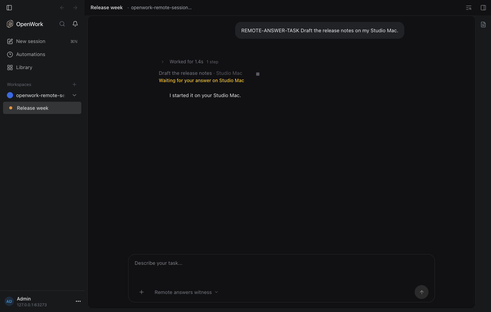
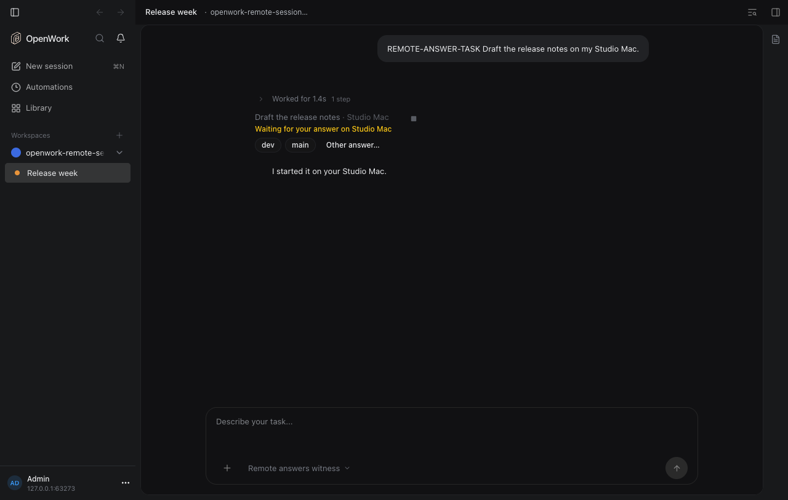
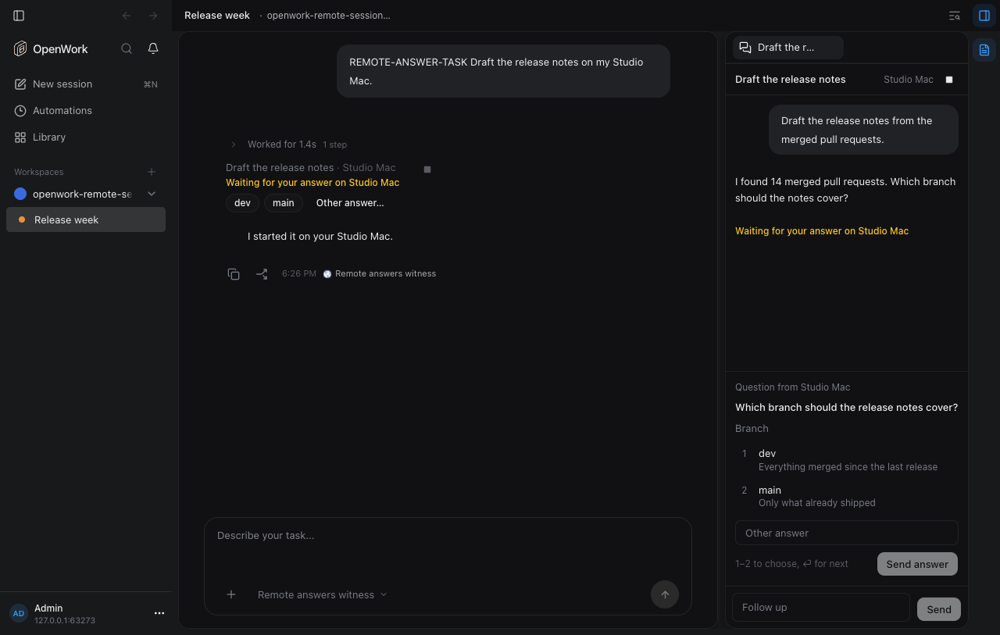
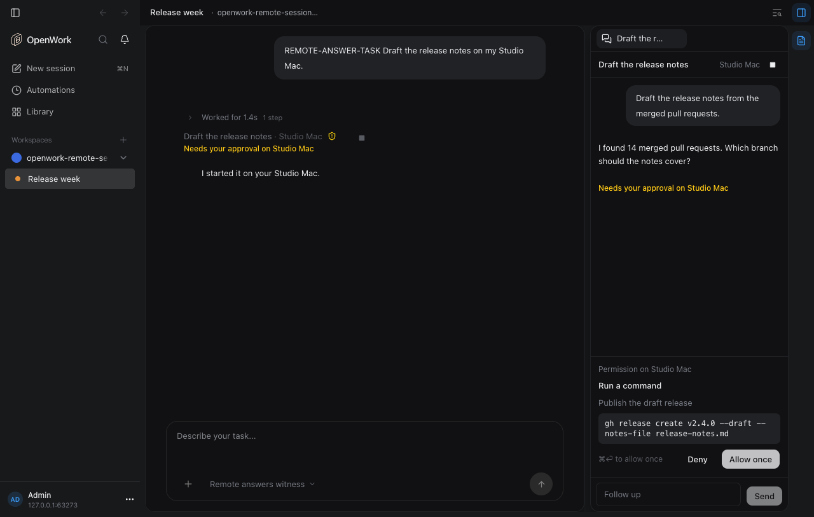
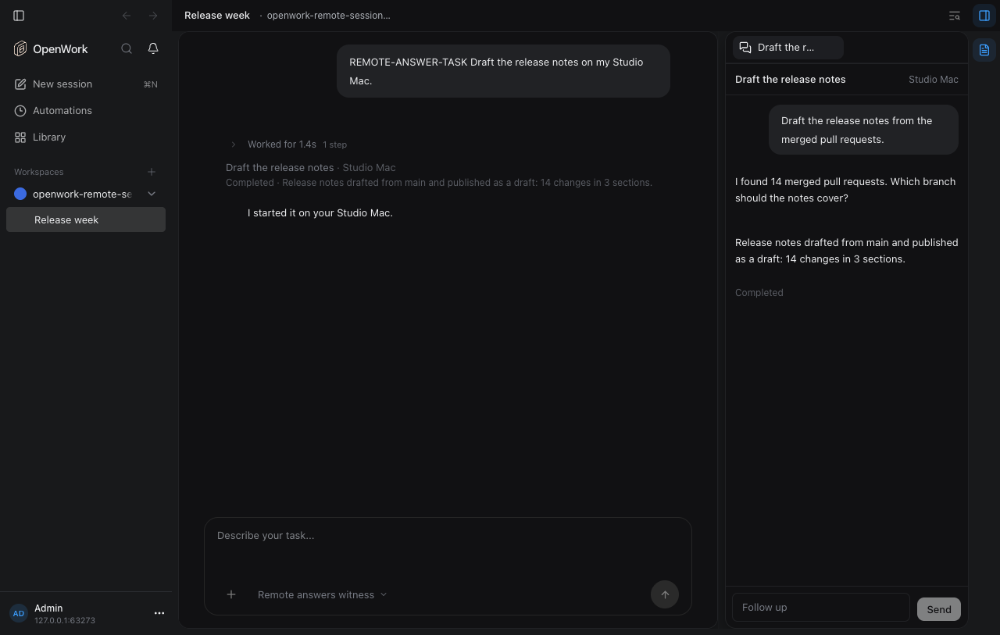

# Answer a sub-agent task's question here

Feature key: `remoteSessionAnswers` · Deployments: Cloud and self-hosted · Default: off · Author: [@benjaminshafii](https://github.com/benjaminshafii)

Needs `remoteSessionSubagents` (the row) and, for the panel card, `remoteSessionThreadView`.

## What people get

A task the agent started on the cloud or another computer sometimes stops to ask a question or to ask for a permission. Today the row says "Waiting for your answer on Studio Mac" and the person has to go to that computer.

With the feature on:

- The row offers the options of a single-choice question as small buttons, plus `Other answer…`, which opens the task's conversation.
- The conversation beside the chat shows the question or permission as a text-only card above the follow-up box: number keys choose, Enter goes to the next question, ⌘Enter allows a permission once. A permission shows its command.
- After an answer the card goes away; the task runs on and the row follows it. A failure shows the reason inline with a retry.

Off (today):

On, the row offers the task's options:

The question card in the task's conversation:

A permission card, with its command:

After allowing it once, the task finishes:

## How it works

- The runner on the other computer (desktop app or `opencode-openwork`) reports what the session waits on (`pending`) with its progress and in transcript reads, and takes an `answer` request. It replies through the same native paths a local chat uses: v1 question and permission replies, v2 form replies by field key and option value, v2 permission replies. Answers are checked against the live request; a request that is no longer pending is refused (`stale_request`). A remote surface never sends "always".
- The runner journals the answer like a follow-up, idempotent by the pending requestId: a lost reply is replayed safely, because a native request is answered at most once.
- Den routes `answer` requests only to runners that register `remote_session_answer_v1`. Older runners get `answer_unsupported` and keep "Answer it on that computer".
- `remote-session:status` carries a short `pending` summary (question and option labels, or the permission's title); a new request changes the status version.
- The app calls `POST /v1/remote-sessions/answer` (owner-only, behind this feature and `remoteSessionSubagents`). Agents get `remote-session:answer`, only in the member's own chat (never Automations, Workflows or Apps), and its instructions require asking the person first, every time.
- The OpenCode plugin host (2.0.26) has no question reply, so `opencode-openwork` answers permissions only; its questions still say to answer them on that computer.

## Try it

1. Turn on `remoteSessionSubagents`, `remoteSessionThreadView` and `remoteSessionAnswers` for your organization in `/admin`.
2. Ask the agent to run a task on another computer that asks a question (for example one that needs a branch) or runs a command that needs approval.
3. Answer from the row or the task's conversation.

The proof `evals/proofs/remote-session-answers.proof.test.ts` drives this end to end against a real Den with a runner that speaks Den's runner protocol.

## Turning it off

The kill switch hides the buttons and the card; rows go back to "Waiting for your answer on …", the route answers 404 `feature_disabled`, and the capability disappears from search. Answers already sent stay sent; nothing else changes on the other computer. Runners keep reporting `pending`, which older apps ignore.

## What to watch

- `remote_session_request` rows with `action = 'answer'` and their outcomes (`stale_request`, `invalid_answer`, `answer_unsupported`, `ambiguous_answer`).
- Audit events `remote_session.request.answer` (app route) and `remote_session.answer` (MCP).
