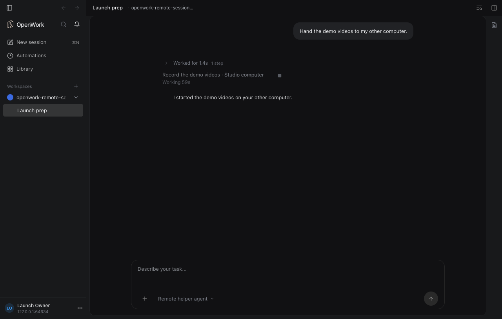
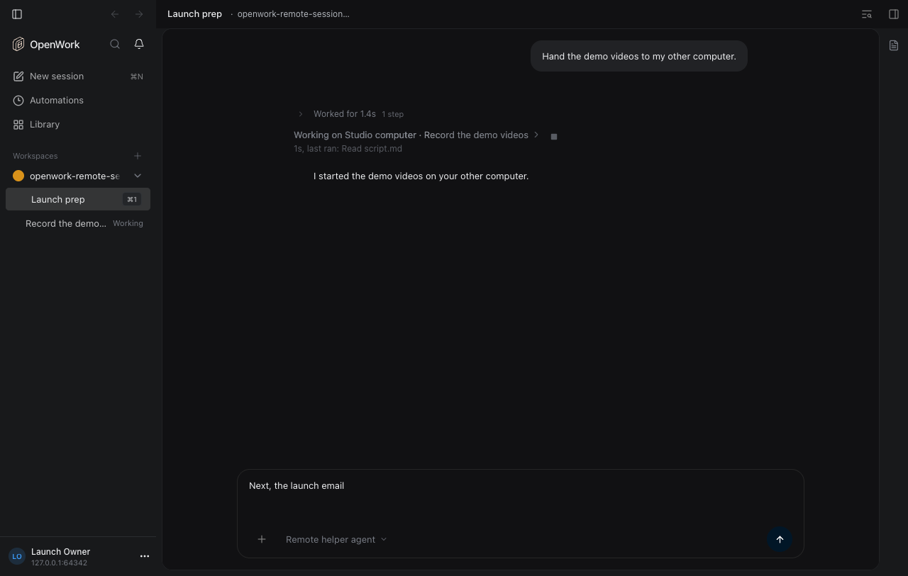
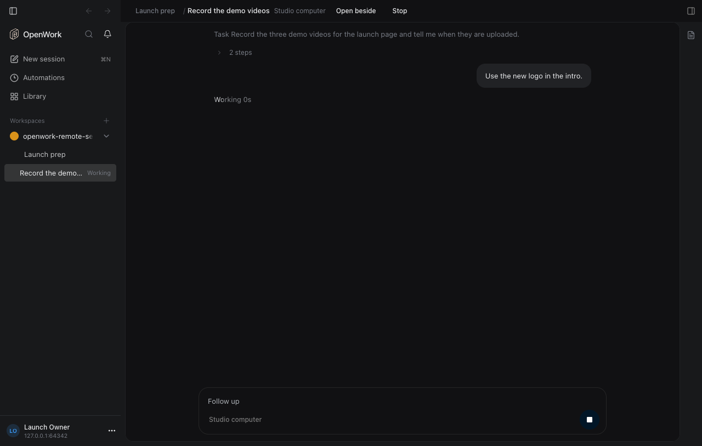
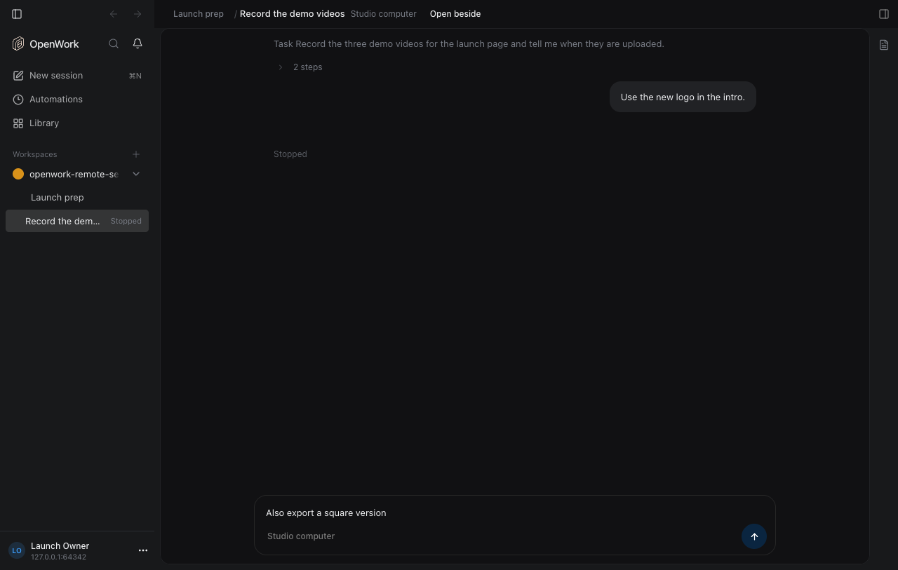

# Open a task on another computer like a helper

Feature key: `remoteSessionHelperView`
Deployments: cloud and self-hosted, off by default
Author: [@benjaminshafii](https://github.com/benjaminshafii)
Task progress and conversation views are generally available (no prerequisite flags).
The Agents list above the composer is generally available; its former
`composerSubagentTracker` rollout needs no override.

## What changes

When the agent starts a task on another computer (`remote-session:create`), its row
in the chat reads as one sentence, like a local helper's, and clicking it opens the
task in the main pane instead of beside the chat:

- The row says `Working on Studio computer · Record the demo videos ›` (the text
  shimmers while it runs), then how long it has worked and the step it ran last:
  `1s, last ran: Read script.md`. Waiting reads `Waiting for you on …` in amber;
  a finished task reads `Finished in the Cloud · …` with how long it took.
- The composer's Agents list lists the task next to the
  turn's local helpers, and is the main place to follow it: where it runs as the agent
  name, the task title, then the same status, time and actions as a local helper (one
  shared row): its working time, `Needs permission` / `Waiting for your answer` with
  **Review**, `Done`, `Stopped` or `Failed`, and `Stop` and `Open` on hover. The header's
  counts include it. Remote rows show on either engine; local helper rows keep their v2-only rule.
- The task opens under its own route, `/workspace/<id>/session/remote:<threadKey>`.
  The header is a breadcrumb (`Launch prep / Record the demo videos`), the computer
  as plain text, and `Open beside` and `Stop` as text buttons. The task as the agent
  sent it is folded to one `Task …` line above the steps.
- Enter sends a follow-up (it steers a running task); the round button becomes Stop
  while the task runs. Esc or the breadcrumb return to the chat at the same pane,
  scroll position and row, with the chat's own draft and the task's unsent
  follow-up both kept.
- The sidebar lists each task under the chat that started it, with a word instead
  of a dot: `Working`, `Needs you`, `Done`, `Stopped`, `Failed`. Its title
  starts on the same left edge as the chat title above it, with no glyph of its own.
- One left edge: the chat row's sentence, the folded `Task …` line and the header's
  breadcrumb start where their surroundings' text does; disclosure chevrons trail the
  text. No leading chevron, glyph or lane is added.
- `remote-session:status` gains `latestStep`, a short sentence for the step a
  running or waiting task ran last. Desktop runners report it with their progress
  (stored in `remote_session_command.session_latest_step`); Cloud tasks derive it
  from the last few messages Den already reads. Older runners and Den deployments
  leave it out and the row shows just the duration.

All screenshots are dark mode with the Agents list, which is now generally available.

| Off (today) | On |
| --- | --- |
|  |  |

The task opened in the main pane (from the Agents list's `Open`), after a follow-up:

After Stop, with the unsent follow-up kept:

## How to try it

Turn on `remoteSessionHelperView` for an organization (it remains a separate
opt-in rollout), sign in on two computers, and ask the
agent to start a task on the other one. `evals/proofs/remote-session-helper-view.proof.test.ts`
walks the whole flow against a registered runner.

## Turning it off

Rows go back to the two-line progress row that opens the side panel, the sidebar
and the Agents list stop listing tasks, and an open `remote:` route shows a one-line note pointing back
to the chat. Nothing is stored in the app; the `session_latest_step` column stays
and is simply not shown. Running tasks are unaffected.

## What to watch

- `remote-session:status` call volume: a running desktop task now changes version on
  each new step, so a following chat makes a few more (still long-polled) calls.
- Errors from `POST /v1/remote-session-commands/:id/session` (runner reports).
