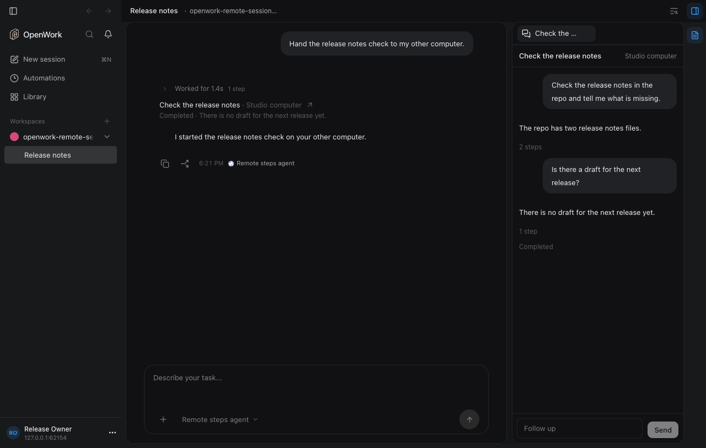
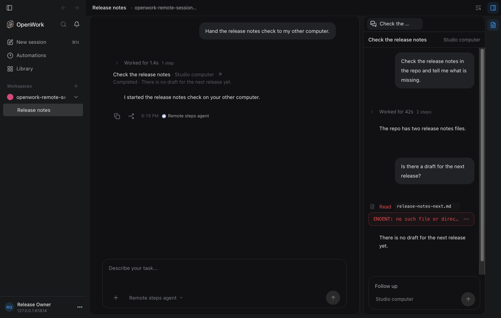
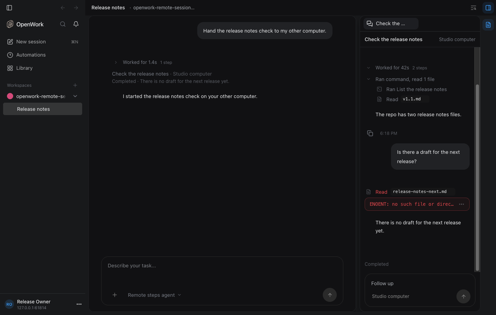

# Desktop: open a sub-agent task's conversation

Feature key: `remoteSessionThreadView` · Deployments: cloud and self-hosted · Default: off · Needs: `remoteSessionSubagents`

## What people get

Clicking the row of a task running on another computer opens its
conversation beside the chat. The conversation is drawn by the chat's own
renderer: every step the other computer took shows as its own line (commands,
file reads, edits, OpenWork and connector calls), a finished turn folds to
"Worked for…", and a failed step stays open in red with what went wrong.
The follow-up box has the composer's shape: one round send button that
becomes Stop while the task runs, and the computer as a quiet pill.

Before, each reply showed its text and a count ("2 steps"):

After, the same task:

## How it works

- Runners send each message's ordered `parts` (text, reasoning, tool with
  status, input, output, error and timestamps) next to the older `text` and
  `toolCalls`; see "Transcript steps" in
  [`docs/session-offloading-architecture.md`](../../session-offloading-architecture.md).
- `remoteTranscriptToUIMessages()` (`apps/app/src/lib/remote-transcript-messages.ts`)
  maps them to chat message parts, and `RemoteTranscriptView` renders them
  with `MessageList` in a read-only provider. The follow-up box is
  `RemoteFollowUpComposer`, sharing `ComposerSendButton` with the chat composer.
- Off: the row shows progress only, and a conversation tab left open says the
  view is turned off.

Proof: `evals/proofs/remote-session-steps.proof.test.ts`.
