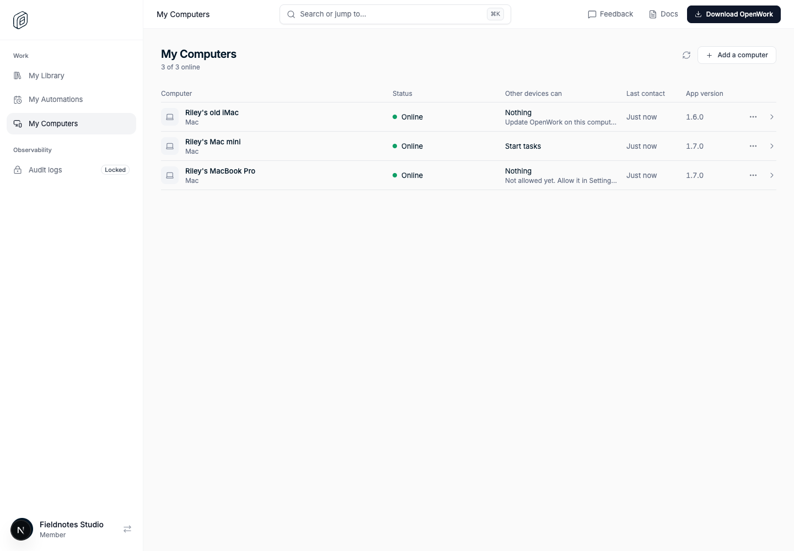
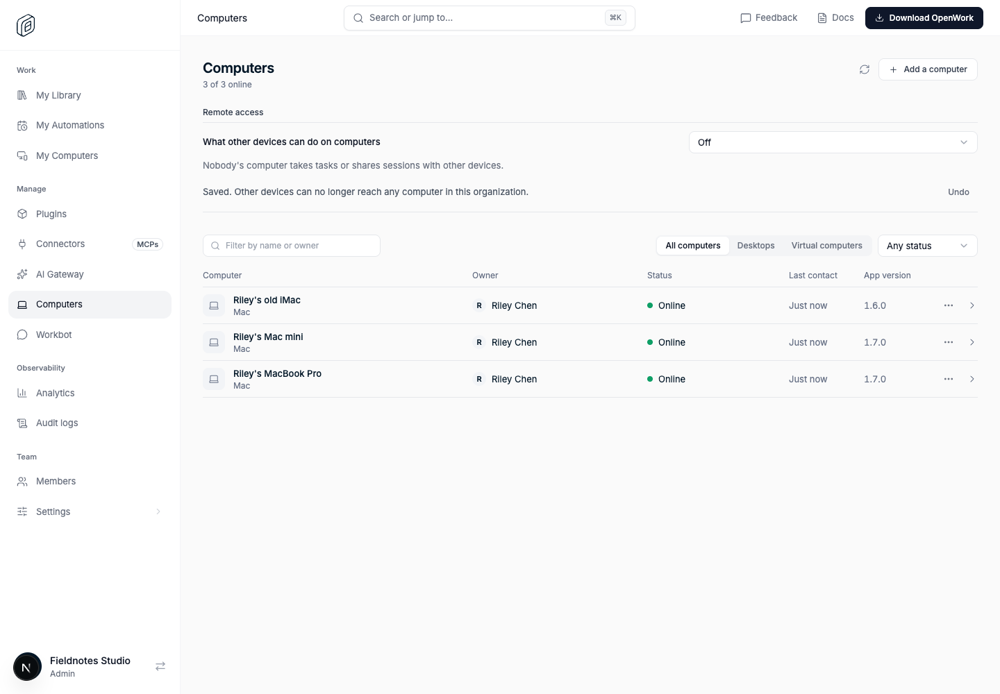

# Other devices reach a computer only after its owner allows it

Feature key: `remoteTasksOptIn` · Deployments: cloud and self-hosted · Default: off · Author: @benjaminshafii

Part of [Computers in Den](../remote-devices/README.md). Reaching sessions that
were started on a computer is a separate feature,
[`remoteSessionAccess`](../remote-session-access/README.md).

## What changes

A signed-in computer has always taken tasks started from its owner's other
devices, Workbot and agents working for them, with no way to say no and no way
to allow one computer and not another.

Every computer now has a choice, made by its owner in **Desktop → Settings →
Devices → What other devices can do on this computer**:

- **Nothing.** No task can be started there and no session reached.
- **Start tasks here.** Tasks can be started there remotely, and only those
  sessions can be followed, continued and answered. This is what every
  computer did before.
- **Also open sessions I started here.** Needs `remoteSessionAccess` and the
  organization to allow it.

The choice is kept per organization, so a choice made for one organization is
never carried into another.

The organization's limit on **Manage → Computers → Remote access** gains
**Off**: nobody's computer takes anything from other devices.

**With `remoteTasksOptIn` on**, a computer whose owner has not chosen takes
nothing. The owner allows each computer themselves. **With it off**, a computer
whose owner has not chosen keeps taking tasks started remotely, as before.
Either way the owner can turn a computer off, and an organization owner can
turn remote access off for everyone.

## Where it is enforced

- **On the computer.** The choice is stored there. While it is off the app
  refuses remote tasks and every request for a session with
  `remote_access_off`, never touches a local session for them, and reports
  nothing about its sessions. This holds on the older paths that predate the
  local journal too. The owner's own scheduled Automations keep running.
- **In Den.** A task for a computer that is off is refused up front with
  `409 remote_access_off` and a sentence saying where to allow it; picking a
  computer automatically skips the ones that are off; `remote-session:targets`
  shows each computer's access so an agent can explain.

## Things to know

- With the opt-in on, a computer running an app from before this choice cannot
  be allowed until it is updated.
- Turning a computer back on restores access to tasks that were already
  delivered there. A task that was refused while it was off stays refused.
- **My Computers** in Den shows, on every computer, what other devices can do
  there and why (not allowed yet, turned off, needs an update, limited by the
  organization). Admins see the same in a computer's detail on **Manage →
  Computers**. Both come with the Computers pages; no other feature is needed.

## Turning it off

Turn `remoteTasksOptIn` off (or use its kill switch). Computers whose owners
have not chosen take remotely started tasks again on their next check-in.
Choices owners made, including Nothing, stay as they are, and an organization
limit of Off keeps applying.

## Verification

- `packages/remote-sessions/test/off.test.ts`: while off the adapter is never
  called and nothing is reported.
- `apps/desktop/test/remote-access-off.test.mjs` and `session-access.test.mjs`:
  the per-organization choice and its migration, the effective value, and off on
  both the journalled and the older path.
- `ee/apps/den-api/test/api/`: refusals, automatic selection, the organization
  limit, the opt-in default, older apps.
- `evals/proofs/den-remote-access-off.proof.test.ts`: real Den web and API with
  stand-in computers.
