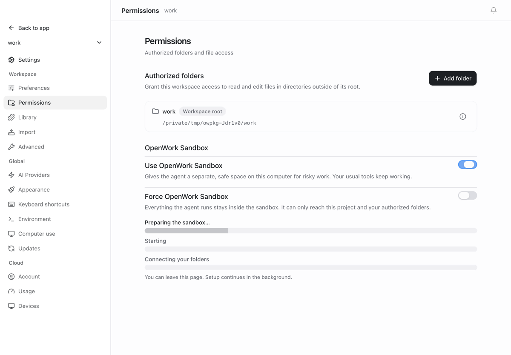
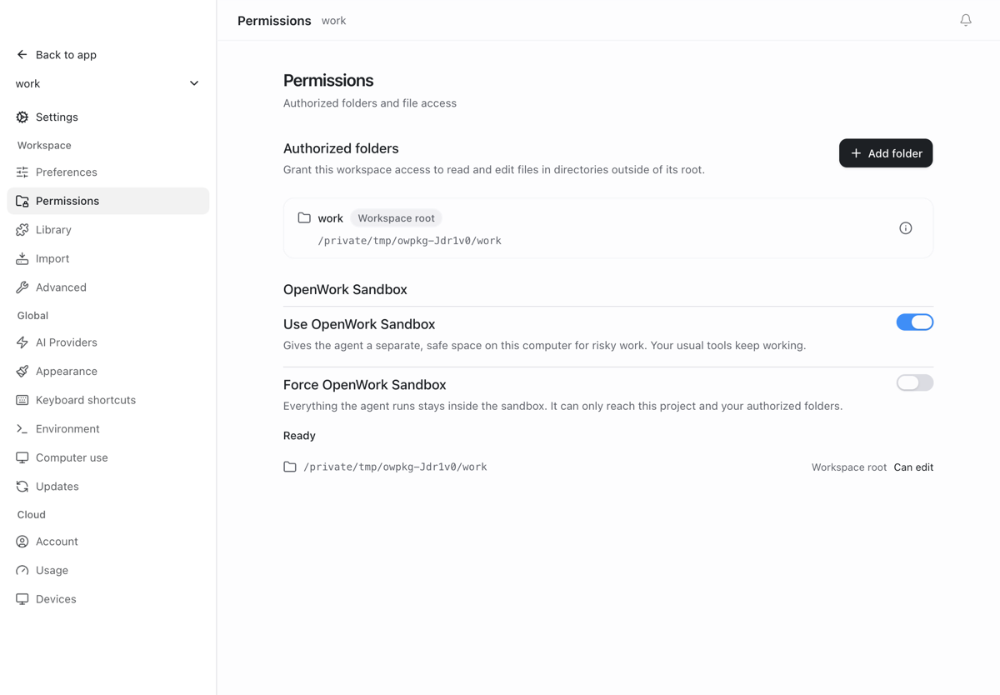
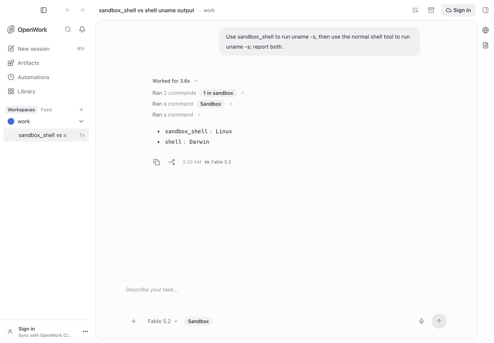
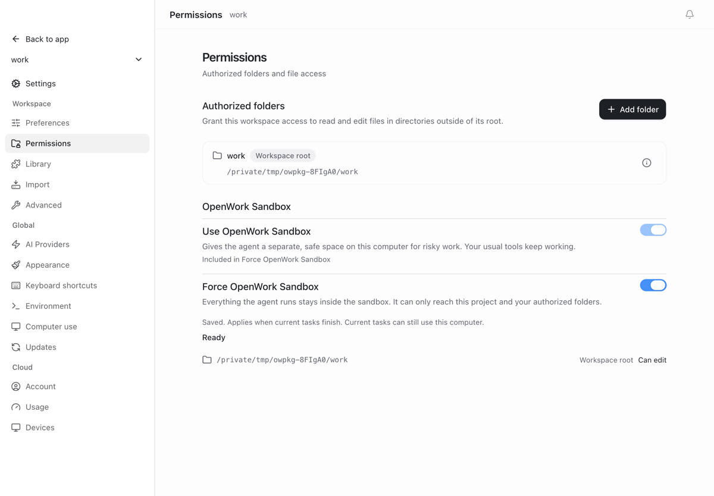
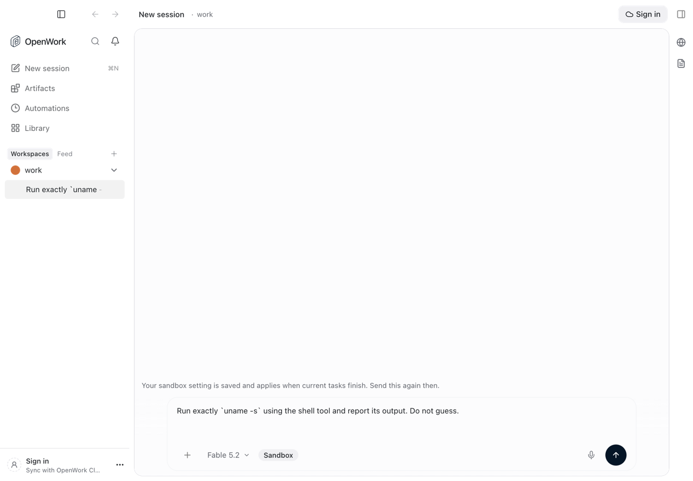
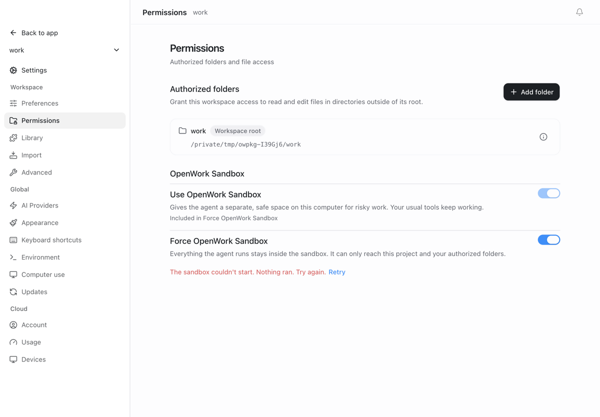
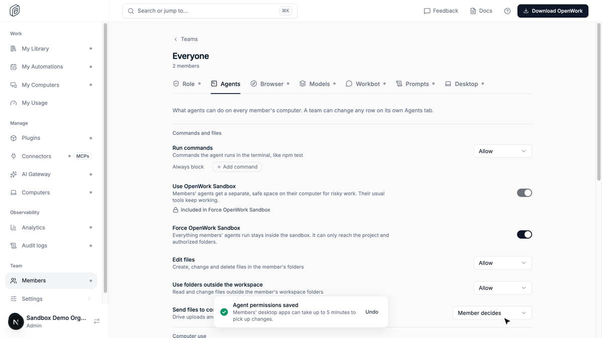
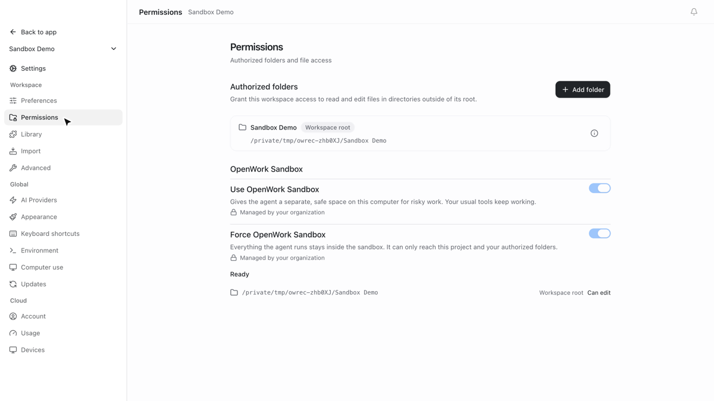

# Use and Force OpenWork Sandbox: packaged verification

Feature: `sandboxTools` (cloud and self-hosted, off by default). Contract: [modes.md](modes.md).

Everything here ran on packaged, ad-hoc signed macOS arm64 builds of the branch, each with its own profile,
project folder and sandbox home, a loopback stand-in for OpenWork Cloud (rollout flag only), and real model chats
through the app's own composer. No production flag, organization or release was touched.

## What a person sees

Turning on **Use OpenWork Sandbox** shows the setup steps, then Ready with the folders the sandbox can see:

In chat, a quiet pill shows the mode, and each step that ran in the sandbox is tagged. A folded group says how many
of its steps ran there:

Changing **Force OpenWork Sandbox** while a task runs is saved and applies when the task finishes. A message sent
meanwhile is kept, with a note instead of an error:

When the sandbox cannot start, nothing runs on the computer instead; Settings says so and offers Retry:

An admin can require either setting in Den; the member's switches are then locked:

## Matrix

`evals/scripts/packaged-sandbox-check.ts` (cases in `evals/worlds/packaged-sandbox.ts`), run once per model with
Claude Fable 5.2 and GPT-6.2 Sol (priority tier). Every case passed with both models.

| Case | What it proves |
|---|---|
| a | Use: progress, Ready, one turn that runs `uname -s` in the sandbox (Linux) and on the Mac (Darwin); both tool sets offered; only the sandbox step is tagged |
| b | Force: exactly six tools, all in the sandbox; a private folder outside the project is unreachable; a `/tmp` write never reaches the Mac |
| c | Folders: an authorized folder appears at the same path, edits are live in both directions, and a removed folder is unreachable on the next command |
| d | First run from an empty cache, then off and on again |
| e | Relaunch prepares the sandbox without opening Settings; a second chat reuses it |
| f1–f3 | Use off, Force on and Force off during a 30-second command: the command finishes where it started, nothing turns red, a message sent meanwhile is kept with a note |
| g | The sandbox process is killed: the next command recovers. The sandbox cannot start: a plain error, nothing runs on the Mac, Retry works |
| i, i-off | Both switches off behaves exactly like the rollout being off |
| j | A real task per mode: get a small project, run its tests in the sandbox, fix the bug, tests pass on the Mac's copy |

A read-only project cannot be exercised through chat in a packaged app, because a read-only server refuses every
message. Read-only mounts are covered by `apps/server/test/sandbox-mounts.test.ts` and
`local-sandbox-runtime.vitest.test.ts`.

## Timings

Measured in the matrix runs above. Ranges cover both models and two builds.

| | After | Before (0.18.69 alpha) |
|---|---:|---:|
| Use: click → Ready, empty cache | 0.6–2.2 s | first command paid for it |
| Use: click → Ready, warm | 0.15 s | first command paid for it |
| Force: click → applied, nothing running | 1.1–1.8 s | 1.2 s |
| Folder change → ready again | 0.4 s | next command +0.3 s |
| Relaunch → sandbox ready, Settings not opened | 1.9 s | next command +0.4 s |
| First sandbox command: tool time | 35–50 ms | 1,240 ms cold, 40 ms warm |
| Command after the sandbox process was killed | recovers, 30–35 ms tool time | fails until relaunch |
| Retry after a failed start: error cleared / Ready | 0.13 s / 0.66 s | no Retry |
| Rollout reads in a one-tool turn, signed out | 1 | 3–5 |

Settings → Permissions time to interactive is measured by `evals/scripts/sandbox-ux-timings.ts` and held by
`evals/proofs/permissions-opens-fast.proof.test.ts` (2,000 ms cold and 600 ms warm with 12 workspaces and 400 ms of
added organization latency). Signed in with 12 workspaces and 150 ms of added latency, a cold open went from
11.3 s to 0.8 s. Opening the page starts no sandbox process.

## Proofs

- `evals/proofs/sandbox-only.proof.test.ts`: native desktop with the real sandbox.
- `evals/proofs/sandbox-controls.proof.test.ts`: Den requirements, locks, older desktops.
- `evals/proofs/permissions-opens-fast.proof.test.ts`: packaged desktop, time budget.
- `evals/proofs/packaged-sandbox.proof.test.ts`: packaged desktop with scripted inference.

## Local packaged builds

An ad-hoc signature has no Team ID, so macOS refuses to let the sandbox runtime load its own firmware library and
no sandbox can start. `apps/desktop/scripts/electron-after-pack.cjs` signs the runtime with
`entitlements.microsandbox.adhoc.mac.plist` for ad-hoc builds only. Developer ID builds keep library validation.

## Known gaps

- A read-only server answers a chat message with its raw `read_only` error text.
- While a Force change waits for a task, the rollout is read again about every 2 seconds.
- The sandbox uses the default shared sandbox home rather than one owned by OpenWork.
- The first launch of a fresh profile spent 7.9 s extracting the bundled engine dependencies on the ad-hoc build,
  against 1.7 s on the Developer ID alpha, with the same archive and unchanged code. Relaunch times are equal
  (2.5 s). This needs a measurement on a Developer ID build of this branch.
