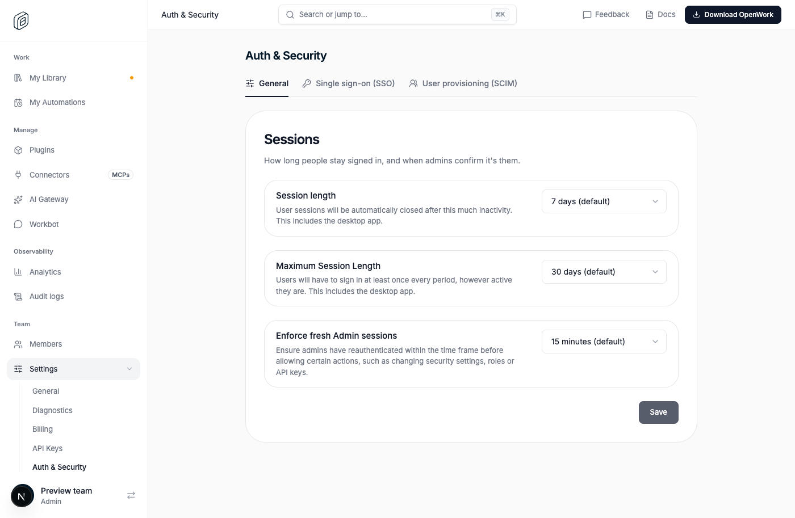
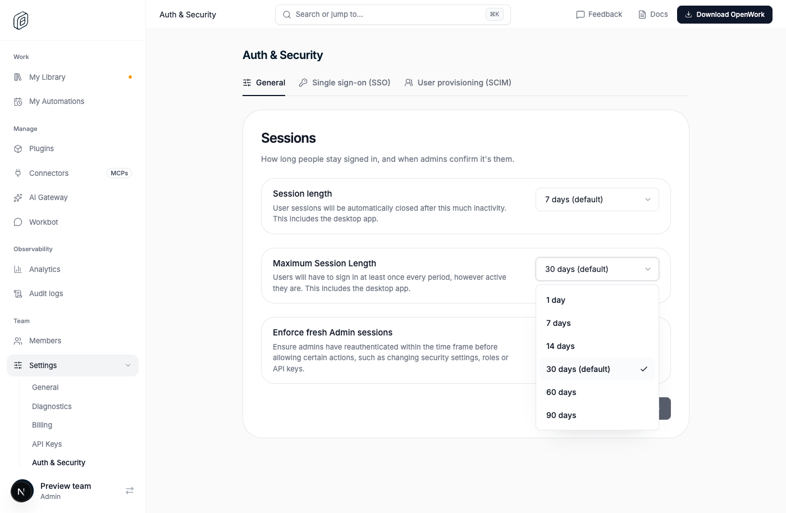

# Session length, maximum session length and admin re-authentication settings

- Feature: `sessionSecuritySettings`
- Deployments: cloud and self-hosted; default **off**.
- Author: `OmarMcAdam`
- Needs `authSecuritySettings` on too: the settings live on its page, and they
  only apply while both are on (`sessionSecuritySettingsApply`).

## What changes

Settings › Auth & Security gets a **General** tab, first and the default, with
three dropdowns. They are saved in the organization's metadata through
`PATCH /v1/org` (Edit organization settings permission, which is sensitive,
so the admin must have signed in recently to change them).

| Setting | Field | Choices | Default |
|---|---|---|---|
| **Session length**: user sessions are closed after this much inactivity, desktop app included | `sessionLengthHours` | 12 hours, 1 day, 3 days, 7 days | 7 days |
| **Maximum Session Length**: users have to sign in at least once every period, however active, desktop app included | `maxSessionLengthDays` | 1, 7, 14, 30, 60, 90 days | 30 days |
| **Enforce fresh Admin sessions**: how recently an admin must have signed in before sensitive changes (the "Confirm your identity" dialog) | `adminReauthMinutes` | 15 minutes, 1 hour, 4 hours, 8 hours, 1 day, Disabled (`0`) | 15 minutes |

Off: sessions last 7 days without activity, are renewed for as long as they
are used, and sensitive changes need a sign-in from the last 2 hours, exactly
as before.

**Ask for SSO again** (`ssoPerOrganization`) was removed outright, whether or
not this feature is on: see [sso-per-organization](../sso-per-organization/README.md).

### Session length and maximum session length (den-api)

A session belongs to a person, not an organization, and opens every
organization they belong to. It gets the **strictest** of each limit among
those organizations (`userSessionLimits` in `src/session-security-lifetime.ts`).
A session expires at the earlier of its length from its last use and its
maximum length from sign-in (`createdAt`), so activity can no longer renew it
forever. Signing in again (including the "Confirm your identity" dialog)
starts a new session and a new period.

- New sessions: Better Auth's `session.create.before` hook shortens `expiresAt`.
  With a 1-day maximum and a longer length, the maximum applies.
  This covers every sign-in path: password, Google, SSO, desktop device sign-in.
- Activity extends a session: Den's middleware (`src/session.ts`, cookies and
  desktop bearer tokens) and MCP token liveness (`src/cache.ts`) extend it to
  the person's length, never past the maximum. A session is extended once its last extension
  (`updatedAt`) is older than a seventh of its length (once a day at 7 days,
  as before; about every 1.7 hours at 12 hours). Only then are organizations
  read, never on every request. Better Auth's own extension on `/get-session`
  is held to the same length by the `session.update.before` hook.
- Lowering either limit ends every member's longer sessions at the new length
  from now, or the new maximum from their sign-in (`shortenMemberSessions`).
  Lowering the maximum below a session's age signs it out at once. A session served from the Redis cache
  can keep its old expiry for up to an hour.
- So the desktop app, which uses the same sessions, is signed out after the
  same inactivity.

### Enforce fresh Admin sessions (den-api)

Every recent sign-in check reads the request's organization:
`organizationPrivilegedSessionMaxAgeMs` in `src/privileged-session.ts`, used by
sensitive permissions (`orgPermissionRoute`, `requirePermission`) and by
`ensureFreshPrivilegedSession` (connections, LLM providers, plugins, Slack,
ownership transfer). Disabled skips the check. Reading connection credentials
keeps its wider 24-hour window unless the check is disabled. API keys and MCP
calls are not affected, as before. Signing in again in the dialog starts a new
session, so the window counts from then.

## How to try it

1. `/admin` › Organizations › your organization › Features: turn on
   **Den: Auth & Security settings** and **Den: session length and admin
   re-authentication settings**.
2. Settings › Auth & Security opens on General. Keep the defaults and wait
   15 minutes after signing in, then delete a role: the "Confirm your
   identity" dialog appears. Choose Disabled and it no longer does.
3. Set Session length to 12 hours: the desktop app and the browser sign out
   after 12 hours without use.
4. Set Maximum Session Length to 1 day: anyone who signed in more than a day
   ago is signed out, and everyone signs in again at least daily.

`ee/apps/den-api/test/api/session-security-settings.api.test.ts` covers both
settings end to end against a real database, including turning the feature
off again.

## Turning it off

The kill switch or the organization override restores 7-day sessions with no
maximum and the 2-hour window on the next request. Sessions already shortened
keep their shorter expiry until their next extension, which gives them 7 days
again. No
stored data needs cleaning up.

## What to watch

- `session length could not be read` in den-api logs: a session was not
  extended (or a new one kept 7 days) because organizations could not be read.
- 403 `reauth` (`fresh_auth_required`) volume per organization after it
  chooses 15 minutes.
- Support reports of people signed out sooner than expected: check every
  organization the person belongs to, since the strictest one applies.
