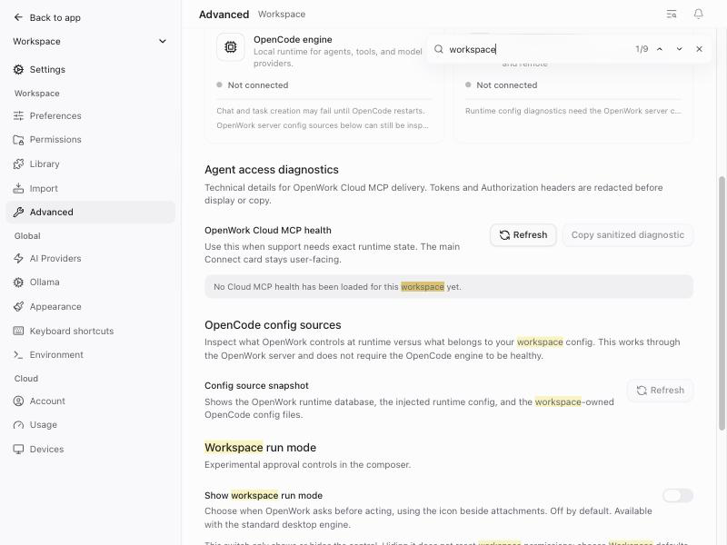

# Find on a settings page (`settingsFind`)

- **Feature key:** `settingsFind`
- **Deployments:** cloud and self-hosted (`everywhere`), off by default
- **Author:** @reachjalil

## What people get

Long settings pages such as **Settings → Advanced** are hard to scan for one
option. With the feature on, the open settings page can be searched:

- **Cmd+F** (Ctrl+F on Windows and Linux), the find button in the settings
  header, or **Find on this page** in the command palette opens a small find
  field at the top right of the page.
- Typing two or more characters highlights every match on the page, including
  text scrolled out of view, and shows where you are, for example `2/7`.
- **Enter** or the **Next match** button moves to the next match and scrolls
  it into view; **Shift+Enter** or **Previous match** moves back. Both wrap
  around.
- **Esc** or the close button removes the field and the highlights.
- Opening another settings page while the field is open searches that page
  for the same text.

It is the same control as **Find in conversation** in a chat, and looks the
same.

## What it searches

Only the settings page itself: not the settings sidebar, the header or the
find field. Text that is not shown is not counted (a setting hidden on this
operating system, or labels meant only for screen readers). What someone
typed into a field is not searched, only the words on the page. A match has
to sit inside one piece of text; words split across differently styled parts
are not joined.

## How it works

- Matches are painted with the browser's CSS Custom Highlight API
  (`::highlight(settings-find)` in `apps/app/src/app/index.css`). The page's
  own elements are never changed, so switches, fields and live status text
  keep working while highlights are showing.
- The page is searched again when its content changes (another page, or
  content that loads late), keeping your place among the matches.
- Settings shown beside a chat share Cmd/Ctrl+F with **Find in conversation**.
  There, the settings page takes the shortcut only while focus is inside
  settings; otherwise the chat keeps it.

Code: `apps/app/src/react-app/domains/settings/find/`, mounted by
`domains/settings/shell/settings-shell.tsx`. The field itself is
`apps/app/src/components/find-field.tsx`, shared with the chat.

## Turning it off

With the feature off there is no find button in the settings header, no
palette entry, and Cmd/Ctrl+F does nothing in Settings, as before. Nothing is stored, so turning
it off or using the kill switch needs no cleanup; an open find field closes
the next time the app reads its features.

## How to try it

Turn `settingsFind` on for an organization in `/admin` › Features, open
**Settings → Advanced** in the desktop app and press Cmd+F.
