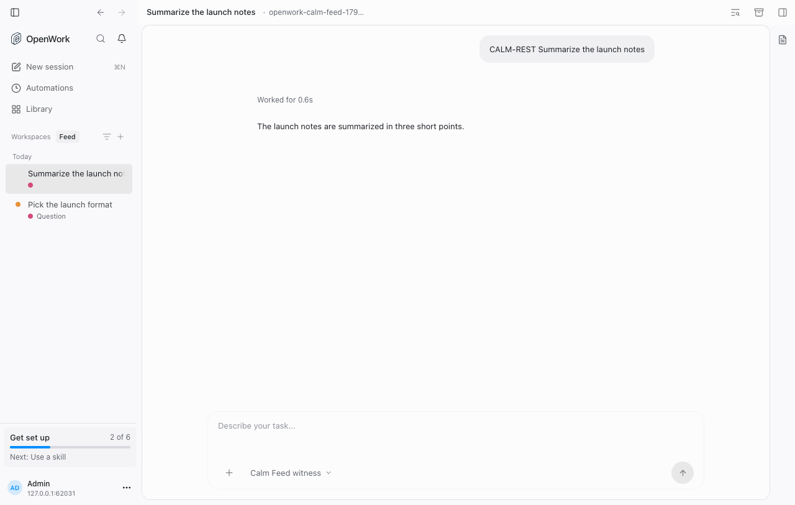
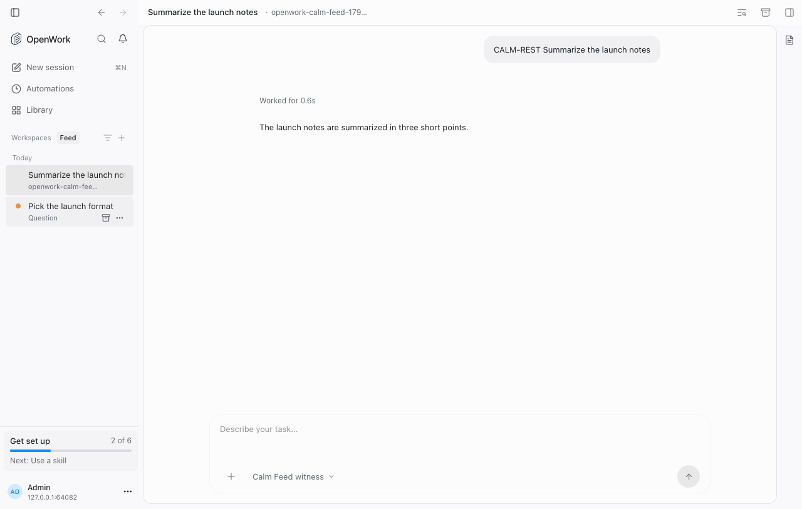
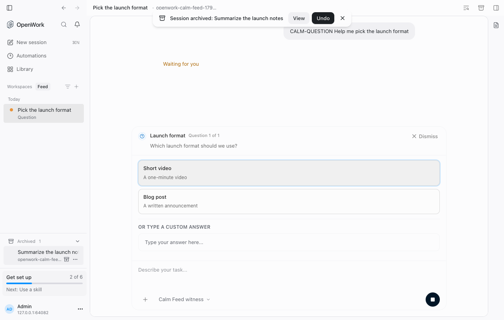
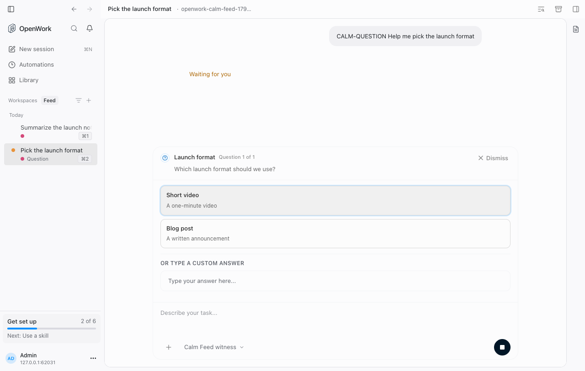

# Session Feed (`settledSessions`)

- **Feature key:** `settledSessions` (the key is permanent; the feature is now the Feed, and settling is gone)
- **Deployments:** cloud and self-hosted (`everywhere`), off by default
- **Author:** @reachjalil

## What people get

A **Workspaces · Feed** switch replaces the Workspaces label. Feed lists every
workspace's sessions in one stream. Workspaces is the default; the last view
chosen is remembered on the device.

- **Last interacted with first.** Rows sort by last activity: the engine's
  session time, or work starting or finishing on this device, whichever is
  newer. OpenCode v2 does not move a session's time when a message is sent, so
  the sidebar records it (`noteActivity`). Today, Yesterday and Earlier group the
  rows by the same time.
- **Manual order.** Any row can be dragged to a new spot, including into another
  day. It stays there until the session has new activity, which brings it back
  to the top. Dragged spots live on the device. Sorting by creation time (the
  group-and-sort menu) turns dragging off.
- **Archive, not Settle.** Settling, the Settled shelf, the per-workspace
  Settled row, auto-settle and its Preferences setting, and the agent's
  `session.settle` command are removed. Finished work is archived: hovering a
  row shows an **Archive** button just before the More menu (Unarchive in the
  Archived shelf). The thread header, command palette and Cmd/Ctrl+Shift+E
  archive or unarchive the open session.
- Each row's second line names the workspace and group, or **Permission** /
  **Question** when a decision is owed.
- Waiting sessions stay in their normal place, listed once. Each 48px row gives
  the title the full first line; Archive, More and held shortcuts share the
  lower-right lane, so nothing in the row moves on hover, focus or shortcut hold.
- Pinned folders and Archived stay fixed below the scrolling Feed; one opens at
  a time, showing about three rows that scroll. Any workspace group can be
  pinned there from its hover actions in Workspaces view; sessions filed in it
  stay until moved, and a row can be dragged into it.
- In Feed, the header's **+** starts a new session, and the group-and-sort menu
  groups by day, by activity (**Active**: working, waiting or unread;
  **Inactive**: the rest) or not at all, and sorts by last activity or creation.

## How it works

- Order: `apps/app/src/react-app/domains/session/sidebar/session-feed.ts`
  (`feedActivityKey`, `feedKeyBetween`), tested in `apps/app/tests/session-feed.test.ts`.
  A drop stores `{ key, at }` for the session; it sorts at `key` while its last
  activity is not newer than `at`.
- Activity: `session-activity.ts` and `workedAtById` in the session-management store.
- Row: `FeedArchiveButton` in `app-sidebar.tsx`; archive
  runs the existing `useSessionArchive` flow.

## Turning it off

The sidebar goes back to the Workspaces tree with its shipped quick actions, and
the header Archive button and shortcut stop. Nothing is deleted: activity times
and dragged spots stay on the device for when it is turned back on. Settle
records from earlier builds are ignored.

## Screenshots

Captured by `evals/proofs/calm-feed.proof.test.ts` from the real app in
headless Chrome with Den and OpenCode v2; only the model is scripted.

Last interacted with first:

Hover shows Archive before More:

Archived from the row, the session sits in the Archived shelf:

Held shortcuts share the lower-right lane:

## Verification

`evals/proofs/calm-feed.proof.test.ts` covers the Workspaces default, saved Feed
selection, a native Question staying in place, fixed row lanes through hover,
focus and held shortcuts, Archive before More, Archive and Unarchive from the row,
and Pin/Unpin and Rename. Dragging is covered by unit tests
(`session-feed.test.ts`); native HTML drag is not driven in the proof.
