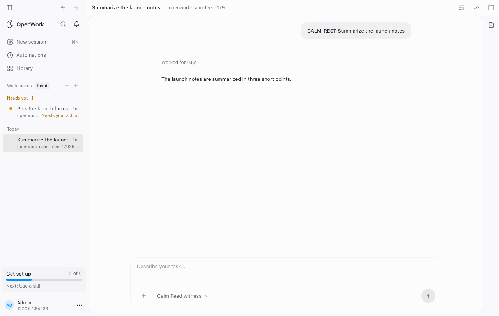
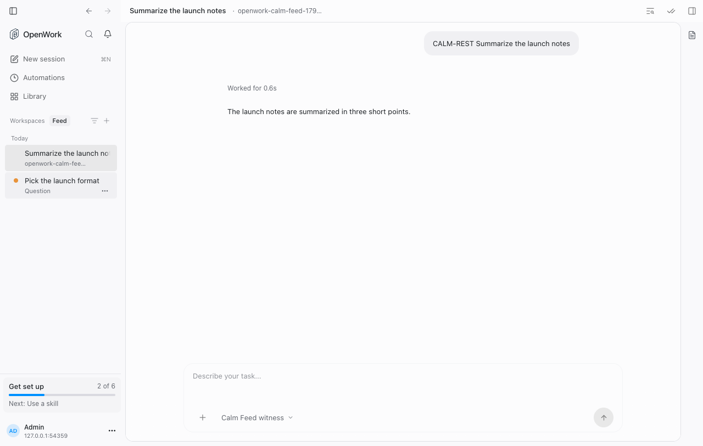
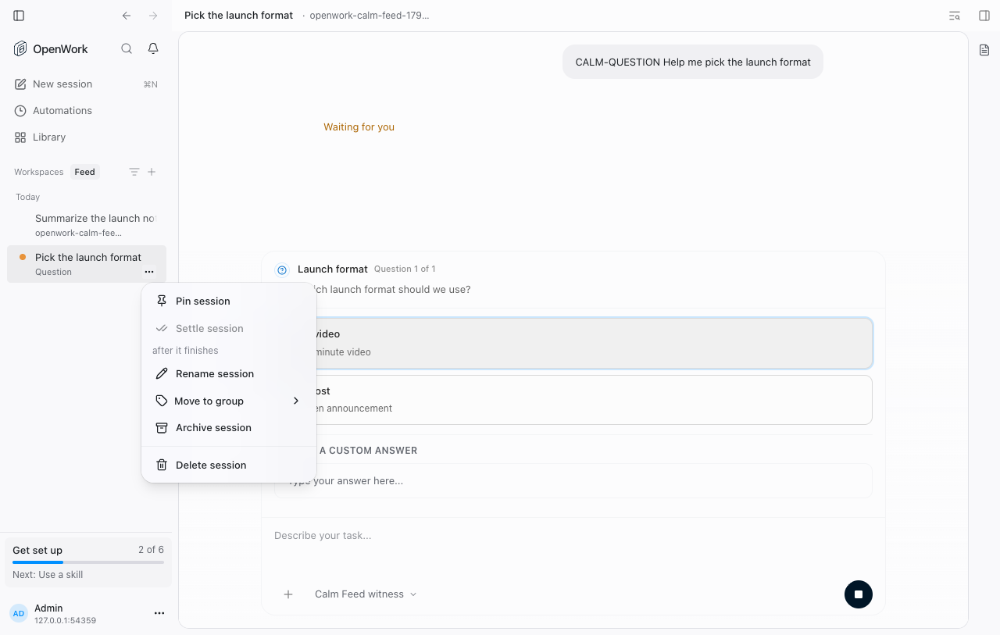
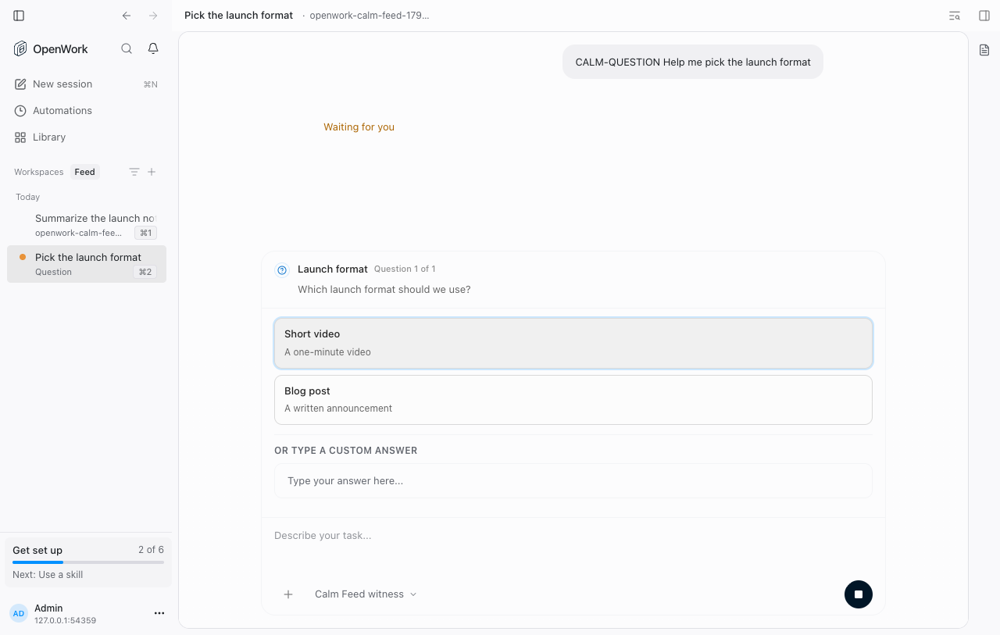

# Settle finished sessions (`settledSessions`)

- **Feature key:** `settledSessions`
- **Deployments:** cloud and self-hosted (`everywhere`), off by default
- **Author:** @reachjalil

## What people get

In OpenCode v2 workspaces, a finished session can be settled. It leaves its
group list in the sidebar and collapses into a **Settled** row at the end of its
workspace, still one click away. Any new activity (a reply, a finished run, an
Automation, an approval request) brings it back.

- Settle or Un-settle from the row's More menu or context menu, the thread header,
  the command palette, or Cmd/Ctrl+Shift+E. Each shows Undo.
- Idle sessions settle on their own after 3 days unless pinned, unread, working
  or waiting. Settings › Preferences › "Settle idle sessions after" changes it
  (Never, 1, 3 or 7 days).
- OpenCode v1 workspaces keep today's sidebar.
- A **Workspaces · Feed** switch replaces the Workspaces label. Feed lists every
  workspace's sessions in one stream: Today, Yesterday and Earlier by last
  activity. Waiting sessions stay in their normal section, never settle, and
  appear only once. Each 48px row gives the title the full first line. The quiet
  second line names the workspace and group, or **Permission** / **Question**
  when a decision is owed (workspace context remains in the tooltip).
  The leading loader communicates activity without repeating a status subtitle;
  read/idle rows have no indicator, and outcomes use a small dot. Feed rows have
  no timestamp. Shortcuts share the lower-right More-menu lane instead of
  reserving empty space beside the title. Fixed lanes keep titles and metadata
  still on hover, keyboard focus and shortcut hold/release.
  Settled sessions from every workspace sit in a collapsed **Settled** shelf.
  Pinned folders, Settled and Archived stay fixed below the scrolling Feed,
  apart from live work; one opens at a time, showing about three rows that
  scroll. Workspaces is the default; the last view chosen is remembered on the device.
- In Feed, the header's **+** starts a new session, and the group-and-sort
  menu next to it groups by day, by activity (**Active**: working, waiting or
  with an unread result; **Inactive**: the rest) or not at all, and sorts by last
  activity or creation time. These choices are remembered on the device.
  Workspaces view keeps its Add workspace **+**.
- Any workspace group can be pinned to the bottom of the Feed (the pin in the
  group's hover actions in Workspaces view). Sessions filed in a pinned group
  stay there, even with new activity; the folder shows a dot when something
  inside is unread or needs you. A whole session row can be dragged into a
  pinned folder of the same workspace; the source stays dimmed in place during
  the drag. The More menu keeps Pin, Settle, Rename, Move to group, split-view,
  Archive and Delete commands where available. Existing manual reorder remains
  scoped to its Workspaces list; Feed keeps the chosen chronological sort.
  Settled and Archived shelves are not drop targets.

## How it works

Settled is derived from each session's activity time, not stored as a flag
(`apps/app/src/react-app/domains/session/sidebar/session-settle.ts`, tested in
`apps/app/tests/session-settle.test.ts`). Manual settles live on the device in
the session-management store, like pins. OpenCode v2 does not move a
session's time when a message is sent, so the sidebar also counts work starting
on this device as activity (`noteActivity`). `session-route.tsx` resolves the
feature once; when it is off, no workspace can settle.

## Turning it off

The kill switch puts every settled session back in its group list right away.
Nothing is deleted: the device keeps its settle records, and turning the feature
back on restores them.

## Screenshots

Captured from the real app in headless Chrome with an isolated Den and OpenCode
v2; only the model response is scripted.

Before: waiting sessions were lifted into a separate section, with timestamps
and repeated attention text.

After: a waiting Question stays below newer finished work. The title uses the
full first line, and the decision replaces competing workspace metadata. Hover
reveals More without moving the title or second line.

The same menu keeps existing commands; Settle is disabled while a task waits.

Held shortcuts share the lower-right action lane; no empty slot clips the title.
An open or keyboard-focused More menu takes priority over its shortcut badge.

## Verification

`evals/proofs/calm-feed.proof.test.ts` exercises the real UI: Workspaces default,
saved Feed selection, native Question, fixed row lanes through hover, focus and
held shortcuts, and Settle/Un-settle, Pin/Unpin and Rename. Its 11 assertion
steps pass on this implementation; the pre-change `deac6bd446` control fails
because the waiting row has no quiet decision label and still appears under
Needs you. The width follow-up also checks that titles span the full text column
and shortcuts sit below them. Screenshots are manually reviewed; automated visual
validation is not included. Measured review flags unchanged header truncation
and 10.5px account metadata, not Feed-row defects.

Remaining real-UI coverage gaps: Permission prompts, folder drop/reorder,
Move-to-group, Archive and Delete execution. Unit tests cover waiting placement,
non-settling and folder derivation. The existing same-workspace drag boundaries
and command implementations are reused.
