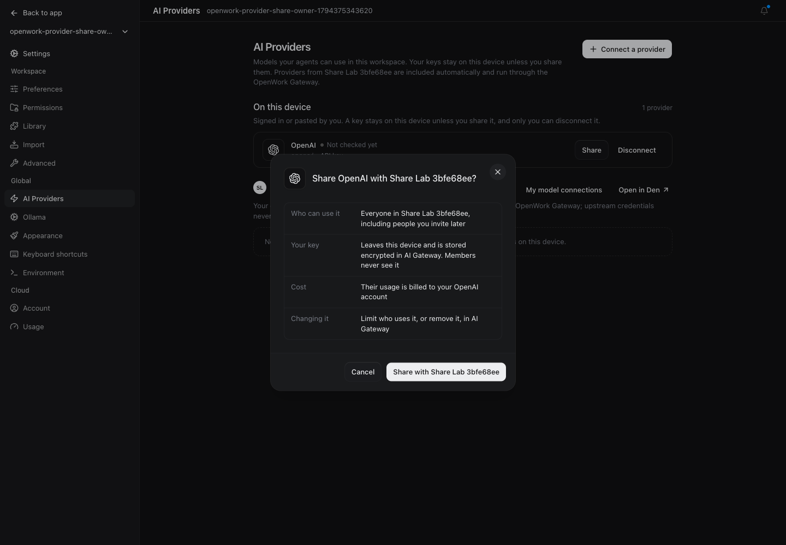
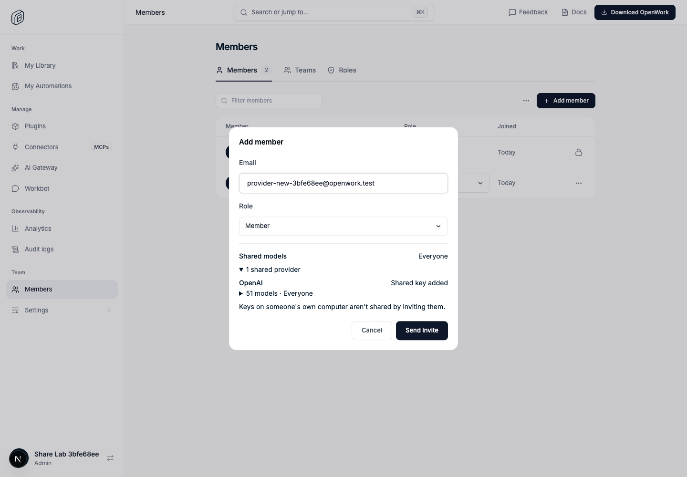
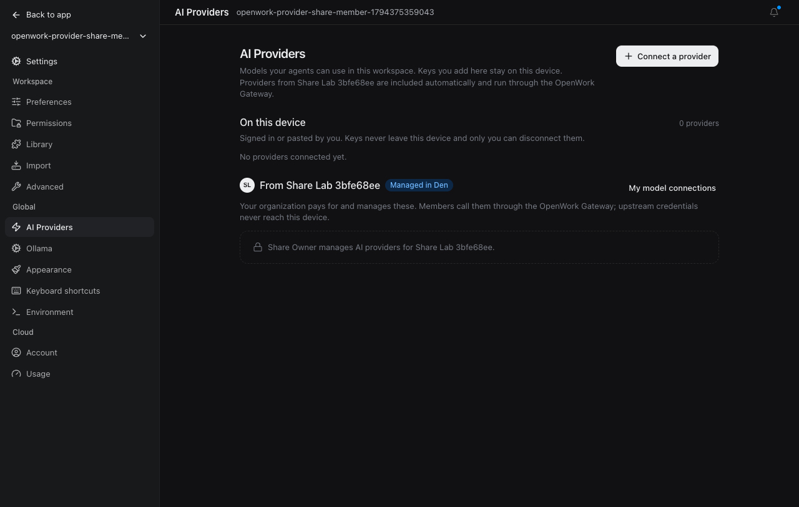

# From a desktop key to models for teammates

Feature: `shareDeviceProvider` · cloud and self-hosted · off by default  
Owner: `benjaminshafii`

## What changes

Trying the desktop app, signing in to a cloud organization, and inviting a
teammate no longer needs three different explanations of who owns a model key.
A personal provider stays personal until its owner explicitly shares it.

- **Desktop → Settings → AI Providers:** supported API-key providers saved on
  this device get **Share with {organization}**. Nothing is uploaded on sign-in.
  The organization empty state explains that invitations do not share personal
  keys. Members without management permission see who manages AI providers.
- **Share confirmation:** names Everyone (including future invitees), where the
  key goes, the provider account that pays, and how to remove or restrict access.
  Cancel changes nothing. The local key remains usable and disconnecting it
  later does not delete the separate organization provider.
- **Cloud → Members → Add member:** a shared-model configuration preview follows
  Everyone and the selected team. It excludes the inviter's personal grants and
  unrelated teams, intersects the provider's allowed model selection, and says
  when the invitee must sign in or an admin must finish setup. This is not a
  live provider test, a billing quote, or a promise of remaining allowance.
  Unknown and locked states never prevent sending an invite.
- **Invitees:** receive models through the existing grant-aware Gateway catalog
  and sync. An invite does not copy the inviter's upstream key to another device.

The Get set up checklist's Share action now starts in desktop AI Providers,
using the saved key when possible and the Gateway form otherwise.

## Credential and permission boundaries

`GET /v1/inference-providers/device-share-options` is an authenticated,
organization-scoped, feature-gated read. Den decides who holds Manage Gateway
providers and which catalog providers work with one key and no extra settings.
It returns no credential. Existing active Gateway providers are not duplicated;
"also available from" means the same provider brand, not the same secret.

After confirmation, the host-token-only local server route
`POST /cloud-provider-sync/device-providers/:id/share` reads the key from the
active local OpenCode credential store. It never returns the key to the
renderer. It sends it directly to the signed-in Den using the existing
permission-checked provider creation route and an explicit Everyone grant.
The `shareFromDevice` create marker is independently feature-checked inside the
transaction. An organization lock plus an existing-provider recheck prevents
concurrent device shares and lost-response retries from creating duplicates;
ordinary Gateway administration still permits separate provider configurations.
Redirects are refused. Errors are sanitized rather than forwarding provider text.
The upstream key is encrypted in Den and stays server-side on Gateway calls.

A recent sign-in is required by the existing sensitive-write policy. Browser
verification is reused, and the local server independently verifies that the
fresh token belongs to the original account. Switching organization or account
before sending cancels the share. A lost create response is **unconfirmed**,
not "nothing was shared"; no automatic retry occurs.

## How to try it

1. Enable `shareDeviceProvider` only for an isolated test organization.
2. Connect an API-key provider on the desktop; sign in to the organization.
3. Open AI Providers. Share the provider, first canceling to verify nothing
   changed, then accepting after reviewing the key destination and cost.
4. In cloud Members, open Add member. Check Everyone and team-specific preview
   changes. Send an invitation only to an isolated test address.
5. Accept as a new account or an existing account. On another device, sign in
   and verify the organization provider appears without the upstream key.
6. Check a plain member cannot share keys and a different organization sees no
   provider or grant from the first organization.

## Reverting and limitations

Turning the flag off removes the share actions and invite preview and rejects
new device-share option requests. Existing organization providers, grants,
keys, chats, and ordinary Gateway administration remain intact; this does not
revoke access already deliberately granted. Remove the provider or change its
access in AI Gateway to do that.

Only API keys saved through the provider credential store are eligible.
Environment credentials, OAuth subscriptions (including Claude Code and
ChatGPT), custom endpoints, and providers requiring project/region/resource
settings stay in their existing setup flows. Sharing from a remote workspace
is not supported; use a local workspace or AI Gateway. Paid OpenWork Models
entitlements and personal grants of existing invitees are not included in the
invite form's **shared Gateway configuration** preview.

## Evidence

- `apps/server/test/device-provider-share.test.ts`: denial before reading a key,
  account verification, organization changes, sanitized errors and uncertain writes.
- `ee/apps/den-api/test/api/device-provider-share.api.test.ts`: feature-off,
  owner/member permissions, existing-provider detection, grant delivery and reauth.
- `apps/app/tests/share-device-provider.test.tsx`: personal-key eligibility,
  consent, unchanged flag-off markup and locked/empty states.
- `ee/apps/den-web/.../invite-model-access*.test.*`: Everyone/team isolation,
  missing/disabled configuration, member sign-in and honest unknown states.

Browser proof and screenshots are recorded by
`evals/proofs/provider-share-invite.proof.test.ts`; its run artifacts are linked
from the pull request verification comment rather than committed as images.
