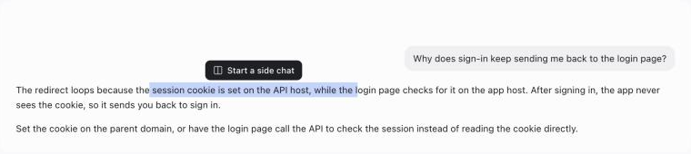

# Start a side chat from selected text (`sideChatFromSelection`)

- **Feature key:** `sideChatFromSelection`
- **Deployments:** cloud and self-hosted (`everywhere`), off by default
- **Author:** @reachjalil

## What people get

Selecting text inside one reply shows a small **Start a side chat** bar just
above the selection. Choosing it opens a side chat beside the conversation
with the selected text quoted in its message box. Nothing is sent until the
person sends it.

- The bar uses the same look as the app's tooltips: a small dark label in
  light mode and a light one in dark mode. It does not take focus, move the
  page or clear the selection.
- It only appears for text inside a single reply. Text in your own messages,
  across two replies or outside the chat does not show it.

## Which side chat opens

The bar only decides whether the action is offered. What opens depends on the
other side chat features:

- With [`sideQuestions`](../side-questions/README.md) on, the quote is attached
  to the **Side chat** tab in the side panel and answered from the
  conversation.
- Otherwise a side chat session opens in the split pane with the quote in its
  draft. Text already typed in an open side chat draft is kept, with the quote
  added under it. With [`sessionTree`](../session-tree/README.md) also on,
  that side chat is listed under the session it came from.

## How it works

- `apps/app/src/react-app/domains/session/links/selection-side-chat.tsx`
  draws the bar as a Popover anchored to the selection.
- `selection-quote.ts` next to it decides which selections count and turns
  the text into a quote.
- `session-route.tsx` passes the start handler to the chat only while this
  feature is on, and marks the feature used when the bar is chosen.

## Turning it off

The bar is no longer shown. Side chats already open, their drafts and quotes
are unchanged, and **Open side chat**, `/btw` and session nesting keep
following their own features.

## How to try it

1. Turn `sideChatFromSelection` on for an organization in `/admin` › Features.
2. In a session, select a few words of a reply. The bar appears above them.
3. Choose **Start a side chat**: a side chat opens with the words quoted.
