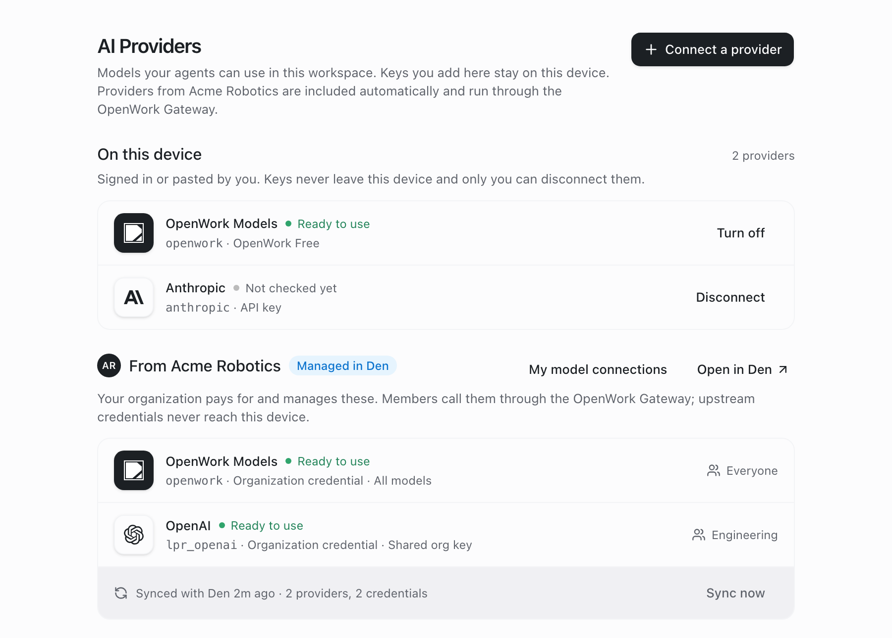
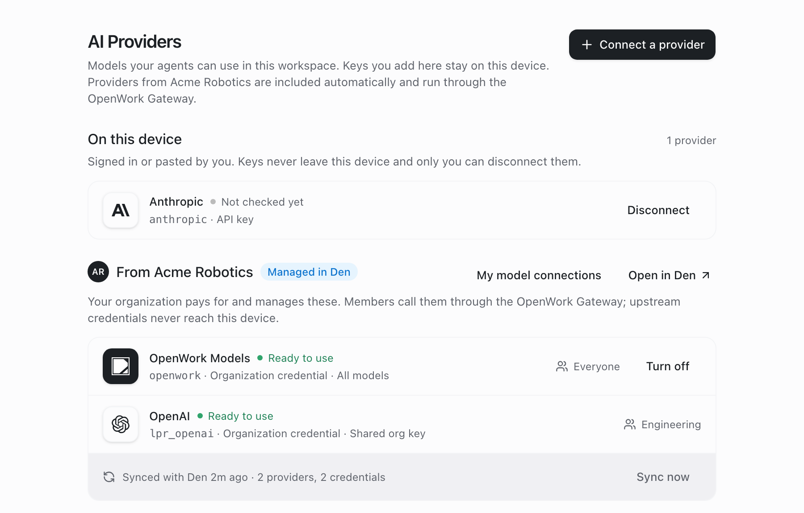
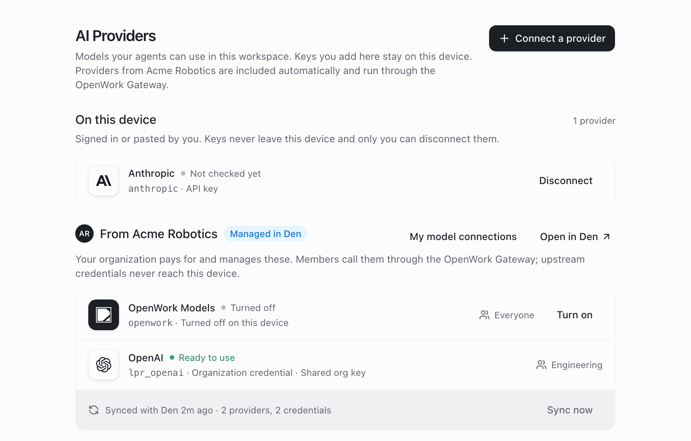

# One OpenWork Models row you can turn off

- **Feature key:** `singleOpenWorkModelsRow`
- **Deployments:** cloud and self-hosted, off by default
- **Author:** benjaminshafii
- **Surface:** desktop app, Settings › AI Providers and the Connect a provider dialog

## What changes

OpenWork Models reaches the desktop in two ways:

- the free relay on this device (`openwork-free`, shown as "OpenWork Free")
- the organization's paid provider from Den (`openwork`), when the organization pays for it

With the flag off, a member of a paying organization sees **OpenWork Models twice**: once under On this device and once under From {organization}. The second row has no way to turn it off on this device.

With the flag on:

- **The organization pays:** the organization's row is the only OpenWork Models row. The free row under On this device and in Connect a provider is not shown. The organization's row has **Turn off** / **Turn on**:
  - Turn off adds `openwork` to this workspace's `disabled_providers` and turns the free relay off too, so no OpenWork Models stay in the model picker.
  - Turn on removes it again and turns the free relay back on when it is allowed.
  - Nothing is removed from Den, and the next sync does not undo the choice.
- **Who can turn it off** follows the usual rule for settings: the person decides unless the organization manages it, then only admins do.
  - Not managed (Model access in Den is anyone's own keys): every member has Turn off / Turn on.
  - Managed (Model access is "Only models you provide", `allowCustomProviders: false`): members see "Managed by {organization}" and no Turn off. Owners and admins keep Turn off / Turn on.
  - A turn-off a member saved before the organization managed models is turned back on, so the admin's choice applies.
- **The organization does not pay (or signed out):** the free row under On this device stays, with its existing Turn off / Turn on.
- **Either way:** `openwork` and `openwork-free` are never listed again as separate "turned off" rows next to it.

| Flag off (today) | Flag on | Flag on, turned off |
| --- | --- | --- |
|  |  |  |

The screenshots are the real Settings components rendered with sample data for a signed-in member of a sample organization.

## How to try it

1. Turn the flag on for an organization that includes OpenWork Models (`/admin` › organization › Features).
2. As a member, open Settings › AI Providers in the desktop app. OpenWork Models shows once, under From {organization}.
3. Press **Turn off**. The row says Turned off, and OpenWork models leave the model picker. **Turn on** brings them back.

## Turning it off

The kill switch brings back today's rows. A choice already saved stays in `disabled_providers`: OpenWork Models stays off on that device. With the flag off it then shows under On this device as a turned-off provider, with Enable to bring it back.

## What to watch

- Reports that OpenWork models are missing from the picker after Turn off and Turn on. Turn on also needs the free relay to be allowed (`canEnable`).
- `providers.disconnect_failed` / `providers.enable_failed` errors in Settings.
