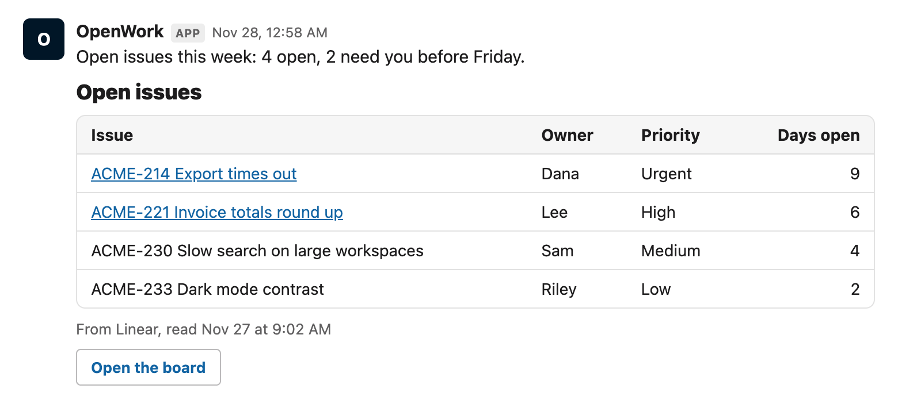

# Slack components in messages from OpenWork (`slackRichMessages`)

Feature key: `slackRichMessages` · Deployments: cloud and self-hosted · Default: off · Author: `benjaminshafii`.

It needs the OpenWork app installed in Slack (`ee/apps/den-api/src/slack-assistant/README.md`). No new Slack scope and
no manifest change: every component here is sent with `chat:write`, and interactivity was already on for feedback.

## What changes

Until now every message the OpenWork app wrote to Slack was text: a Markdown block for answers, mrkdwn sections for
desktop results (tables flattened into code blocks), plain `text` for `slack_send_as_bot` and Your agent. Agents had no
way to ask for anything else and were never told what Slack can draw.

With the feature on, one composer (`slack-assistant/rich-message.ts`) turns agent output into Slack blocks for every
surface. It accepts two inputs and nothing else:

- **Markdown** the agent already writes. A `#` or `##` heading becomes a header block, `---` a divider, a Markdown
  table a real table block, an image line a picture (only from this deployment's own address, see Safety).
- **Components**: a small vocabulary OpenWork defines and validates (`header`, `text`, `divider`, `context`, `fields`,
  `table`, `image`, `buttons`, `choices`). An agent passes them to `slack_send_as_bot`, or writes them as JSON in one
  fenced block with the language `slack` in a Slack answer. Raw Block Kit is never accepted.

Pictures and the exact input for each: [example use cases](./examples.md). Every picture is drawn by the sample
renderer (the sandbox's sample Slack), not by Slack.

| Surface | Feature off (unchanged) | Feature on |
| --- | --- | --- |
| Slack assistant, live reply | Streamed Markdown text and task updates | Unchanged. Components belong to the final answer |
| Slack assistant, final answer | One `markdown` block, 300 character notification | Header, real table, divider, context, fields, link buttons, picture, and one question with choice buttons |
| Background task report | Mention, then a `markdown` block | Same components as an answer |
| `slack_send_as_bot` (chats, Automations) | `text` only | `text` plus validated `components` |
| Your agent's message | Text | The same words in sections, a header on the first check of the day, a line naming what was read |
| Your agent's source notices | A sentence with a link | The sentence and a button to the fix |
| Desktop result posted in the thread | mrkdwn sections, tables as code blocks | Header, real table, divider, picture. No choices |
| Check-ins, done and failure lines, connect card | Text (connect card already had a button) | Unchanged: one line reads faster as one line |

Internal webhooks to our own workspace (harness feedback, support triage) and CI alerts are out of scope.

## Choices: buttons that answer a question

`choices` is the only interactive component, because it is the only one with a handler. The question is posted as its
own message. A press goes through two steps (`slack-assistant/choice.ts`):

1. **The interactions route** checks Slack's signature, workspace and app (as for feedback) and that the value pressed
   is the label of that button on that message. It queues the press in `slack_assistant_event` and answers 200. It
   never calls Slack, so the acknowledgment does not wait on Slack.
2. **The worker** settles the press on its next tick (`settleSlackChoice`). It tells anyone else privately "Only
   @member can answer this." It starts nothing, and says so privately, when the assistant is off, the channel is not
   allowed, the deployment has no cloud runner, or `slackRichMessages` is now off for that member. Otherwise it records
   the label as that member's next request in the thread, in one transaction keyed by the message, so the first press
   wins. Then it replaces the buttons with "✅ @member chose Send it", always showing the recorded answer. A later
   press of another button is told which answer is already running.

`slack_send_as_bot` refuses `choices` when the deployment has no cloud runner, because nothing would answer the click.
Link buttons need no handler of their own: Slack still sends an interaction for them, and the route already
acknowledges every signed interaction.

## Limits enforced before anything is sent

From Slack's reference, checked 27 Nov 2026. The composer splits or degrades instead of sending something Slack refuses.

| Limit | Value | What OpenWork does | Source |
| --- | --- | --- | --- |
| Blocks per message | 50 | Continues in the next message, keeping room for feedback and attribution | [Blocks](https://docs.slack.dev/reference/block-kit/blocks) |
| Markdown block text | 12,000 across the payload | Budgets 11,000 and splits at paragraph breaks | [Markdown block](https://docs.slack.dev/reference/block-kit/blocks/markdown-block) |
| Table | 100 rows, 20 cells a row, 10,000 characters a message | Splits rows across messages with the header repeated; one table a message; wider tables stay Markdown | [Table block](https://docs.slack.dev/reference/block-kit/blocks/table-block) |
| Header | 150 characters, plain text | Longer or linked headings stay Markdown | [Header block](https://docs.slack.dev/reference/block-kit/blocks/header-block) |
| Section | 3,000 characters; 10 fields of 2,000 | Splits text; more fields start another section | [Section block](https://docs.slack.dev/reference/block-kit/blocks/section-block) |
| Context | 10 elements | One element per line | [Context block](https://docs.slack.dev/reference/block-kit/blocks/context-block) |
| Image | URL 3,000; alt text and title 2,000 | Clips text; alt text is required | [Image block](https://docs.slack.dev/reference/block-kit/blocks/image-block) |
| Actions and buttons | 25 elements; text 75; `action_id` 255; URL 3,000; value 2,000 | At most five buttons, ids set by OpenWork | [Actions block](https://docs.slack.dev/reference/block-kit/blocks/actions-block), [Button](https://docs.slack.dev/reference/block-kit/block-elements/button-element) |
| Top-level `text` | Aim for 4,000 | A full text version of the message, up to 3,900, for notifications and screen readers. Table links are kept, and when it must be cut the buttons or the question stay at the end | [chat.postMessage](https://docs.slack.dev/reference/methods/chat.postMessage) |
| Stream | 12,000 Markdown characters and 10 minutes | Starts a new stream at 11,000 characters or 4 minutes, and when Slack answers `msg_too_long` | [chat.startStream](https://docs.slack.dev/reference/methods/chat.startStream) |
| Interactions | Acknowledge within 3 seconds, link buttons included | The route queues a press and answers 200 without calling Slack; the worker does the rest | [Handling user interaction](https://docs.slack.dev/interactivity/handling-user-interaction) |

The stream limit is a fix that ships without the flag: the code rotated at 30,000 characters, past Slack's limit.

If Slack still refuses the blocks (`invalid_blocks`, `msg_blocks_too_long` and similar), the same content is posted once
as plain mrkdwn sections, counted together with the caller's own blocks (attribution, mention, feedback) so the retry
stays inside 50. If Slack refuses that too, it is posted as text alone. `slack_rich_message_rejected` is logged each
time with the surface and Slack's error code.

## Safety

- The model never writes Block Kit. Components are parsed with a strict schema; unknown types and extra keys are
  refused, and a `slack` block that does not parse stays visible as written and is counted in
  `slack_rich_component_invalid`.
- `@channel`, `@here`, `@everyone` and group mentions are neutralized everywhere. So are user mentions a model
  wrote: in the message text, in Markdown, in every component and in the text fallback, `<@U…>` is shown as text and
  notifies no one. The only mentions that work are the ones OpenWork adds itself (the member a report or a desktop
  result is for, the attribution line of a channel post). The text-only path of `slack_send_as_bot` is unchanged from
  today: a user mention in `text` with no components still notifies.
- Button and action ids are OpenWork's. A model cannot name one, so it cannot imitate feedback or a choice.
- A choice button has no hidden value: what is queued as the member's request is the label they saw and pressed,
  and the handler checks it against the buttons on that message.
- Link buttons need `https`. Your agent's links still pass its own allowlist before layout.
- A picture is fetched by Slack as soon as the message arrives, which would let a prompt injection send data out in
  the image address. So a picture is shown only from this deployment's own web or API address. Any other image is a
  link, as it is today.
- `slack_send_as_bot` keeps every existing check: membership, write scope, channel access, daily and per-minute limits,
  audit. The duplicate check now covers the components as well as the text.

## Try it

1. In `/admin` › organization › Features, turn on **Slack: tables, buttons and sections in messages from OpenWork**.
2. In a chat: "Send me my open issues on Slack as a table." The agent's `slack_send_as_bot` call now lists `components`.
3. In Slack: mention the app and ask for something tabular ("pipeline by stage"), or for a draft it should ask before
   sending.

Proof: `evals/proofs/slack-rich-messages.proof.test.ts` (Den, a sandbox organization and the sample Slack).
Unit tests: `ee/apps/den-api/test/slack-rich-message.test.ts`, `ee/apps/den-api/test/slack-rich-surfaces.test.ts`,
`evals/packages/open-workplace/src/workshop-slack.test.mjs`.

## Turning it off

Off, or after the kill switch, every surface sends exactly what it sent before. Agents stop being told about
components on their next message. A reply already in flight keeps its instructions but is delivered as text, so a
`slack` block in it shows as a code block. A question already posted stops working too: the worker rechecks the
member's flag when a button is pressed, starts nothing, leaves the buttons, and tells the member privately to reply in
the thread instead.

## What to watch

- `slack_rich_message_rejected` (surface, code): Slack refused blocks the composer thought valid. The content still
  arrived as text. A steady stream of these means a limit or shape here is wrong.
- `slack_rich_component_invalid`: models writing `slack` blocks that do not parse.
- `slack_choice_settled` (outcome: accepted, already_answered, not_addressed, unavailable, throttled),
  `slack_choice_update_failed`, `slack_choice_notice_failed`.

## Not verified in a real Slack workspace

Everything above was run against the sample Slack, which is written from Slack's reference and is not Slack. The
tests prove that a press is queued, settled once and the message replaced there. They do not prove that a real Slack
client sends the press, or that the queued request then runs to an answer. Before turning this on for everyone, check
in a real workspace: the table block next to other blocks, a multi-message answer, a choice press through to the
assistant's reply, and the fallback text in a notification.

## What Slack still does not allow, or we chose not to use

- A streamed reply cannot carry these components reliably. Slack documents a `blocks` chunk but no list of which
  blocks it accepts, so streams stay text and task updates.
- `table` is not available in modals, and `markdown` blocks only in messages.
- The docs no longer state a one-table-per-message rule, only 10,000 characters across tables. We keep one table a
  message until that is confirmed in a real workspace.
- Newer blocks (`card`, `carousel`, `container`, `data_table`, `data_visualization`, `layout`, `plan`, `task_card`)
  are documented but not used here.
- Pictures from other sites, for the reason under Safety. Uploaded Slack files (`slack_file`) are not wired.
- Menus, date pickers and inputs in messages: no handler, so not offered.
