# Slack components: example use cases

Each picture below is the message OpenWork's own code produced for the input shown, posted to the sample Slack that
ships with sandbox organizations (`evals/packages/open-workplace`, "Open Slack"). That sample Slack checks every block
against the limits Slack documents and draws it from the Block Kit reference. It is a stand-in, not Slack: spacing and
type differ in the real client.

Regenerate with `pnpm --filter @openwork-ee/den-api slack:examples`. This file and its pictures are written by
`ee/apps/den-api/scripts/slack-rich-examples.ts`, so an input here is always the one that made its picture.

## A status report with a table

**Where:** A chat or Automation sending with `slack_send_as_bot`

**Made with:** `executeSlackSendAsBot` and the DM sender, posting to the sample Slack. The proof sends the same call through Den's MCP endpoint.

**Tool call:**

````json
{
  "target": "me",
  "text": "Open issues this week: 4 open, 2 need you before Friday.",
  "components": [
    {
      "type": "header",
      "text": "Open issues"
    },
    {
      "type": "table",
      "columns": [
        "Issue",
        "Owner",
        "Priority",
        "Days open"
      ],
      "rows": [
        [
          "[ACME-214 Export times out](https://linear.app/acme/issue/ACME-214)",
          "Dana",
          "Urgent",
          "9"
        ],
        [
          "[ACME-221 Invoice totals round up](https://linear.app/acme/issue/ACME-221)",
          "Lee",
          "High",
          "6"
        ],
        [
          "ACME-230 Slow search on large workspaces",
          "Sam",
          "Medium",
          "4"
        ],
        [
          "ACME-233 Dark mode contrast",
          "Riley",
          "Low",
          "2"
        ]
      ]
    },
    {
      "type": "context",
      "text": "From Linear, read Nov 27 at 9:02 AM"
    },
    {
      "type": "buttons",
      "buttons": [
        {
          "text": "Open the board",
          "url": "https://linear.app/acme/team/ACME/active"
        }
      ]
    }
  ]
}
````

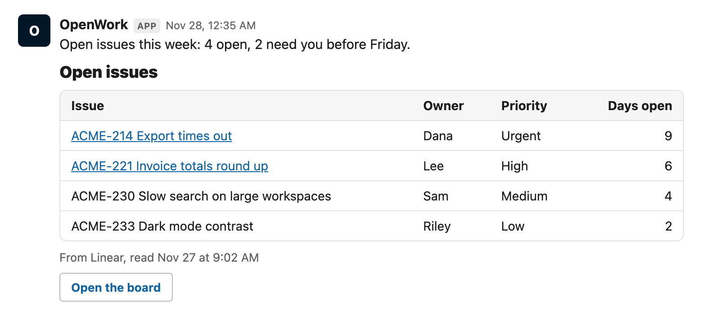

## The same report with the feature off

**Where:** A chat or Automation sending with `slack_send_as_bot`

**Made with:** `executeSlackSendAsBot` with the feature off: only `text` is accepted.

**Tool call:**

````json
{
  "target": "me",
  "text": "Open issues this week: 4 open, 2 need you before Friday.\n```\nIssue | Owner | Priority | Days open\nACME-214 Export times out | Dana | Urgent | 9\nACME-221 Invoice totals round up | Lee | High | 6\nACME-230 Slow search on large workspaces | Sam | Medium | 4\nACME-233 Dark mode contrast | Riley | Low | 2\n```"
}
````

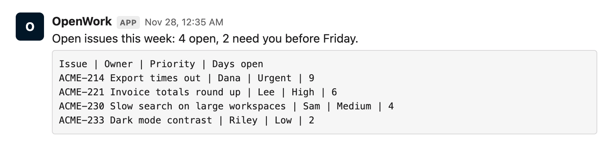

## Pipeline by stage, answered in a thread

**Where:** The Slack assistant's answer to a mention or DM

**Made with:** `advanceSlackRun` posting the turn's last message. Markdown gives the header and the table; the fenced `slack` block adds the source line and the button.

**The assistant's last message:**

````markdown
# Pipeline by stage
Two deals moved forward this week and one slipped: **Northwind** is waiting on their security review.

| Stage | Deals | Value | Change |
| --- | ---: | ---: | --- |
| Qualified | 7 | $96,000 | +2 |
| Proposal | 4 | $82,000 | +1 |
| Negotiation | 2 | $54,500 | Northwind slipped a week |
| Won this month | 2 | $31,500 | |

```slack
[
  {
    "type": "context",
    "text": "From the CRM, read just now"
  },
  {
    "type": "buttons",
    "buttons": [
      {
        "text": "Open the pipeline",
        "url": "https://crm.example.com/pipeline"
      }
    ]
  }
]
```
````

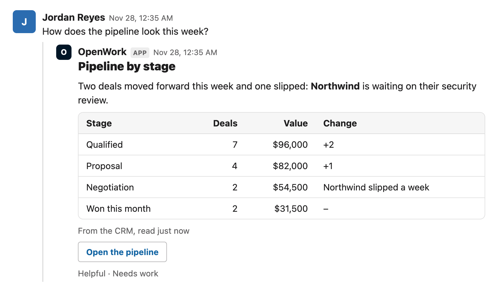

## A meeting follow-up with action items and owners

**Where:** A chat or Automation sending with `slack_send_as_bot`

**Made with:** `executeSlackSendAsBot` and the DM sender. The proof sends the same call through Den's MCP endpoint.

**Tool call:**

````json
{
  "target": "me",
  "text": "Follow-up from the Northwind renewal call: they want the security review by Dec 4 and agreed to a two-year term.",
  "components": [
    {
      "type": "header",
      "text": "Northwind renewal call"
    },
    {
      "type": "fields",
      "fields": [
        {
          "label": "When",
          "value": "Fri Nov 27, 10:00 AM"
        },
        {
          "label": "Decision",
          "value": "Two-year term, pending security review"
        },
        {
          "label": "Attendees",
          "value": "Alex, Dana and two from Northwind"
        },
        {
          "label": "Next meeting",
          "value": "Tue Dec 8"
        }
      ]
    },
    {
      "type": "divider"
    },
    {
      "type": "table",
      "columns": [
        "Action item",
        "Owner",
        "Due"
      ],
      "rows": [
        [
          "Send the security questionnaire answers",
          "Dana",
          "Dec 2"
        ],
        [
          "Draft the two-year order form",
          "Alex",
          "Dec 3"
        ],
        [
          "Confirm SSO requirements with their IT lead",
          "Lee",
          "Dec 4"
        ]
      ]
    },
    {
      "type": "context",
      "text": "From the meeting notes and the calendar invite"
    }
  ]
}
````

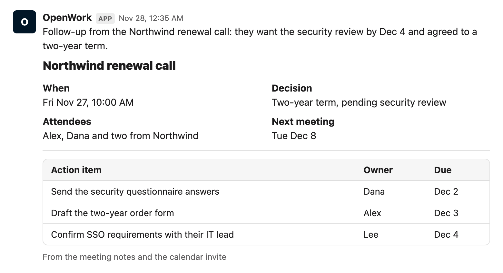

## A daily brief from Your agent

**Where:** Your agent's first check of the day

**Made with:** `agentBriefParts` and `deliverAgentMessage`. The agent writes only the paragraphs, as before; OpenWork adds the header, the dividers and the line saying what was read.

**The agent's message, and what OpenWork knows about the check:**

````json
{
  "text": "Before your 10 AM with Northwind: <https://mail.google.com/mail/u/0/#inbox/18c2f|Dana's follow-up> from Thursday still has no reply, and it asks for the security questionnaire by *Dec 4*. I'd answer with a date before the call.\n\nA decision due today: Lee asked in <https://acme.slack.com/archives/C0123ABCD/p1764230400000100|#launch> whether the pricing page ships Monday or waits for legal. Nobody has answered since yesterday afternoon, and the build freezes at *5 PM*.\n\nTomorrow's 2 PM design review now overlaps the customer call that was moved this morning. I checked both invites: the customer call can't move again. I'd ask Sam to shift the review to 3.",
  "sources": [
    "Gmail",
    "Slack",
    "Google Calendar"
  ],
  "at": 1795798920000,
  "timeZone": "America/Los_Angeles",
  "first": true
}
````

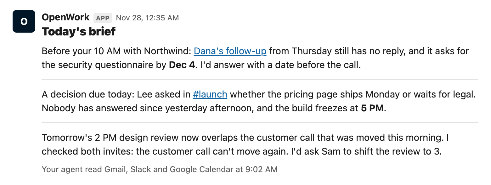

## An Automation result with a button to open it in OpenWork

**Where:** An Automation run sending with `slack_send_as_bot`

**Made with:** `executeSlackSendAsBot`. The agent names the place (`open: "automations"`) and OpenWork fills in the address.

**Tool call:**

````json
{
  "target": "me",
  "text": "Your weekly signups digest finished: 468 signups, up 14% on last week.",
  "components": [
    {
      "type": "fields",
      "fields": [
        {
          "label": "This week",
          "value": "468"
        },
        {
          "label": "Last week",
          "value": "412"
        },
        {
          "label": "Change",
          "value": "+14%"
        },
        {
          "label": "Top source",
          "value": "Docs (38%)"
        }
      ]
    },
    {
      "type": "context",
      "text": "Weekly signups digest, ran Mon Nov 23 at 9:00 AM"
    },
    {
      "type": "buttons",
      "buttons": [
        {
          "text": "Open in OpenWork",
          "open": "automations"
        }
      ]
    }
  ]
}
````

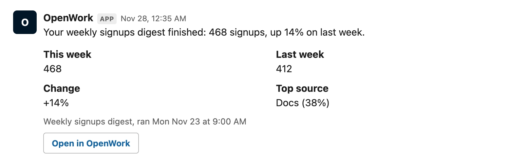

## An approval with buttons

**Where:** The Slack assistant asking before it sends something

**Made with:** `advanceSlackRun` posts the question as its own message. The second picture is the same message after `answerSlackChoice` handled the member's click and replaced the buttons.

**The assistant's last message:**

````markdown
Here's the reply to Dana, ready to go:

> Hi Dana, the security questionnaire answers are attached. The two open items are SSO and data retention; I'll have both to you by Wednesday.

```slack
{
  "type": "choices",
  "prompt": "Send this reply to Dana from your Gmail?",
  "options": [
    "Send it",
    "Let me edit it first",
    "Don't send"
  ]
}
```
````

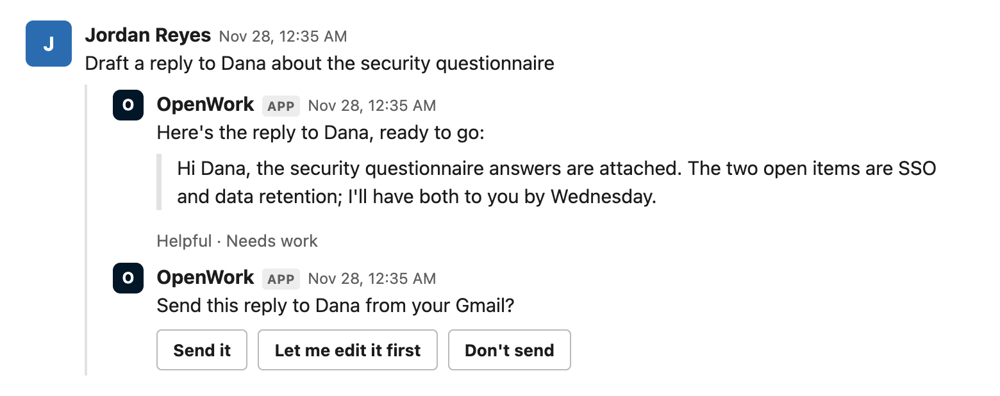

After the member presses **Send it**: the buttons are replaced, and "Send it" is queued as their next request in the thread.

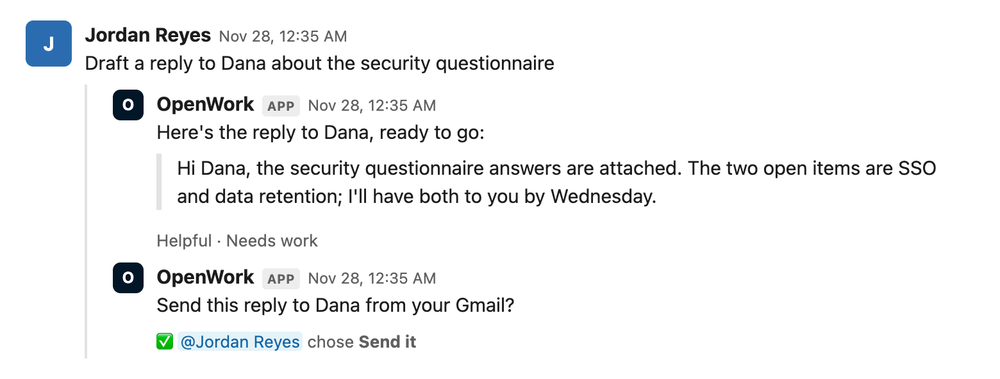

## An app needs reconnecting

**Where:** Your agent, when a source it reads stops working

**Made with:** `agentNoticeParts` and `deliverAgentMessage`: the sentence OpenWork already sends, with the fix as a button instead of a link in the text.

**What OpenWork knows:**

````json
{
  "text": "Quick check: I can't read your Gmail, so I've paused checking it and kept reading the rest.",
  "actions": [
    {
      "text": "Reconnect Google Workspace",
      "url": "https://app.example.com/dashboard/library/connectors/emc_example"
    }
  ]
}
````

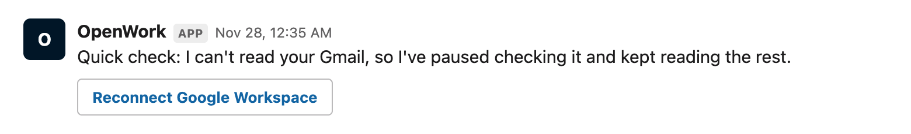

## An Automation that could not run

**Where:** An Automation run sending with `slack_send_as_bot`

**Made with:** `executeSlackSendAsBot`. One sentence, when it stopped, and a button to Your Connections.

**Tool call:**

````json
{
  "target": "me",
  "text": "Your pipeline report didn't run: Google Sheets needs you to sign in again. Nothing was changed.",
  "components": [
    {
      "type": "context",
      "text": "Pipeline report, stopped Mon Nov 23 at 9:00 AM"
    },
    {
      "type": "buttons",
      "buttons": [
        {
          "text": "Reconnect in OpenWork",
          "open": "connections"
        }
      ]
    }
  ]
}
````

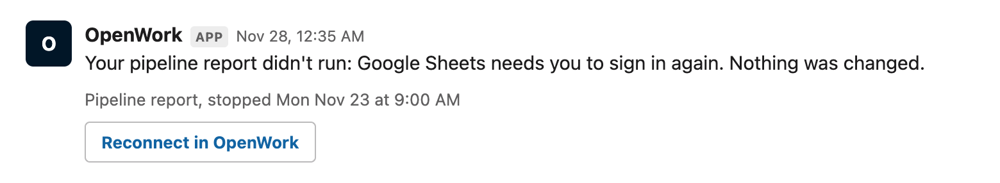

## A finished desktop task with a table

**Where:** Work handed to the desktop from Slack, when it finishes

**Made with:** `postDesktopHandoffNotice`. The desktop agent wrote ordinary Markdown; nothing about it is Slack-specific.

**The desktop session's final message:**

````markdown
## Renewals due in December

I went through the contracts folder and the CRM export. Three renew next month and all three drafts are in `Renewals/2026-12`.

| Account | Renews | Seats | Draft |
| --- | --- | ---: | --- |
| Northwind | Dec 3 | 120 | Ready |
| Fabrikam | Dec 12 | 45 | Ready |
| Tailspin | Dec 19 | 300 | Needs the new price list |

Tailspin is the only one I couldn't finish: the 2027 price list isn't in the folder yet.
````

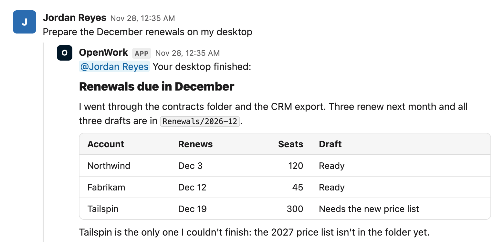

## The same desktop result with the feature off

**Where:** Work handed to the desktop from Slack, when it finishes

**Made with:** `postDesktopHandoffNotice` with the feature off: the table is typed characters in a code block.

**The desktop session's final message:**

````markdown
## Renewals due in December

I went through the contracts folder and the CRM export. Three renew next month and all three drafts are in `Renewals/2026-12`.

| Account | Renews | Seats | Draft |
| --- | --- | ---: | --- |
| Northwind | Dec 3 | 120 | Ready |
| Fabrikam | Dec 12 | 45 | Ready |
| Tailspin | Dec 19 | 300 | Needs the new price list |

Tailspin is the only one I couldn't finish: the 2027 price list isn't in the folder yet.
````

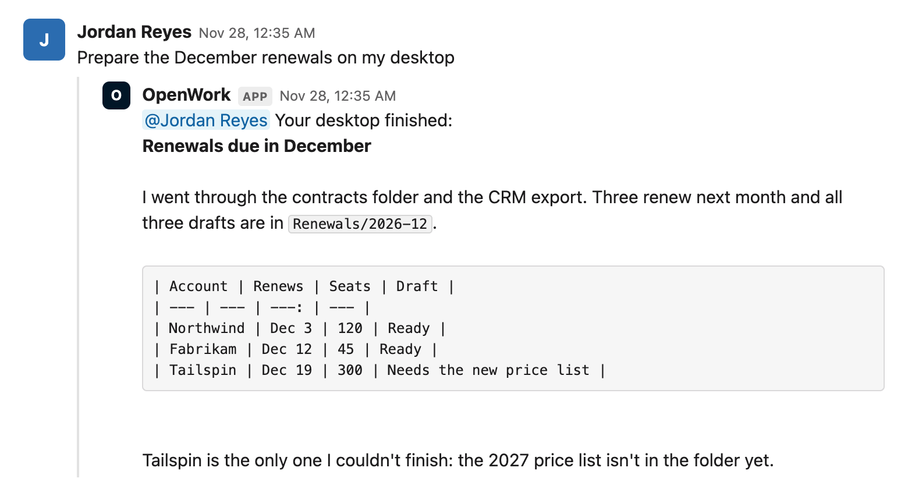
