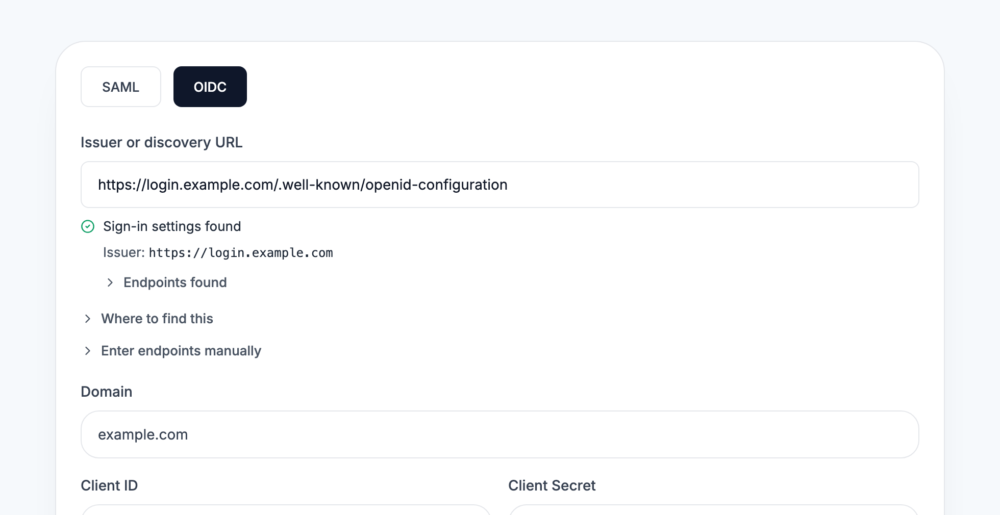
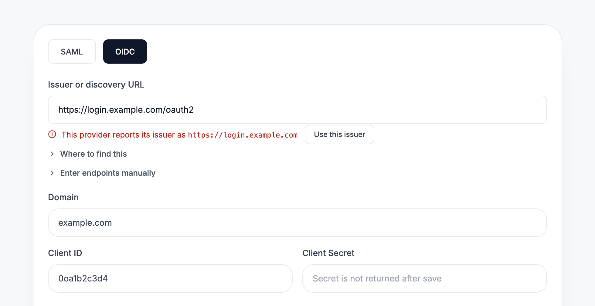
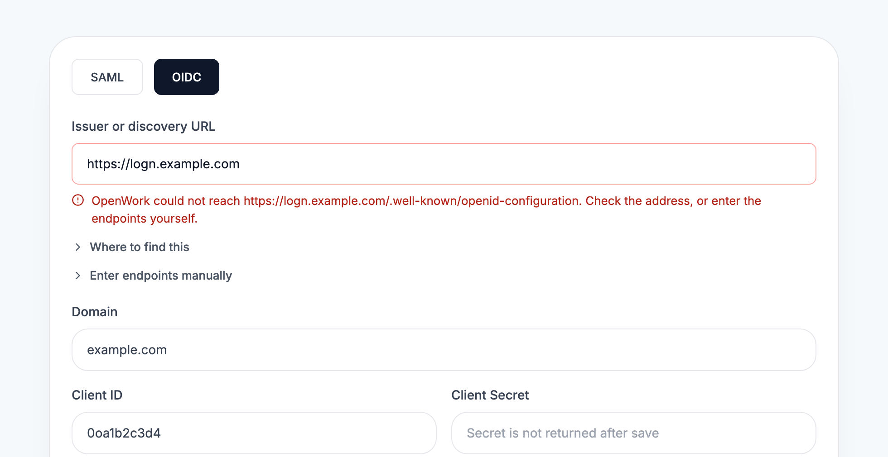

# SSO: check the OIDC issuer during setup

> **Generally available:** `ssoOidcSetupCheck` is retired; its enabled behavior is standard on Cloud and self-hosted. Actual settings, permissions, billing rules and consent remain enforced. Rollout/off-state instructions below are historical; see [the retirement guide](../globally-enabled-retirement/README.md).

- Feature: `ssoOidcSetupCheck`
- Deployments: cloud and self-hosted; default **off**
- Owner: `benjaminshafii`
- Read on the organization that owns the connection.

## Why

Provider documentation hands administrators the discovery URL
(`https://idp.example.com/.well-known/openid-configuration`), and the form asked
for the issuer (`https://idp.example.com`). Pasting the first into the second
failed discovery, and the error pointed administrators at manual endpoints,
which saved a connection whose issuer could never match a token.

## What changes

Off: the OIDC form saves what was typed. A discovery failure is reported in the
banner at the top of the page.

On, in the OIDC tab of the SSO connection form:

- **One field, "Issuer or discovery URL".** An address ending in
  `/.well-known/openid-configuration` is read as it is and the issuer is taken
  from the document. Anything else is an issuer: the well-known path is
  appended and the document must name that same issuer.
- **The field reports what was found.** The check runs when the field loses
  focus and again on save: checking, found (with the issuer and endpoints that
  will be saved), issuer mismatch (with the issuer the provider reports and a
  button to use it), or not found (with the exact URL tried and its status).
- **Manual endpoints are a disclosure**, closed by default. With manual
  endpoints, an issuer containing `/.well-known/` is refused.
- **A failed save lands on the issuer field**, not the page banner.

## API

- `POST /v1/sso/oidc/check` `{ issuer }` returns what the discovery document
  says or why it could not be read. Nothing is saved. Needs `sso.manage`.
  `404 feature_disabled` when the feature is off.
- `POST /v1/sso/oidc` and the per-connection OIDC routes run the same check
  before saving and answer `400 invalid_request` with path `["issuer"]`.
- The check goes through the private-address guard used for MCP connection
  URLs: on a hosted deployment it only reaches public addresses.

Unflagged, shipped with this feature: a discovery failure on save answers
`400` instead of `500`, with the same message as before.

## Turning it off

Connections saved while it was on are ordinary rows (issuer and endpoints).
Nothing new is stored, so the kill switch needs no cleanup.

## Screenshots

The issuer field component with canned provider answers (the Client Secret
field is a plain input here so the page can be captured).

A discovery URL is accepted and the issuer that will be saved is shown:

A wrong path names the issuer the provider reports:

An address that cannot be reached names the exact URL tried:

