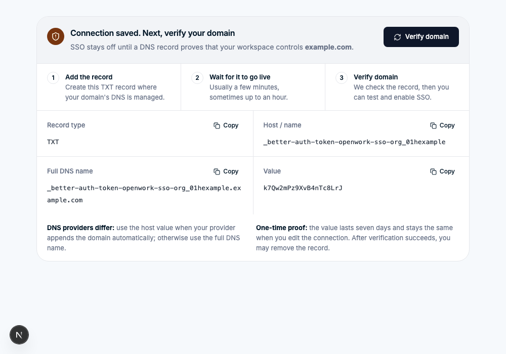
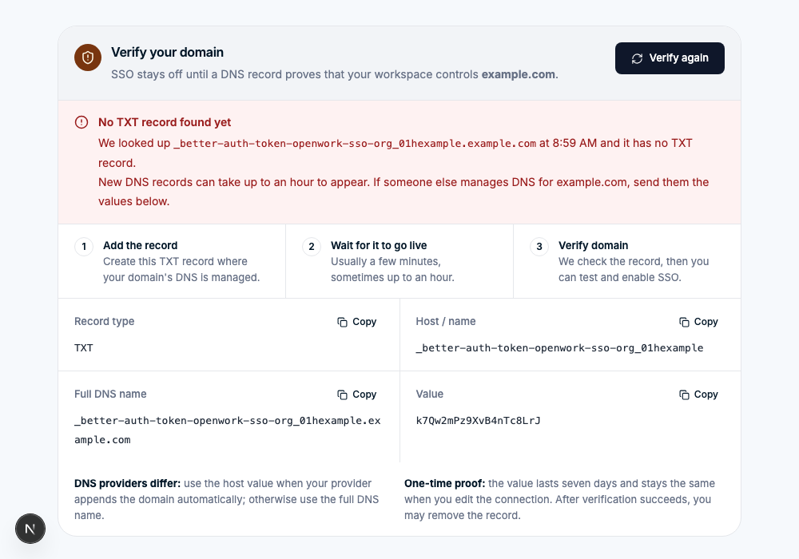
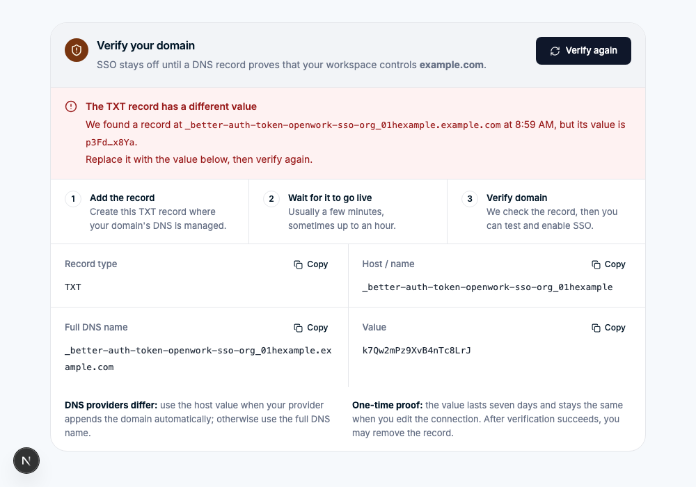
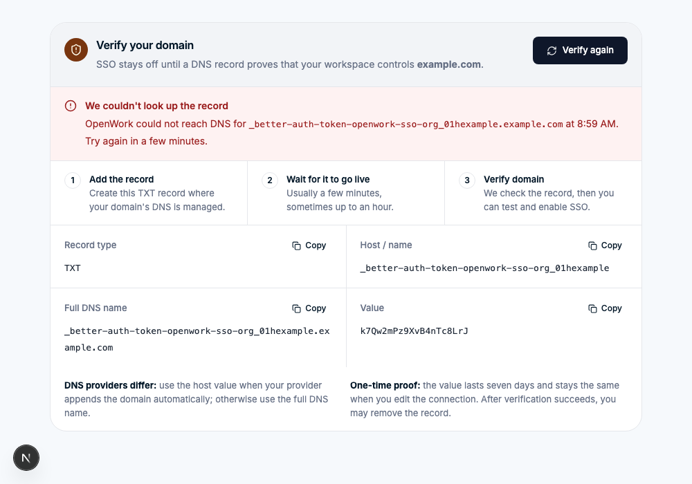
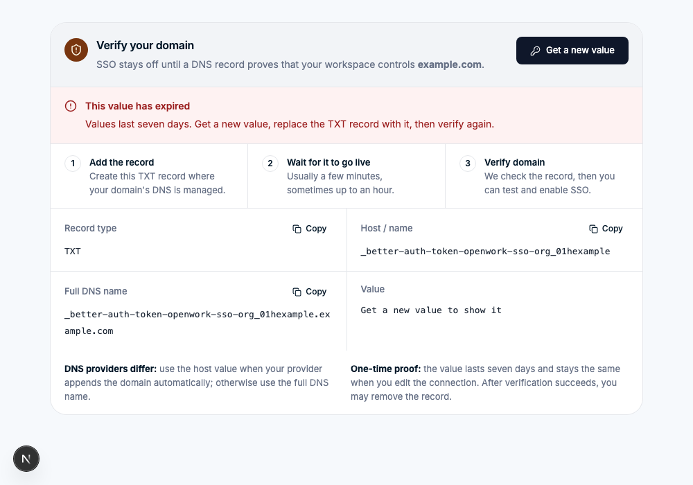

# SSO: check the OIDC issuer during setup

- Feature: `ssoOidcSetupCheck`
- Deployments: cloud and self-hosted; default **off**
- Owner: `benjaminshafii`
- Read on the organization that owns the connection.

## Why

Provider documentation hands administrators the discovery URL
(`https://idp.example.com/.well-known/openid-configuration`), and the form asked
for the issuer (`https://idp.example.com`). Pasting the first into the second
failed discovery, and the error pointed administrators at manual endpoints,
which saved a connection whose issuer could never match a token.

## What changes

Off: the OIDC form saves what was typed. A discovery failure is reported in the
banner at the top of the page.

On, in the OIDC tab of the SSO connection form:

- **One field, "Issuer or discovery URL".** An address ending in
  `/.well-known/openid-configuration` is read as it is and the issuer is taken
  from the document. Anything else is an issuer: the well-known path is
  appended and the document must name that same issuer.
- **The field reports what was found.** The check runs when the field loses
  focus and again on save: checking, found (with the issuer and endpoints that
  will be saved), issuer mismatch (with the issuer the provider reports and a
  button to use it), or not found (with the exact URL tried and its status).
- **Manual endpoints are a disclosure**, closed by default. With manual
  endpoints, an issuer containing `/.well-known/` is refused.
- **A failed save lands on the issuer field**, not the page banner.

On, in the domain verification panel (OIDC and SAML):

- **The next step leads.** After a save the panel reads "Connection saved.
  Next, verify your domain", with three steps: add the record, wait for it to
  go live, verify.
- **A failed check says why, inside the panel**: no TXT record yet at the exact
  name looked up (and when), a record with another value (its ends shown), DNS
  could not be reached, or the value expired (with a button to get a new one).
  Off, Better Auth's "Unable to verify domain ownership… Try again later" goes
  to the page banner.
- **One button at a time.** "Get record value" when no value is shown or it
  expired, otherwise "Verify domain" ("Verify again" after a failure).
- **The value survives edits.** Better Auth returns the same unexpired value on
  every request, and saving a connection does not delete it; the panel says
  so, so administrators do not republish the record after an edit.

## API

- `POST /v1/sso/oidc/check` `{ issuer }` returns what the discovery document
  says or why it could not be read. Nothing is saved. Needs `sso.manage`.
  `404 feature_disabled` when the feature is off.
- `POST /v1/sso/oidc` and the per-connection OIDC routes run the same check
  before saving and answer `400 invalid_request` with path `["issuer"]`.
- The check goes through the private-address guard used for MCP connection
  URLs: on a hosted deployment it only reaches public addresses.

- `POST /v1/sso/verify-domain` (and the per-connection route) adds
  `domainVerification` `{ reason, domain, dnsName, found, checkedAt, message }`
  to its `400` when the feature is on. `reason` is `record_missing`,
  `value_mismatch`, `lookup_failed` or `expired`. Den looks the record up again
  only after Better Auth's own check failed.

Unflagged, shipped with this feature:

- A discovery failure on save answers `400` instead of `500`, with the same
  message as before.
- When the verification value has expired, Den forgets its copy, so the next
  request issues a new value instead of returning the expired one.

## Turning it off

Connections saved while it was on are ordinary rows (issuer and endpoints).
Nothing new is stored, so the kill switch needs no cleanup.

## Screenshots

The issuer field component with canned provider answers (the Client Secret
field is a plain input here so the page can be captured).

A discovery URL is accepted and the issuer that will be saved is shown:

A wrong path names the issuer the provider reports:

An address that cannot be reached names the exact URL tried:

The domain verification panel component with canned answers. Right after a
save:

Verify clicked before the record exists:

A record with an old or mistyped value:

DNS could not be reached:

The value expired:

