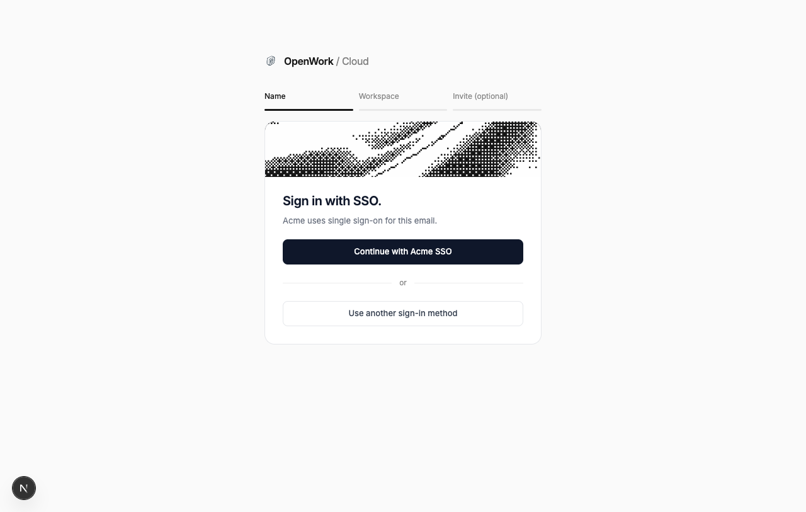
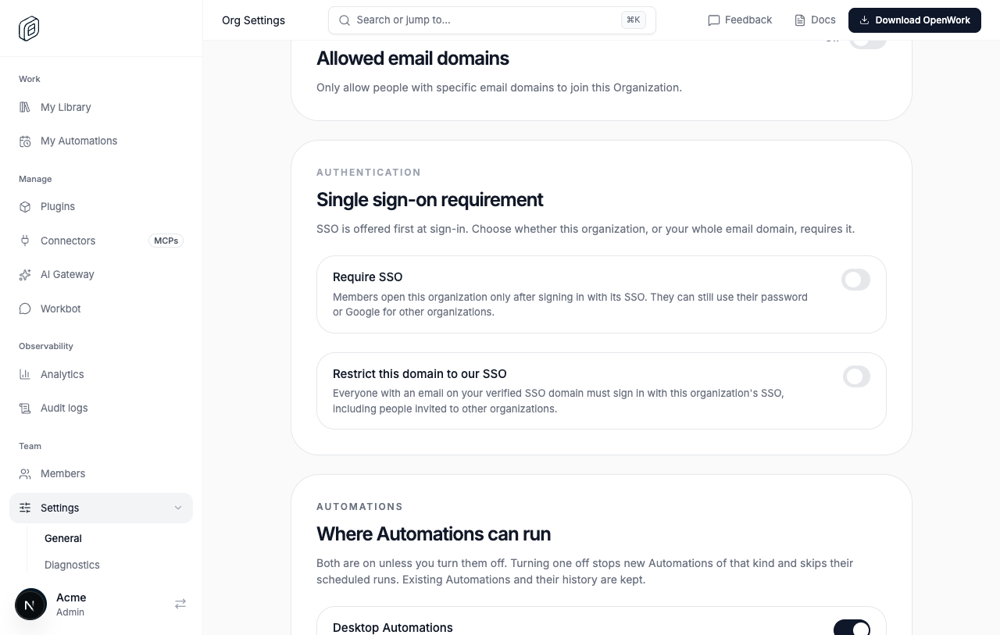
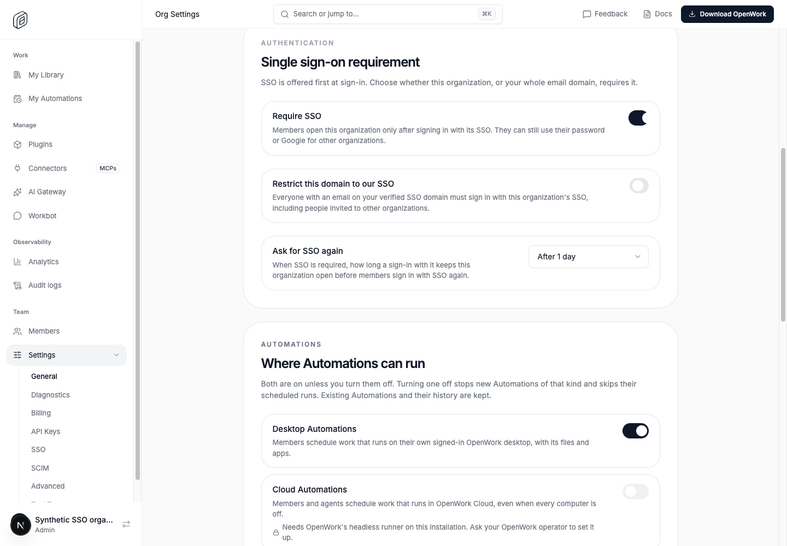
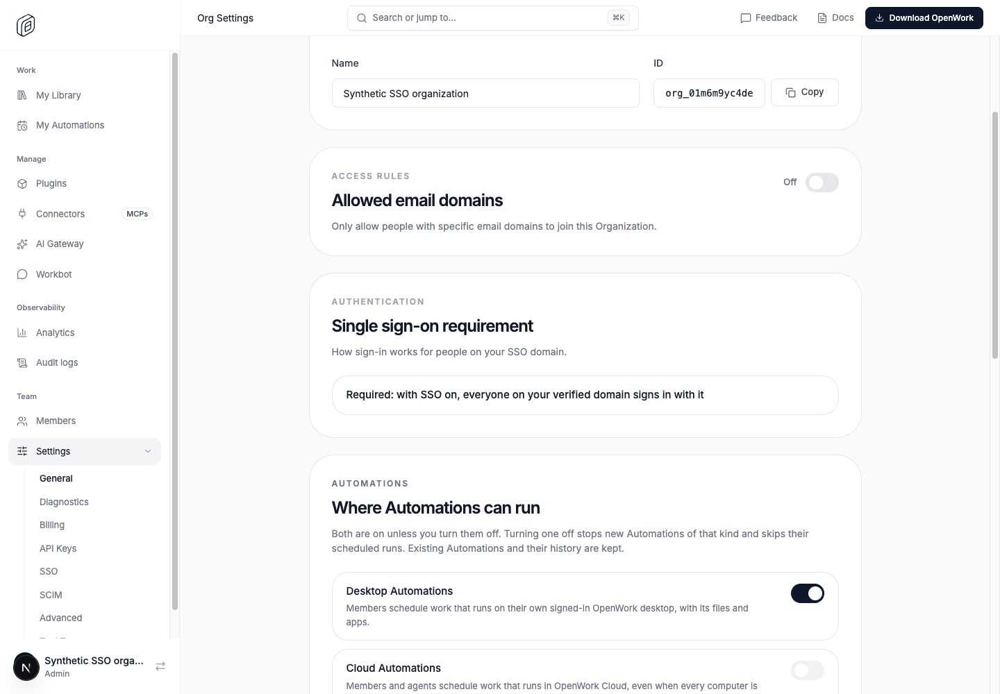

# SSO: optional unless required, enforced per organization

- Feature: `ssoPerOrganization`
- Deployments: cloud and self-hosted; default **off**. Never changes
  single-organization deployments (`DEN_ORG_MODE=single_org`): their SSO stays
  the only way in.
- Owner: `benjaminshafii`
- The flag is read on the **SSO organization** (the one that owns the verified
  domain), never on the person's other organizations.

## What changes

Off (today): when an organization has an enabled SSO connection on a verified
domain, every email on that domain is sent to its SSO by `GET
/v1/auth/login-options`, an invitation to another organization included, and
every member of that organization is refused password and Google sign-in.
Setting up SSO therefore behaves as if SSO were required.

On, the organization's settings decide (Organization settings › Authentication):

| Setting | Sign-in for emails on the domain | Opening the SSO organization |
|---|---|---|
| SSO set up, nothing required | "Continue with <org> SSO" first, "Use another sign-in method" below it | Any session |
| **Require SSO** (`requireSso`) | Same, and the copy says the organization requires SSO | Only a session signed in through its SSO |
| **Restrict this domain to our SSO** (`restrictDomainToSso`, new) | SSO only, invitations included; password, Google and new accounts on the domain are refused | Only a session signed in through its SSO |
| **Ask for SSO again** (`ssoSessionMaxAgeHours`, new: 8, 24, 168 or 720; unset means only when the session ends) | Unchanged | With SSO required, only while that SSO sign-in is younger than the limit |

### Default: organizations with SSO keep it required

Until the flag is on, SSO set up is SSO required. So that turning the flag on
never makes an organization's SSO optional without an admin choosing it:

- Migration `0180_keep_sso_required_on_rollout` sets `requireSso: true` for
  every organization with an enabled SSO connection on a verified domain that
  is not already effectively on the flag (its own override on, or the
  deployment-wide rollout without an override off, and no kill switch).
  Organizations already on the flag keep their admins' choice. It cannot see
  operator locks (`DEN_FEATURE_SSO_PER_ORGANIZATION`); a self-hosted install
  locked on before this migration keeps what its admins saved.
- Turning SSO on (`POST /v1/sso/enable`) while the flag is off also sets
  `requireSso: true`, for the same reason.
- With the flag on, a **new** SSO connection starts optional: nothing sets
  `requireSso`, so SSO is offered first and an admin turns on Require SSO.
- With the flag off, Organization settings no longer show a "Require SSO"
  switch that changed nothing. They say that SSO is required, and a save never
  writes `requireSso`. With the flag on, a save sends only the SSO settings the
  admin changed.

`requireSso` set by the migration bypasses the Enterprise-plan check that
guards turning it on from settings: Team-plan organizations with SSO keep the
enforcement they have today. Their admins can turn it off; turning it back on
from settings needs the Enterprise plan.

- A valid pending invitation to **another** organization skips the domain's SSO
  in login options (unless the domain is restricted).
- "Require SSO" is enforced per organization, at every way in: the organization
  context of every org-scoped route (`sso_required`, 403, with `signInUrl`),
  set-active (Better Auth `SSO_REQUIRED` and `POST /v1/me/active-organization`),
  MCP OAuth consent and `/v1/mcp/token`, device sign-in approval, and the
  desktop handoff. The organization list stays complete; a session is never
  made active in an organization it cannot open. Den Web sends the person to
  the organization's SSO and back.
- Sessions created by an SSO callback are recorded in `session_sso_proof`
  (one row per session and organization, with when the identity provider
  authenticated the person; removed with the session, user or organization).
  That is how an SSO session is told apart from a password or Google one. Rows
  are written whether the flag is on or off. A historical linked SSO account is
  never sufficient proof for a session.
- **Several organizations per browser.** Signing in through an organization's
  SSO creates a new session. When the browser that started that sign-in was
  already signed in, the new session keeps the old session's SSO proofs, with
  their original times, so a member of several organizations that require SSO
  is not sent through each of them again. `POST /sign-in/sso` sets a signed
  `sso_carry` cookie naming the current session (ten minutes; `SameSite=None`
  on HTTPS so a SAML identity provider's cross-site POST carries it). The
  callback copies proofs only from a live session of the same user. A password
  or Google session has no proofs to carry.
- **Ask for SSO again.** A proof older than the organization's
  `ssoSessionMaxAgeHours` no longer opens it (`403 sso_required`); the person
  signs in through its SSO again and keeps their other proofs. A carried proof
  keeps its age, so carrying never extends it.
- `session_sso_authentication` (one row per session) is superseded by
  `session_sso_proof` (migration 0179 copies its rows). It is still written
  with the newest proof so replicas from before 0179 keep working during a
  rolling deploy; drop it in a later release.
- Device approval captures the approving session's actual provider proof, and
  when it was earned, on the device code, including while SSO is optional. Redemption copies that proof,
  not whatever policy happens to be enabled when the terminal next polls.
  Codes approved by password before enforcement cannot acquire SSO proof by
  polling after enforcement. Existing pending approvals without proof fail
  closed when opening an organization that now requires SSO.
- Verified-domain auto-join (Google sign-in with a verified domain email joins
  the SSO organization on Team plans and up) no longer happens for an
  organization that requires SSO; people join it through SSO sign-up.
- Turning **Require SSO** or the domain restriction on needs the admin's own
  session to have signed in through the organization's SSO (409
  `sso_session_required`), so nobody locks themselves out.
- Restricting the domain and "Ask for SSO again" can only be changed while the
  flag is on (404 `feature_disabled` otherwise).

API keys are created behind the organization check and are not re-checked.
MCP access tokens and API keys issued before the flag turned on keep working
until they expire or are revoked.

## How to try it

1. Platform admin › Organizations › the SSO organization › Features: turn on
   **SSO: optional unless required, enforced per organization**.
2. Sign out, enter an email on the organization's verified domain: the page
   shows "Continue with <org> SSO" and "Use another sign-in method".
3. As an admin who signed in through SSO, turn on **Require SSO**. A member who
   signs in with their password can use their other organizations; opening this
   one sends them through its SSO.









## Turning it off

Kill switch or the organization override restores today's behavior on the
next request: domain emails go to SSO only and members are refused password
and Google sign-in. `restrictDomainToSso` and `ssoSessionMaxAgeHours` stay
stored but have no effect. Recorded SSO proofs are harmless when off.

Turning it **on** for an organization with **Require SSO** set (every
organization with SSO today, after migration 0180) asks a member to sign in
through SSO once only if their session has no SSO record. SSO sign-ins are
recorded since #6980 whether or not the flag is on, and members of these
organizations could only sign in through SSO, so this is limited to sessions
older than that deploy.

## Recovering an administrator's session safely

If saving Require SSO returns `sso_session_required`, use **Sign in with SSO**
in the notice. It opens the organization's `/sso/<slug>` page with Settings as
the return destination. If Den asks you to select a workspace, select this
organization and reopen Settings. Leave SSO optional until that fresh sign-in
succeeds, then save again. A configuration test in another browser or an
account link from an older session is not a substitute for this session's
SSO authentication. Never backfill session proof from account history.

If the identity provider rejects the sign-in before returning to OpenWork,
check its application assignment and SAML configuration with its administrator.
That rejection alone does not identify an OpenWork callback failure. Check the
callback response and provenance-write logs separately. Do not enable required
SSO until the fresh sign-in succeeds. No policy or rollout change is necessary
to test this while SSO remains optional.

`test/api/sso-callback.api.test.ts` exercises the real signed OIDC and SAML
callbacks against a disposable database, including tampered SAML rejection,
password-session credential denial and approval-to-redemption policy changes.
Those callbacks also work on the original implementation: the device race and
single-organization guard are independently reproduced regressions. The
[headless browser matrix](./browser-proof.md) additionally exercises the real
password preflight, SAML redirects, recovery action and invitation flow; it
catches the older preflight incorrectly forcing SSO after an organization
requires it, even though ordinary sign-in for other organizations remains
permitted.

## What to watch

- 403 `sso_required` on org routes (den-api request logs, `http_status_code`
  403 with the organization id).
- `session SSO provenance could not be recorded` errors in den-api logs: an SSO
  sign-in whose session was not recorded sends the person through SSO again.
- `earlier SSO sign-ins could not be carried to the new session` errors: the
  person is sent through their other organizations' SSO again.
- Support reports of members unable to open a "Require SSO" organization: check
  that its SSO connection is enabled and its domain verified.

## Pre-enable check (read only)

Organizations whose sign-in changes when the flag turns on (enabled SSO,
verified domain), with what they would get:

```sql
SELECT o.id,
  JSON_UNQUOTE(JSON_EXTRACT(o.metadata, '$.requireSso')) AS require_sso,
  c.domain,
  (SELECT COUNT(*) FROM member m WHERE m.organization_id = o.id AND m.removed_at IS NULL) AS members,
  (SELECT COUNT(*) FROM user u WHERE u.email LIKE CONCAT('%@', c.domain)) AS domain_users
FROM organization o
JOIN sso_connection c ON c.organization_id = o.id AND c.status = 'enabled'
JOIN sso_provider p ON p.provider_id = c.provider_id AND p.organization_id = o.id AND p.domain_verified = 1;
```

`require_sso` not `true`: SSO becomes optional for that organization (after
migration 0180, only organizations already on the flag whose admins chose
it). `true`: members can sign in with other methods for other organizations but
must use SSO for this one.
