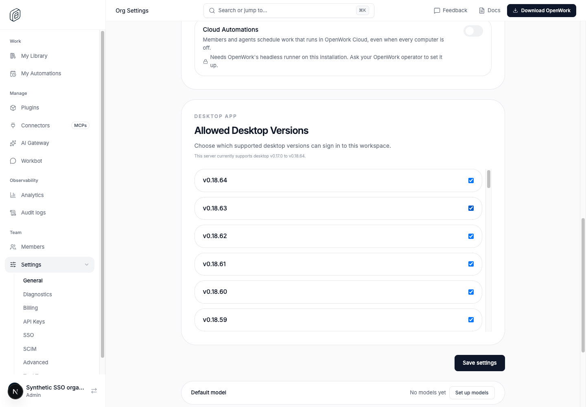
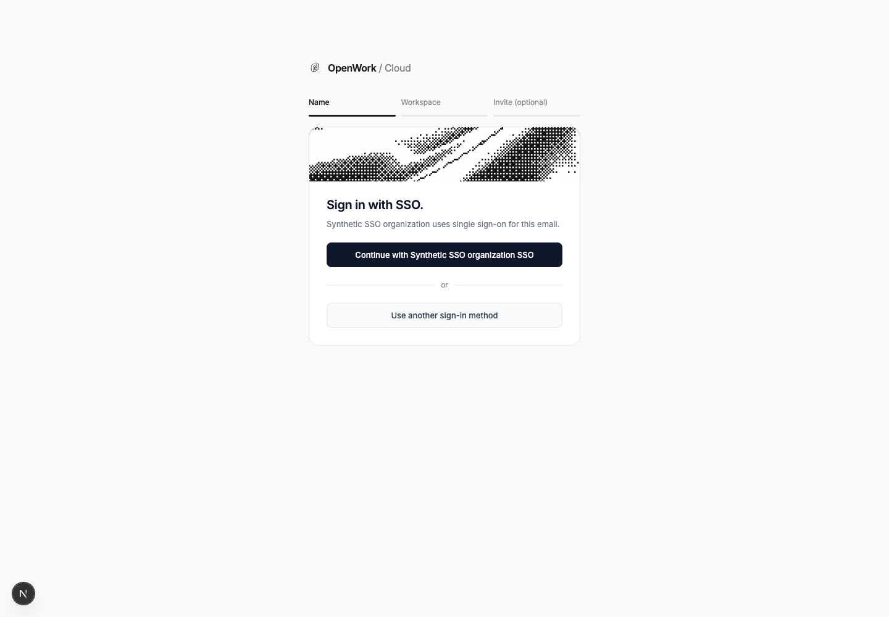
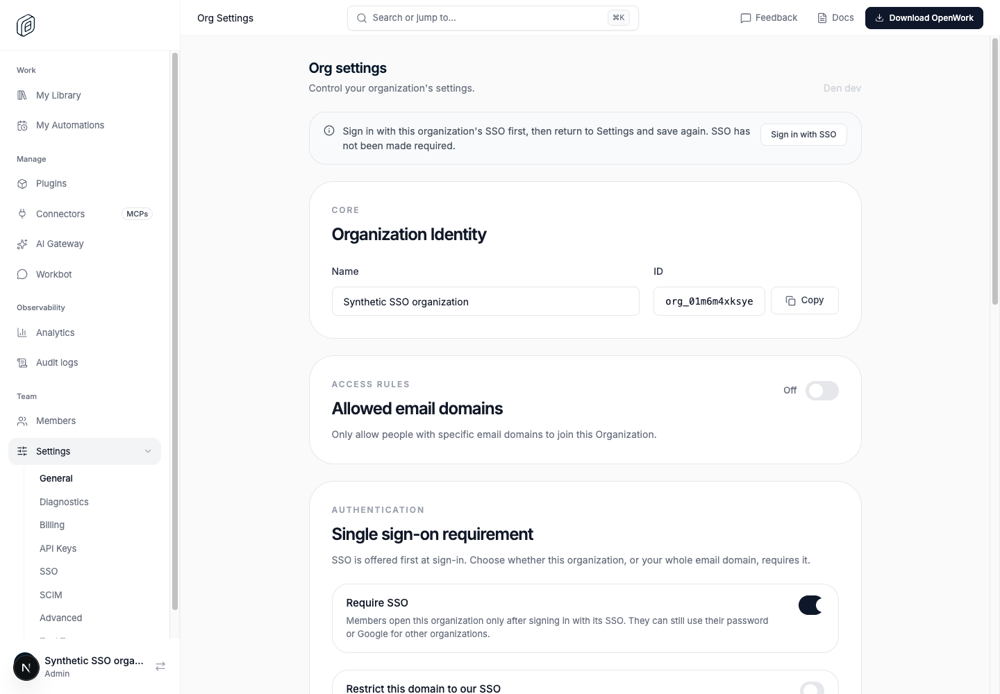
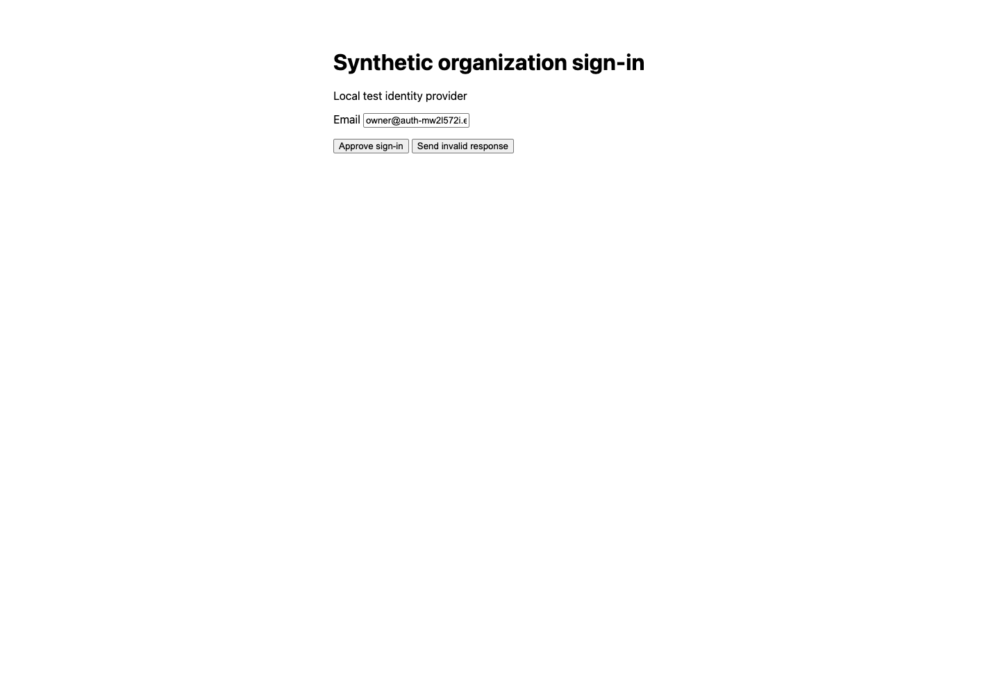
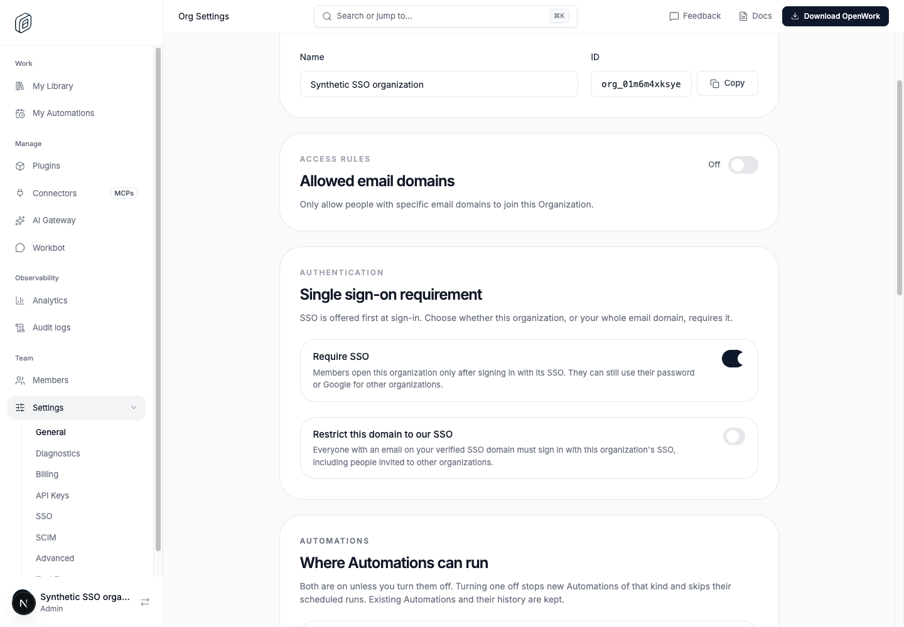

# SSO browser proof

This proof starts the real Den web and API from the checked-out source, a
throwaway MySQL database, and a loopback-only synthetic SAML identity provider.
It drives headless Chrome with the existing testkit/CDP primitives. Den's
authentication responses are not intercepted or mocked, and no SSO provenance
is inserted. The legacy/single-org controls start with password sessions made
through the real API; the main flow signs in through the browser.

The world arranges synthetic users, organizations, invitations, a SAML
configuration, and DNS ownership/configuration status. The signing peer receives
the browser's real AuthnRequest and posts an RSA-SHA256-signed assertion to the
real SAML ACS. An intentionally modified assertion must fail. Email delivery is
disabled; the invitation flow proves its synthetic mailbox through its invite
link and does not require a verification email.

## Run locally

Use Node 24.22+, pnpm, OpenSSL, MySQL and Redis on localhost, and local Chrome.
Install the root and `evals` dependencies first. The world refuses attachment to
an existing Den via `OPENWORK_EVAL_DEN_API_URL`.

```sh
pnpm install --frozen-lockfile
pnpm --dir evals install --frozen-lockfile
OPENWORK_EVAL_MAX_WORKERS=1 pnpm evals:e2e sso-browser sso-legacy-browser --local
```

Run one spec at a time, or keep `OPENWORK_EVAL_MAX_WORKERS=1`: concurrent local
Next development servers in the same worktree contend for Next's dev lock.
Do not substitute a reused Den or public mock provider. The runner prints its
placement, creates distinct ephemeral ports/databases, and writes screenshots,
assertions, source information and `index.html` under
`evals/results/test-runs/`. It tears down its browsers, services and database.

## What the matrix proves

| Case | Browser action and independent witness |
| --- | --- |
| Optional, flag on | SSO alternative is visible; choose the password method, sign in and open the optional organization (200). |
| Safe administrator recovery | A password administrator's save returns 409 with a visible **Sign in with SSO** link. Click it, reject a tampered assertion, complete a valid signed callback, then enable Require SSO through Settings. |
| Required, flag on | A fresh password browser uses the other organization (200). Header selection, set-active, API-key creation and MCP token issuance for the protected organization all return 403. Selecting it in the browser reaches its SAML IdP; after authentication, selecting the protected organization works. |
| Invitation bypass | A fresh person on the claimed domain creates their account and joins the other organization normally. The person has exactly that membership, no SAML event, and reaches the real install/onboarding screen. |
| Flag off | Only the SSO method is shown. An existing password administrator can save the legacy requirement without the new 409. The visitor completes a real signed SAML callback. |
| Single organization | A password-created session can save and reload the setting even with the per-organization flag override present. |

The independent callback test also separates authentication from the ordinary
method preflight: the callback may work while a subsequent password attempt is
incorrectly sent back to the IdP.

## Regression discovered by the browser

The email-first page correctly offered a password alternative, but submitting
it repeated `/v1/orgs/sso/resolve`. That older preflight treated an organization's
`requireSso` as a domain-wide sign-in requirement. Consequently, once Require
SSO was enabled, the offered password alternative led back to SAML, including
for a person trying to use another organization. Calling the password API
directly did not exercise this defect.

The preflight now forces SSO only for the legacy path or an explicit domain
restriction. Organization access, SSO proof requirements, membership and
permission checks remain enforced separately. API tests also assert that an
explicit domain restriction still forces SSO.

## Recorded source controls

The same generic proof/world files were copied into independent worktrees;
product files were not changed in those worktrees.

- **Before #6980:** `f368943099`, the parent of the merged change. The
  flag-off legacy browser test passed, including saving the setting from an
  existing password session and completing signed SAML. Its sibling single-org
  test was intentionally deselected, not counted as a pass.
- **Merged #6980:** `0ac7fcbf0904885010def2ab46d2728b67cb3a30`. The full
  optional/recovery file had two expected failures: no recovery link after
  the password-admin 409, and the password alternative being forced back to
  SAML. The independent test's preceding signed callback and settings save
  succeeded. The legacy file passed its flag-off test and failed its single-org
  test on the unintended 409.
- **Fix:** the committed proofs exercise the corrected preflight and recovery
  action as well as the unchanged legacy control. Full run records bind the
  source commit to each screenshot and assertion.

The original recovery dead end, rendered from the merged source:



The original password alternative wrongly returning to the local IdP after
Require SSO was enabled:


The source-control commands were the two normal CLI commands above in the
merged checkout. For the pre-change checkout, only the legacy control was
selected:

```sh
OPENWORK_WORLD_PLACE=local OPENWORK_EVAL_E2E_TESTS=1 \
  pnpm --dir evals exec vitest run --config vitest.config.ts --project e2e \
  proofs/sso-legacy-browser.proof.test.ts -t 'with the rollout off'
```

## Real screenshots from the synthetic world

Optional SSO, with the ordinary method available:



The blocked save gives a usable, same-origin recovery action (P4, P5, C5, C6):



Clicking that action reaches the local signing peer, not a mock of Den's UI:



After the real callback, the browser can open the protected organization with
Require SSO saved:



## Scope and limits

This is synthetic SAML interoperability and real browser routing, not a test of
Google Workspace application assignment or any live IdP configuration. It
cannot establish the cause of an upstream `app_not_configured_for_user` error.
OIDC has separate API integration coverage; OIDC is not used as evidence for
these SAML browser claims. No production identity, count, credential, domain,
configuration, public mock service, or rollout is used.

Moving the controls from General settings to the SSO page remains a follow-up;
this change only repairs the current flow and its recovery action.
